# Manual do Integration Incident Copilot

Fonte única, didática e executável do projeto. Um capítulo por conceito, na
ordem em que os dados atravessam o sistema, e **cada capítulo termina com uma
sessão de debug**: a configuração do VS Code, o breakpoint, o comando e a
saída esperada. Quem seguir o manual de ponta a ponta vê a aplicação rodando
enquanto aprende como ela é feita.

**Proveniência.** Escrito a partir do código deste checkout em 2026-10-15,
commit `79510c0`, versão `1.2.0` do `pyproject.toml`. Os números citados
(regras, conectores, migrations, testes) foram conferidos no fonte, e cada um
traz o comando que os reconfere.

**Regra de ouro.** Quando este manual divergir do código, **o código vence** —
corrija o manual. Se a divergência for uma decisão, registre uma DA
(`CLAUDE.md`, seção "Como registrar uma nova DA").

**O que este manual não é.** Não é referência de API (isso é
[`USER_GUIDE.md`](USER_GUIDE.md) e `/docs` no servidor rodando), não é o
registro das decisões (isso é
[`DECISOES_DE_ARQUITETURA.md`](DECISOES_DE_ARQUITETURA.md), 63 DAs) e não
substitui as aulas: cada capítulo aponta a aula correspondente (os arquivos
docs/DA_AULA_*.md) para quem quiser o detalhe exaustivo.

**Sobre as aulas citadas.** A série de aulas, a trilha de estudos e alguns
tutoriais são material **local, fora do versionamento** (`.gitignore`, linhas
57–65): num clone limpo eles não existem. Por isso este manual os cita como
texto simples, sem link, e **cada capítulo é autossuficiente** — a aula é
aprofundamento, nunca pré-requisito.

---

## Como usar este manual

Três modos de leitura:

| Se você… | Leia |
|---|---|
| nunca rodou o projeto | Capítulos 0 → 3, na ordem. Em ~20 minutos há um diagnóstico respondido na tela |
| quer entender uma decisão específica | Vá direto ao capítulo e siga o link da DA no fim dele |
| está depurando um incidente agora | [Apêndice B — mapa de sintoma → breakpoint](#apêndice-b--mapa-de-sintoma--breakpoint) |

**Convenções.**

- Código é citado na forma app/arquivo.py::simbolo, entre backticks. É a forma canônica deste
  repositório — é também a forma que o gate `docs_code_references` verifica a
  cada build (capítulo 16). Os números de linha aparecem só nas tabelas de
  breakpoint, marcados com o commit em que foram medidos, porque linha
  envelhece e símbolo não.
- Blocos marcados **Veja executar** são a parte prática. Pressupõem o Capítulo 0 feito.
- `[DA-N]` remete a `DECISOES_DE_ARQUITETURA.md`.
- **Material local, não publicado.** Nomes de arquivo em texto simples, sem link
  (as aulas `DA_AULA_*.md`, a trilha de estudos e o processo de desenvolvimento),
  são material de estudo do mantenedor e **não estão neste repositório**. Tudo o
  que é necessário para instalar, avaliar, operar e customizar está nos documentos
  com link — o ponto de partida é [`README.md`](README.md).

### Mapa dos capítulos

```mermaid
flowchart LR
    C0["0 · Bancada"] --> C1["1 · Um incidente<br/>de ponta a ponta"]
    C1 --> C2["2 · Contratos<br/>(Pydantic + State)"]
    C2 --> C3["3 · Porta de entrada<br/>(FastAPI/auth)"]
    C3 --> C4["4 · Supervisor<br/>(roteamento)"]
    C4 --> C5["5 · Conectores"]
    C5 --> C6["6 · RAG"]
    C6 --> C7["7 · Rule Engine"]
    C7 --> C8["8 · LLM e gateway"]
    C8 --> C9["9 · Evidência<br/>e guardrails"]
    C9 --> C10["10 · Escalonamento"]
    C10 --> C11["11 · GraphRAG"]
    C11 --> C12["12 · MCP, A2A,<br/>eventos, fila"]
    C12 --> C13["13 · Banco, admin,<br/>correlação"]
    C13 --> C14["14 · Drift de contrato"]
    C14 --> C15["15 · Observabilidade"]
    C15 --> C16["16 · Testes e gates"]
    C16 --> C17["17 · Deploy"]
```

---

## 0. A bancada

**O que este capítulo responde:** o que preciso instalado, e por que meu `.env`
quebra quando eu troco de modo.

### 0.1 O que o projeto exige

| Requisito | Versão | Como confirmar |
|---|---|---|
| Python | 3.12 (`.python-version`) | `python3 --version` |
| `uv` | qualquer recente — **não usar pip/poetry direto** | `uv --version` |
| Docker | com `docker compose` v2 | `docker compose version` |
| Ollama | opcional no primeiro diagnóstico | `ollama list` |

Toda a infraestrutura vem do `docker-compose.yml` **deste repositório**. Não
existe diretório de infra externo.

```bash
git clone https://github.com/marcos-slima/integration-incident-copilot.git
cd integration-incident-copilot
uv sync
```

### 0.2 Os dois modos, e a armadilha do `.env`

Esta é a causa mais comum de "subiu mas não conecta". Os dois modos usam o
mesmo compose; muda **onde o processo Python roda**.

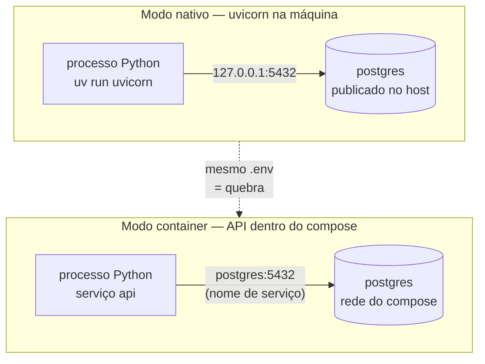

| Modo | O `.env` precisa de | O que quebra se errar |
|---|---|---|
| nativo | hosts de loopback: `DATABASE_URL=postgresql://…@127.0.0.1:5432/iic` | `postgres` **não resolve na máquina** — é nome de serviço da rede do compose |
| container | nada: o compose injeta `postgres`, `qdrant` e `neo4j` por default em `x-common-env` | apontar o `.env` para `127.0.0.1` quebra o container |

Para apontar o container a um banco externo use
`CONTAINER_DATABASE_URL` / `CONTAINER_NEO4J_URI` / `CONTAINER_REDIS_URL`, que
não colidem com as variáveis do modo nativo.

Outras três armadilhas registradas, todas silenciosas:

1. **Dois Qdrant na mesma máquina.** O compose publica em
   `${QDRANT_HOST_PORT:-6333}`. Se outro stack já ocupa a 6333, defina
   `QDRANT_HOST_PORT=6335`.
2. **`NEO4J_AUTH` só vale na primeira inicialização do volume.** Trocar
   `NEO4J_PASSWORD` depois não troca a senha do banco — é preciso remover o
   volume `integration-incident-copilot_neo4j_data`.
3. **O estado da ingestão não registra o destino.**
   `data/.ingest_state_reference.json` tem chave `hash:filename` e nenhuma URL
   (`app/rag/ingest.py::load_state`). Indexar contra um Qdrant e depois contra
   outro faz o segundo run **pular tudo, sem erro**. Trocar de destino exige
   `--reset-state`.

### 0.3 O `.env` mínimo do primeiro diagnóstico

```bash
cp .env.example .env
echo "EMBEDDING_BACKEND=fastembed" >> .env
for v in API_KEY POSTGRES_PASSWORD GRAFANA_PASSWORD NEO4J_PASSWORD; do
  echo "$v=$(python3 -c 'import secrets; print(secrets.token_urlsafe(24))')" >> .env
done
```

Duas escolhas foram feitas aí, de propósito:

- `EMBEDDING_BACKEND=fastembed` roda os embeddings **no processo**, sem Ollama
  — é o que permite o primeiro diagnóstico sem baixar um modelo de 20+ GB [DA-38].
- `API_KEY` **fixa**. Sem isso, `app/main.py::_ensure_api_keys_configured`
  gera uma chave aleatória a cada boot e nenhum cliente MCP, A2A ou `curl`
  consegue autenticar duas vezes seguidas.

O compose exige as três senhas (`POSTGRES_PASSWORD`, `GRAFANA_PASSWORD`,
`NEO4J_PASSWORD`) mesmo para serviços que você não vai subir.

### Veja executar — o ambiente responde antes de qualquer código

```bash
docker compose up -d qdrant
uv run python -m app.rag.ingest --target incidents
uv run uvicorn app.main:app
```

Saída esperada, em ordem:

1. `ingest` indexa os **15** playbooks de `data/sample_docs/` na coleção
   `sap_incident_docs` e grava `data/index_manifest.json`.
2. O uvicorn sobe em `http://127.0.0.1:8000`. O lifespan
   (`app/main.py::lifespan`) valida chaves, GraphRAG e chave de evidência
   **antes** de aceitar requisição — se faltar algo obrigatório, o boot falha
   com a mensagem do que falta, em vez de degradar em silêncio.
3. `http://127.0.0.1:8000/docs` abre o OpenAPI gerado dos modelos Pydantic.

Confirme o estado derivado da configuração:

```bash
curl -s http://127.0.0.1:8000/health | python3 -m json.tool
```

O corpo detalhado (conectores, provider de LLM, GraphRAG, fila) só aparece
para quem já é cliente legítimo — `X-API-Key` válida ou sessão web
(`app/main.py::_caller_is_authenticated`). Sem credencial o `/health` responde
o status, e nada que sirva de reconhecimento para quem varre a porta.

**Aprofundar:** [`GETTING_STARTED.md`](GETTING_STARTED.md) ·
DA_AULA_1_PYTHON.md (ambiente e dependências) ·
[`TROUBLESHOOTING.md`](TROUBLESHOOTING.md) (falha por sintoma).

---

## 1. Um incidente de ponta a ponta

**O que este capítulo responde:** o que exatamente acontece entre o `curl` e o
relatório — e por que a primeira resposta não usa LLM nenhum.

### 1.1 O pipeline

O grafo abaixo é o do código (`app/agent/graph.py::build_graph`), no default
`GRAPH_RAG_ENABLED=false`. O diagrama equivalente no
[`README.md`](../README.md) é **gerado** por `scripts/graph_diagram.py` e um
teste falha se divergir do fonte.

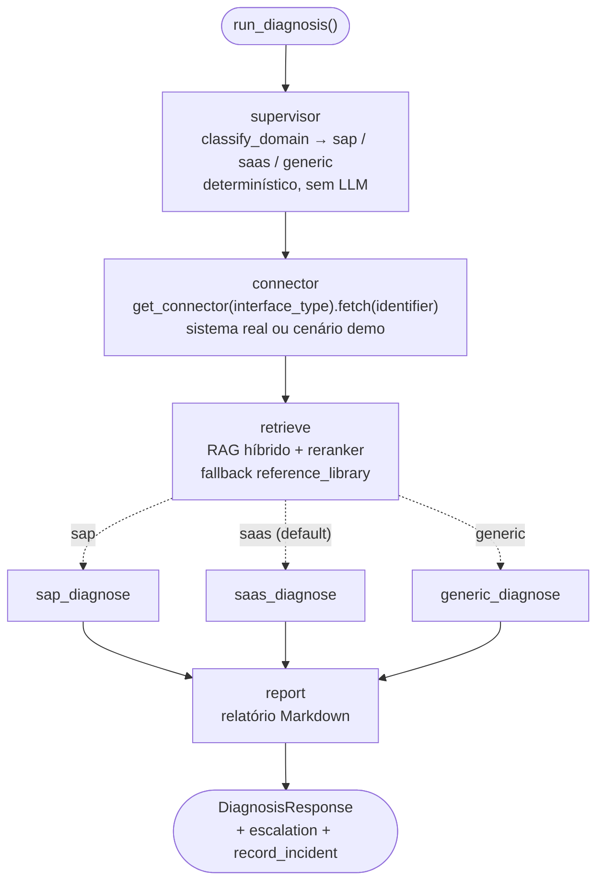

Nos três nós de diagnóstico roda a mesma sequência, nesta ordem — e a ordem é
a decisão de arquitetura mais importante do projeto:

1. **Rule Engine** (`app/agent/rules.py::match_known_error`): se o texto casa
   com um erro conhecido, o diagnóstico sai daqui. Custo zero, latência de um
   regex, auditável [DA-33].
2. **LLM via gateway** (`app/llm/gateway.py::invoke_via_gateway`), só se a
   regra não casou.
3. **Guardrails** (`app/agent/nodes.py::_apply_confidence_guardrails`) e
   **montagem de evidência** (`::_assemble_evidence`), sempre.

### 1.2 O primeiro diagnóstico

```bash
API_KEY=$(grep '^API_KEY=' .env | cut -d= -f2)
curl -s -X POST http://127.0.0.1:8000/diagnose \
  -H "X-API-Key: $API_KEY" -H "Content-Type: application/json" \
  -d '{"description": "IDoc travado em status 51",
       "interface_type": "rfc",
       "identifier": "RFC-IDOC-51-DEMO"}'
```

Resposta, abreviada:

```json
{
  "agent_domain": "sap",
  "matched_source": "rule_engine:sap_idoc_status_51",
  "llm_provider_used": "rule_engine",
  "model_confidence": 0.9,
  "evidence": [
    {"source_type": "rule_engine", "trust_level": "system_observed"},
    {"source_type": "connector",   "trust_level": "simulated"},
    {"source_type": "rag",         "trust_level": "retrieved_document"},
    {"source_type": "user",        "trust_level": "user_reported"}
  ],
  "escalation": {"escalation": "grounded", "should_escalate": false}
}
```

Leia os três campos que explicam o resto do manual:

- `llm_provider_used: "rule_engine"` — **nenhum LLM foi chamado**. É o caminho
  de custo zero do capítulo 7.
- `evidence` lista quatro fontes, cada uma com seu nível de confiança. Nenhum
  item vem de autoavaliação do modelo (capítulo 9).
- `escalation: "grounded"` é um sinal determinístico, calculado por regra sobre
  valores observáveis (capítulo 10).

Campos ausentes também informam: `prompt_version` e `prompt_digest` vêm
**nulos** quando o rule engine encerra, porque nenhum prompt produziu aquele
diagnóstico. Preencher com um default fabricaria procedência [DA-53].

### Veja executar — o mesmo incidente, por dentro

A configuração **"Debug: graph.py (caso IDoc travado)"** do
`.vscode/launch.json` roda exatamente este incidente, sem HTTP no caminho —
é a forma mais curta de parar dentro do pipeline.

| # | Breakpoint em | Linha (commit `79510c0`) | O que inspecionar |
|---|---|---|---|
| 1 | `app/agent/graph.py::run_diagnosis` | 210 | `initial_state` — o `CopilotState` que entra no grafo |
| 2 | `app/agent/supervisor.py::classify_domain` | 128 | o retorno: `"sap"`, decidido sem LLM |
| 3 | `app/agent/nodes.py::connector_node` | 125 | `state["connector_data"]`, com `is_mock=True` |
| 4 | `app/agent/rules.py::match_known_error` | 602 | o `dict` devolvido — é o diagnóstico final |
| 5 | `app/agent/nodes.py::_assemble_evidence` | 741 | a lista de evidências antes de virar resposta |

Pela linha de comando, o equivalente:

```bash
uv run python -m app.agent.graph --interface rfc --id RFC-IDOC-51-DEMO --debug "IDoc travado em status 51"
```

O `--debug` liga `state["debug"]`, que imprime o **prompt enviado ao LLM** e as
**iterações do agente ReAct** (`app/agent/nodes.py::_run_diagnosis_agent`).
Neste caso os dois blocos **não** aparecem — e é a prova visual de que a regra
curto-circuitou antes do modelo. Para vê-los, use um texto que nenhuma regra
cobre:

```bash
uv run python -m app.agent.graph --debug "comportamento estranho na integração desde ontem"
```

**Aprofundar:** [`CASOS_DE_USO.md`](CASOS_DE_USO.md) (UC-01 é este caso, e cada
número de lá vem de `tests/test_casos_de_uso.py`) ·
[`TUTORIAL_ARQUITETURA_DEBUG.md`](TUTORIAL_ARQUITETURA_DEBUG.md).

---

## 2. Os contratos

**O que este capítulo responde:** quais são os três objetos que carregam tudo,
e por que mexer na descrição de um campo pode reprovar o build.

### 2.1 Os três

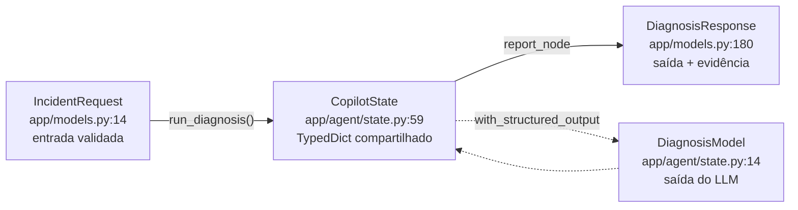

| Objeto | Papel | Detalhe que importa |
|---|---|---|
| `IncidentRequest` | o que o cliente manda | `interface_type` é um `Literal` **fechado**; limites de tamanho em `MAX_DESCRIPTION_LENGTH`, `MAX_LOGS_LENGTH`, `MAX_PAYLOAD_LENGTH` |
| `CopilotState` | estado do grafo | `TypedDict, total=False` — o `StateGraph` **descarta chave fora do schema**. Campo novo que não entra aqui simplesmente desaparece no meio do pipeline |
| `DiagnosisResponse` | o que o cliente recebe | inclui `evidence`, `escalation`, `matched_source` e a procedência (`llm_model`, `prompt_version`, `prompt_digest`) |
| `DiagnosisModel` | o que o **LLM** devolve | validado na origem: `confidence` tem `ge=0.0, le=1.0` |

### 2.2 `Field(description=)` não é comentário

Em `DiagnosisModel` (`app/agent/state.py::DiagnosisModel`) as descrições dos
campos são injetadas pelo LangChain no schema de *tool-calling* enviado ao
modelo. São a **única** orientação semântica que o LLM recebe sobre o que cada
campo significa. Já houve uma rodada em que `matched_source` quebrou por causa
de uma descrição removida.

Consequência operacional: editar um `Field(description=)` muda o **digest do
prompt** e reprova o gate `prompt_digest_measured` [DA-53]. O caminho certo é
rodar o promptfoo e regravar o baseline com `--write-prompt-baseline`
(capítulo 16).

### Veja executar — ver a validação acontecer

Sem subir servidor nenhum:

```bash
uv run python -c "
from app.models import IncidentRequest
print(IncidentRequest(description='IDoc travado', interface_type='rfc', identifier='RFC-IDOC-51-DEMO'))
try:
    IncidentRequest(description='x', interface_type='inexistente')
except Exception as e:
    print('rejeitado:', type(e).__name__)
"
```

Esperado: a primeira linha imprime o objeto; a segunda imprime
`rejeitado: ValidationError` — o `Literal` fechado barra o tipo de interface
que o pipeline não sabe atender. Pela API o mesmo erro vira **422**, tratado
por `app/main.py::_validation_error_handler`.

Breakpoint útil: `app/agent/graph.py::run_diagnosis` (linha 210) e, no painel
de variáveis, abra `initial_state`. Compare as chaves com `CopilotState`: o que
não está no `TypedDict` não sobrevive ao grafo.

**Aprofundar:** DA_AULA_1_PYTHON.md (type hints e
Pydantic a partir destes arquivos) ·
DA_AULA_9_LANGGRAPH.md (o state no grafo).

---

## 3. A porta de entrada

**O que este capítulo responde:** quem pode chamar o quê, e o que o servidor
verifica antes de aceitar a primeira requisição.

### 3.1 As superfícies e suas chaves

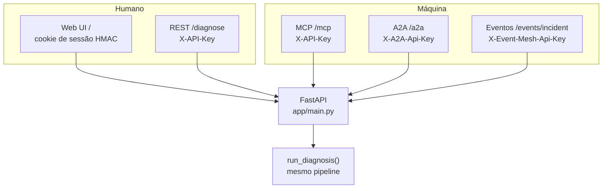

| Superfície | Entrada | Autenticação | Guarda no código |
|---|---|---|---|
| REST | `POST /diagnose`, `POST /diagnose/async`, `GET /diagnose/async/{job_id}` | `X-API-Key` **ou** sessão da UI | `app/main.py::verify_session_or_api_key` |
| Web UI | `GET /` | usuário e senha → cookie HttpOnly assinado | `app/auth.py::login`, `::verify_session` |
| MCP | `/mcp` (Streamable HTTP) | `X-API-Key` | `app/mcp/server.py::RequireApiKeyMiddleware` |
| A2A 0.3 | `POST /a2a`, card em `/.well-known/agent-card.json` | `X-A2A-Api-Key` | `app/a2a/server.py::_check_auth` |
| Eventos | `POST /events/incident` (CloudEvents 1.0) | `X-Event-Mesh-Api-Key` | `app/main.py::verify_event_mesh_api_key` |
| Feedback | `POST /incidents/{id}/verify` | `X-API-Key` | `app/main.py::verify_incident_endpoint` |

Três chaves **distintas** de propósito: um agente externo com a chave de A2A
não ganha a superfície de administração, e vice-versa [DA-18/19/23/54].

### 3.2 O boot que falha de propósito

`app/main.py::lifespan` executa, antes de servir:

- `_ensure_api_keys_configured` — chave ausente é gerada aleatoriamente e
  **avisada no log**; para uso real ela precisa estar fixada no `.env`;
- `_ensure_graph_rag_password_configured` — `GRAPH_RAG_ENABLED=true` sem
  `NEO4J_PASSWORD` falha o boot, em vez de subir um GraphRAG que nunca conecta;
- `_ensure_evidence_key_configured` — `DATABASE_URL` configurada sem
  `LLM_CREDENTIALS_MASTER_KEY` falha o boot: sem a chave, `evidence_json` seria
  gravado em claro [DA-60].

É o mesmo princípio das invariantes do capítulo 16: **falhar alto na hora do
boot em vez de degradar baixo em produção**.

### 3.3 Limite de uso e erro tratado

`app/rate_limit.py::request_client_identity` deriva a identidade do chamador
(chave ou sessão, não só IP) — sem isso um NAT inteiro compartilharia a mesma
cota. Erros têm handler próprio:
`_validation_error_handler` (422), `_unhandled_error_handler` (500 com
`error_id` para correlação), `_diagnosis_overloaded_handler` e
`_diagnosis_timeout_handler` (`DIAGNOSIS_TIMEOUT_SECONDS`, default 180 s).

### Veja executar — pare dentro do handler

Use a configuração **"Debug: FastAPI (uvicorn)"** do `launch.json`.

| # | Breakpoint em | Linha (commit `79510c0`) | O que observar |
|---|---|---|---|
| 1 | `app/main.py::lifespan` | 245 | a sequência de validações do boot |
| 2 | `app/main.py::verify_session_or_api_key` | 76 | a chave chegando no header, antes do pipeline |
| 3 | `app/main.py::diagnose` | 663 | o `IncidentRequest` já validado |
| 4 | `app/main.py::_validation_error_handler` | 369 | o corpo do 422 que o cliente vai ver |

Dispare os três casos, em ordem, e veja o breakpoint 2 aceitar, recusar e o 4 formatar:

```bash
# 1) autorizado
curl -s -o /dev/null -w '%{http_code}\n' -X POST http://127.0.0.1:8000/diagnose \
  -H "X-API-Key: $API_KEY" -H 'Content-Type: application/json' \
  -d '{"description":"IDoc travado","interface_type":"rfc","identifier":"RFC-IDOC-51-DEMO"}'

# 2) sem chave  -> 401
curl -s -o /dev/null -w '%{http_code}\n' -X POST http://127.0.0.1:8000/diagnose \
  -H 'Content-Type: application/json' -d '{"description":"teste"}'

# 3) tipo de interface inexistente -> 422
curl -s -X POST http://127.0.0.1:8000/diagnose \
  -H "X-API-Key: $API_KEY" -H 'Content-Type: application/json' \
  -d '{"description":"teste","interface_type":"sapzinho"}' | head -5
```

Esperado: `200`, `401`, e um JSON de erro de validação citando
`interface_type`.

**Aprofundar:** DA_AULA_2_FASTAPI_HTTP.md ·
MODOLO_2_FASTAPI_GATEWAY.md (mesma matéria,
foco em superfícies autenticadas) ·
DA_AULA_14_SECURITY.md.

---

## 4. O supervisor: quem atende o incidente

**O que este capítulo responde:** como o sistema escolhe o especialista sem
gastar um token de LLM.

### 4.1 A decisão

`app/agent/supervisor.py::classify_domain` é **100% determinístico** — é uma
invariante do projeto, não uma otimização [DA-22]. A prioridade:

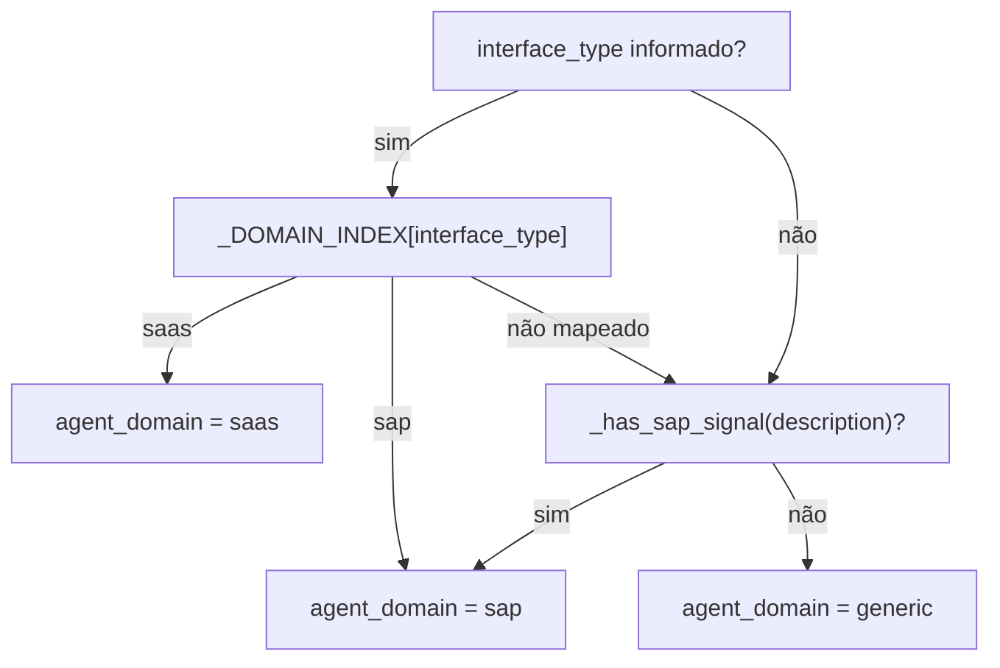

Dois detalhes que só se vê no fonte:

1. **O índice vem de arquivo declarativo, não de `set` no código** [DA-63]:
   `_DOMAIN_INDEX = build_domain_index()` lê `data/skills/*.yaml`
   (`app/mcp/skill_registry.py::build_domain_index`). Índice vazio **falha no
   import** — seguir em frente rotearia todo incidente para `generic` sem erro
   nenhum, e é exatamente o tipo de falha silenciosa que o projeto trata como
   bug de arquitetura.
2. **"sapato" não ativa o domínio SAP.** A heurística textual usa fronteira de
   palavra (`_SAP_WORD_RE`) e remove antes os RFCs da IETF
   (`_IETF_RFC_RE`, por exemplo "RFC 7231") — senão qualquer menção a padrão
   HTTP viraria incidente SAP.

O terceiro especialista existe por decisão explícita: `generic_diagnosis_node`
**não** é o `saas_diagnosis_node` reaproveitado (invariante 7 do `CLAUDE.md`).

### Veja executar — classificar sem rodar o grafo

```bash
uv run python -c "
from app.agent.supervisor import classify_domain
casos = [
    {'interface_type': 'rfc', 'description': ''},
    {'interface_type': 'servicenow', 'description': ''},
    {'description': 'erro no iFlow do CPI ao chamar o IDoc'},
    {'description': 'o sapato do usuario nao chegou'},
    {'description': 'timeout conforme RFC 7231'},
]
for c in casos:
    print(f\"{c.get('interface_type') or '-':<14} {classify_domain(c)}\")
"
```

Esperado: `sap`, `saas`, `sap` (sinal textual), `generic` (fronteira de
palavra), `generic` (RFC da IETF descartado).

Breakpoint: `app/agent/supervisor.py::classify_domain` (linha 128). Inspecione
`_DOMAIN_INDEX` no painel de variáveis — é o conteúdo dos YAML de
`data/skills/`, não um literal do Python.

**Aprofundar:** DA_AULA_9_LANGGRAPH.md ·
DA_AULA_10_NODES.md.

---

## 5. Conectores: os fatos do sistema de origem

**O que este capítulo responde:** como dez sistemas diferentes entram no
pipeline por uma única porta — e como saber se o que você está vendo é real.

### 5.1 Um contrato, dez implementações

```
fetch(identifier) → ConnectorResult
```

`app/connectors/base.py::ConnectorResult` carrega os campos que o resto do
pipeline usa para decidir **confiança**:

| Campo | Significado | Quem usa depois |
|---|---|---|
| `status` | `"ok"` ou `"error"` | montagem de evidência |
| `error_code`, `message`, `raw` | o erro como o sistema o relatou | prompt e rule engine |
| `is_mock` | `True` = cenário de demonstração | `trust_level` (`simulated` vs `system_observed`) |
| `is_fallback` | identificador não reconhecido → dado genérico | guardrails |

Cada conector decide real vs. mock **dentro do próprio `fetch()`**, olhando a
variável que o registro declara em
`app/connectors/__init__.py::_REAL_MODE_SETTING`. Essa é a fonte única: o
`GET /health` deriva o estado dali (`::connector_status`) em vez de manter uma
lista paralela que divergiria do `.env`.

Os dez registrados em `::_REGISTRY`, com o identificador de demonstração para
exercitar cada um sem credencial:

| `interface_type` | Sistema | Liga o modo real | Cenário demo | Validado contra instância real |
|---|---|---|---|---|
| `odata` | SAP CPI / Integration Suite (OData v2) | `ODATA_SERVICE_URL` | `CPI-401-DEMO`, `CPI-TIMEOUT-DEMO` | não |
| `rfc` | ECC / S/4HANA via pyrfc | `SAP_ASHOST` | `RFC-IDOC-51-DEMO`, `RFC-CONN-REFUSED-DEMO`, `RFC-GWY-POOL-TIMEOUT-DEMO` | logon sim (ABAP Trial); leitura de IDoc não |
| `servicenow` | ServiceNow ITSM (Table API) | `SERVICENOW_INSTANCE_URL` | `INC0010001` | sim |
| `salesforce` | Salesforce (OAuth2 + SOQL) | `SALESFORCE_INSTANCE_URL` | `SF-CASE-00847-DEMO` | sim |
| `workday` | Workday (OAuth2 + REST) | `WORKDAY_TENANT` | `WD-SYNC-FAIL-DEMO` | não |
| `ariba` | SAP Ariba / Business Network | `ARIBA_BASE_URL` | `ARIBA-PO-BLOCKED-DEMO` | não |
| `successfactors` | SuccessFactors EC (OData v2) | `SFSF_BASE_URL` | `SFSF-REPL-FAIL-DEMO`, `SFSF-INACTIVE-DEMO`, `SFSF-AUTH-FAIL-DEMO` | não |
| `cap` | SAP CAP (OData v4 + XSUAA) | `CAP_SERVICE_URL` | `CAP-PO-APPROVAL-DEMO` | sim (BTP Trial) |
| `apim` | SAP API Management — eventos de *analytics* | `APIM_ANALYTICS_URL` | `APIM-RATE-LIMIT-DEMO` | não; schema especulativo |
| `po` | SAP PO/PI on-premise (Message Monitor) | `PO_BASE_URL` | `PO-FAILED-001`, `PO-HOLDING-001` | não; API não pública |

**Implementado não é validado.** A última coluna é uma afirmação por conector,
e o gate `connector_validation_matrix` garante que a afirmação **exista** para
todo conector registrado — não que ela seja verdadeira. Nunca apresente "tem
conector" como "foi validado".

### 5.2 O que protege o pipeline

- **Exceção não escapa para o grafo.** Falha HTTP vira
  `ConnectorResult(status="error")` — ver
  `app/connectors/base.py::json_or_error` e `::record_response_outcome`.
- **Circuit breaker por sistema** [DA-41]: `connector_circuit_breaker`
  (namespace `conn`, Redis quando `REDIS_URL` existe, memória quando não).
  Só indisponibilidade conta (`::_is_availability_failure`) — um 404 de
  registro inexistente não abre circuito.
- **Cache de token** OAuth2 compartilhado (`::_TokenCache`) e erro de token com
  resposta própria (`::token_error_result`).
- **Identificador é validado** antes de entrar em URL
  (`::validate_identifier_charset`).

### 5.3 Adicionar um conector são nove superfícies

Registrar a classe **não** basta. O gate `connector_reachable` confere oito
superfícies e o gate `connector_coverage` a nona — porque cada ausência falha
de um jeito diferente, e quase sempre em silêncio:

| # | Superfície | Onde | Se faltar |
|---|---|---|---|
| 1 | registro e variável de modo real | `app/connectors/__init__.py::_REGISTRY`, `::_REAL_MODE_SETTING` | não existe |
| 2 | `Literal` da requisição | `IncidentRequest.interface_type` em `app/models.py` | 422 em toda chamada |
| 3 | `Literal` do evento | `IncidentEventData.interface_type` em `app/models.py` | evento rejeitado |
| 4 | domínio de roteamento | `domains` em `data/skills/diagnose_incident.yaml` | cai em `generic` |
| 5 | CLI | `choices` de `--interface` em `app/agent/graph.py` | só por HTTP |
| 6 | catálogo admin | `app/admin/models.py::CONNECTOR_TYPES` | invisível na tela que responde "qual sistema é" |
| 7 | seed de busca web | `SEED` em `alembic/versions/008_create_web_search_sources.py` (nova migration, não edite a 008) | **sem busca web, sem erro nenhum** |
| 8 | formulário de sistemas | `<select name="connector_type">` em `app/admin/templates/systems.html` | sem `integration_system` → correlação cai no fallback |
| 9 | mapa de cobertura | `data/connector_coverage.yaml` + `uv run python scripts/coverage_map.py --write` | funciona e **não aparece no mapa** |

### Veja executar — real, mock e fallback na mesma sessão

Use **"Debug: graph.py (ServiceNow - alerta ITSM)"** do `launch.json`.

| # | Breakpoint em | Linha (commit `79510c0`) | O que confirmar |
|---|---|---|---|
| 1 | `app/connectors/__init__.py::get_connector` | 47 | a classe escolhida pelo `interface_type` |
| 2 | `app/agent/nodes.py::connector_node` | 125 | `is_mock` e `is_fallback` do resultado |

Compare dois identificadores, um mapeado e um inventado:

```bash
uv run python -c "
from app.connectors import get_connector
for ident in ['INC0010001', 'INC-QUE-NAO-EXISTE']:
    r = get_connector('servicenow').fetch(ident)
    print(f'{ident:<22} status={r.status} mock={r.is_mock} fallback={r.is_fallback}')
"
```

Esperado: o primeiro devolve o cenário mapeado (`is_fallback=False`); o segundo
devolve dado genérico com `is_fallback=True`. Essa diferença atravessa todo o
resto: `is_mock=True` rebaixa o `trust_level` para `simulated` (capítulo 9) e
reduz o `evidence_strength` do rule engine de `0.95` para `0.70` (capítulo 7).

E para ver o que o `.env` atual realmente habilitou:

```bash
curl -s -H "X-API-Key: $API_KEY" http://127.0.0.1:8000/health | python3 -m json.tool | head -40
```

**Aprofundar:** [`CONNECTORS.md`](CONNECTORS.md) (variáveis completas e como
adicionar um) · [`COVERAGE_MAP.md`](COVERAGE_MAP.md) (mapa produto ×
mecanismo — **gerado**, não editar à mão).

---

## 6. RAG: de onde vem o documento

**O que este capítulo responde:** como o sistema acha o playbook certo, e qual
número decide se ele serve como evidência.

### 6.1 Duas coleções, papéis diferentes

`app/rag/retriever.py::COLLECTIONS`:

| Chave | Coleção Qdrant | Conteúdo | Busca |
|---|---|---|---|
| `incidents` | `sap_incident_docs` | os playbooks curados de `data/sample_docs/` (15 arquivos) | **híbrida** (dense + BM25 esparso, fusão RRF) |
| `reference` | `sap_reference_library` | acervo de referência grande, opcional | densa |

Só a base curada usa híbrido (`::HYBRID_TARGETS`). A `reference` é **fallback**:
consultada apenas quando a curada não tem match forte — gate
`REFERENCE_FALLBACK_THRESHOLD = 0.665` [DA-17], desligável por
`REFERENCE_LIBRARY_FALLBACK_ENABLED`.

### 6.2 O caminho de uma consulta

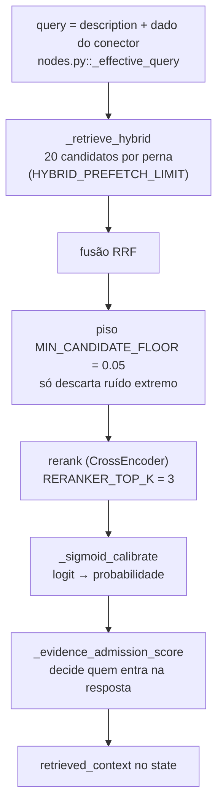

Três decisões não óbvias, todas medidas:

1. **O reranker é invariante** [DA-29]:
   `RERANKER_MODEL = "cross-encoder/mmarco-mMiniLMv2-L12-H384-v1"` — venceu o
   baseline `ms-marco-L6` por +7 p.p. de Hit@1. O gate `reranker_invariant` lê
   essa atribuição por regex; **mantenha-a em uma linha**.
2. **O piso pré-reranker é baixíssimo de propósito** (`0.05`). Antes, o
   `DEFAULT_SCORE_THRESHOLD` (0.5) era aplicado aqui e descartava candidato com
   BM25 forte e cosseno moderado — um documento com o termo exato
   ("IDoc status 51") podia nunca chegar ao cross-encoder.
3. **A admissão é do reranker, não do cosseno** [DA-25/42]. A versão anterior
   usava `max(cosseno, sigmoid)` e admitia um caso fora de escopo com cosseno
   0.753 enquanto o reranker dizia 0.0067. Os grupos de cosseno in-scope e
   out-of-scope se sobrepõem; o sigmoid separa.

A calibração sigmoid existe porque o CrossEncoder devolve **logit**, não
probabilidade: `σ(0)=0.50`, `σ(2)=0.88`, `σ(4)=0.98`, `σ(-2)=0.12`. Nenhum
consumidor usa o score cru [DA-42].

### 6.3 Ingestão

```bash
uv run python -m app.rag.ingest --target incidents --reset
```

Pontos de atenção (`app/rag/ingest.py`):

- `--target` escolhe entre os destinos de `::TARGETS`; `--reset` recria a
  coleção; `--reset-state` esquece o que já foi processado.
- A **identidade do embedding** é carimbada na coleção
  (`app/rag/embedding_guard.py::stamp_collection`) e verificada na leitura
  (`::verify_collection_embedding`): indexar com `fastembed` e consultar com
  Ollama levanta `EmbeddingMismatchError` em vez de devolver vizinhos
  aleatórios [DA-45].
- O estado da ingestão **não** guarda a URL de destino (armadilha 3 do
  capítulo 0).

### Veja executar — ver o score que decide

```bash
uv run python -c "
from app.rag.retriever import retrieve
for hit in retrieve('IDoc travado em status 51', top_k=3):
    print(f\"{hit.get('source','?'):<34} collection={hit.get('collection','?'):<22} \"
          f\"score={hit.get('score',0):.3f} rerank={hit.get('rerank_score_calibrated')}\")
"
```

Esperado: `idoc_status_51.md` em primeiro, coleção `sap_incident_docs`, com
`rerank_score_calibrated` perto de 1.0. Agora o contraste — uma consulta fora
de escopo:

```bash
uv run python -c "
from app.rag.retriever import retrieve
print(retrieve('qual a receita de pão de queijo', top_k=3))
"
```

Esperado: lista vazia ou candidato com calibrado muito baixo — a admissão
rejeita. É essa diferença que o job `rag-quality` do CI mede (medição de
2026-10-18 com 110 casos: Hit@1 95,6 %, MRR 0,967; 19 de 20 consultas fora
de escopo rejeitadas).

| # | Breakpoint em | Linha (commit `79510c0`) | O que inspecionar |
|---|---|---|---|
| 1 | `app/rag/retriever.py::_retrieve_hybrid` | 164 | os 20 candidatos por perna, antes da fusão |
| 2 | `app/rag/retriever.py::rerank` | 338 | `rerank_score` cru vs. `rerank_score_calibrated` |
| 3 | `app/rag/retriever.py::_evidence_admission_score` | 369 | o número que admite ou rejeita |

Para inspecionar o que está realmente indexado existe
`scripts/debug_matched_source.py`.

**Aprofundar:** [`RERANKER_BENCHMARK.md`](RERANKER_BENCHMARK.md) ·
DA_AULA_8_LLMS.md.

---

## 7. Rule Engine: a camada de custo zero

**O que este capítulo responde:** por que 9 de 10 incidentes conhecidos não
chegam ao modelo.

### 7.1 Uma regra

`app/agent/rules.py::ErrorRule` é um `dataclass` com `patterns` (regex),
`probable_root_cause`, `next_steps`, `category` e `confidence` (default `0.90`).
`match_known_error(text, has_connector_data)` percorre as regras e, no primeiro
casamento não negado, devolve um `dict` **já compatível com `DiagnosisModel`**.

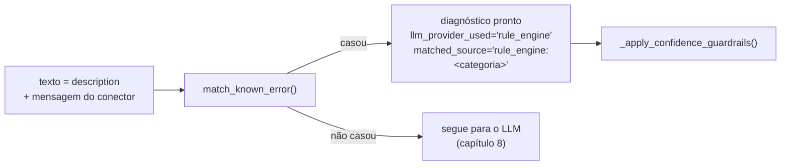

Dois refinamentos vindos de falhas reais:

- **`.*` virou janela curta** (`::_bounded`, `_GAP`): o padrão `ja.*existe`
  casava a frase inteira — "Já verificamos a janela… o pedido existe". Agora
  nenhum `.*` atravessa fim de frase.
- **Negação é verificada** (`::_negated`): "não houve timeout" não dispara a
  regra de timeout.
- **`401` sozinho não é "token expirado"**: credencial errada, escopo faltando,
  usuário bloqueado e relógio dessincronizado também dão 401. São duas
  categorias distintas (`auth_oauth_expired`, `auth_unauthorized`), cada uma
  com causa honesta.

### 7.2 O número que calibra a confiança

```
evidence_strength = 0.95  se has_connector_data (conector real, não mock)
evidence_strength = 0.70  se só texto digitado
```

A razão está no docstring: um regex sobre texto digitado é mais frágil que um
código de erro capturado do sistema de origem.

### 7.3 Regras e taxonomia SKOS

`KNOWN_ERROR_RULES` tem **22** regras hardcoded (conferido neste checkout). Com
`app/agent/ontology_loader.py::load_error_rules_combined`, as regras passam a
vir de `app/ontology/error_codes.ttl` (SKOS) e as hardcoded entram como
complemento das categorias ausentes [DA-61] — o [`README.md`](../README.md)
registra **28** no total (22 + 6 da taxonomia). Se o TTL faltar ou não parsear,
o carregador cai nas hardcoded; o fallback é silencioso (limitação aceita e
registrada).

Invariante: `RULE_ENGINE_ENABLED` é `True` por default e só se desliga em teste
que precise forçar o LLM.

### Veja executar — o curto-circuito, com e sem

```bash
uv run python -c "
from app.agent.rules import KNOWN_ERROR_RULES, match_known_error
print('regras hardcoded:', len(KNOWN_ERROR_RULES))
for texto, conector in [
    ('IDoc travado em status 51', True),
    ('o token OAuth expirou no iFlow', False),
    ('nao houve timeout nenhum na chamada', False),
    ('comportamento estranho desde ontem', False),
]:
    m = match_known_error(texto, has_connector_data=conector)
    print(f\"{texto[:38]:<40} -> {m['matched_source'] if m else 'None (vai ao LLM)'}\"
          f\"{' evid=' + format(m['evidence_strength'], '.2f') if m else ''}\")
"
```

Esperado: a primeira casa com `evid=0.95`; a segunda casa com `0.70`; a
terceira **não** casa (negação); a quarta não casa e segue para o modelo.

| # | Breakpoint em | Linha (commit `79510c0`) | O que inspecionar |
|---|---|---|---|
| 1 | `app/agent/rules.py::match_known_error` | 602 | `rules` (origem: ontologia ou hardcoded) e o `dict` de retorno |
| 2 | `app/agent/rules.py::_negated` | 88 | por que "não houve timeout" não dispara |
| 3 | `app/agent/nodes.py::_run_diagnosis_agent` | 1074 | a linha em que a regra retorna **antes** de montar prompt |

No breakpoint 3, observe: com regra casada, a execução nunca alcança
`_build_diagnosis_prompt`. É o mesmo fato que o `--debug` mostra pela ausência
do bloco "PROMPT ENVIADO AO LLM".

**Aprofundar:** DA_AULA_11_RULES.md.

---

## 8. O LLM: fábrica, gateway e prompt como artefato

**O que este capítulo responde:** o que acontece quando a regra não casa — e o
que impede o dado confidencial de sair da máquina.

### 8.1 Um único ponto de entrada

**Invariante:** `app/llm/gateway.py::invoke_via_gateway` é o **único** caminho
do grafo para o modelo. Nunca chamar
`app/llm/factory.py::invoke_with_hybrid_fallback` direto.

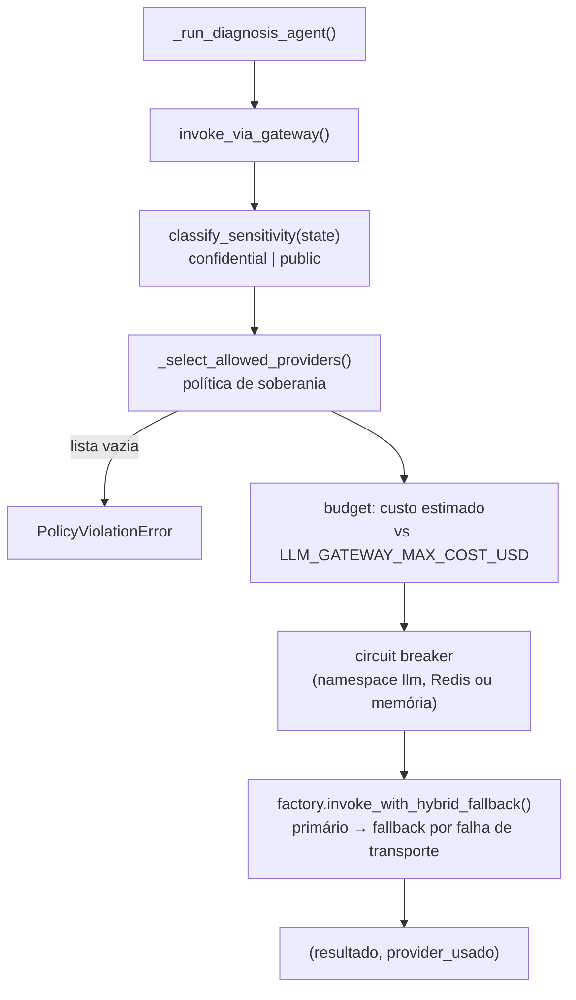

### 8.2 Soberania por origem real, não por rótulo

- A heurística classifica como **`confidential`** quando há dado real de
  conector; a classificação declarada pelo cliente
  (`IncidentRequest.sensitivity_level`) só **eleva**, nunca rebaixa.
- `DATA_SOVEREIGNTY_MODE=strict` (default): dado confidencial só vai para
  provider **local**. Em `cloud_with_dlp`, também para origens explicitamente
  listadas em `CONFIDENTIAL_ALLOWED_ORIGINS` [DA-39].
- A unidade de governança é a **ORIGIN** (`scheme://host[:porta]`), não o rótulo
  do provider [DA-43]: `openai` apontando para `api.openai.com` e `openai`
  apontando para um vLLM interno não são o mesmo destino.
- `app/llm/routes.py::LLM_ROUTES` declara onde o dado sai e o que o destino
  aceita. `require_loopback` é mutuamente exclusivo com origem remota: a rota
  `local_lab` apontando para a internet **falha no boot**, e a
  `enterprise_azure` apontando para loopback também. Impede os dois lados da
  mentira de auditoria.
- **Modelo nunca é chave de rota**: `LLM_MODEL` é texto livre; há teste que
  falha se um nome de modelo entrar como chave [DA-45].

`GET /llm/policy` devolve esse quadro resolvido — é a resposta pronta para
"para onde vai meu dado confidencial?" sem nenhum "confia"
(`app/llm/gateway.py::describe_effective_policy`).

### 8.3 Modelo e prompt

| Item | Valor neste checkout | Onde |
|---|---|---|
| provider default | `ollama` | `app/config.py` (`LLM_PROVIDER`) |
| modelo canônico | `qwen3.6:35b-a3b` | `app/config.py` (`LLM_MODEL`), `.env.example`, `docker-compose.yml`, promptfoo |
| `seed` | 42 obrigatório para determinismo | [DA-2]; `LLM_SEND_SEED=None` significa "manda seed", não "não manda" |
| prompt | artefato versionado | `app/agent/prompts.py::PROMPT_VERSION` + `::compute_digest` |

O prompt é **artefato de governança** [DA-53]: a resposta, o relatório e a
tabela `incidents` carregam `llm_model`, `prompt_version` e `prompt_digest`. O
gate `prompt_digest_measured` reprova o build se o digest do código divergir do
baseline medido em `data/eval/prompt_baseline.json`.

### 8.4 Fallback híbrido

`invoke_with_hybrid_fallback` troca de provider **somente** por falha de
transporte (`TRANSPORT_FAILURE_EXCEPTIONS`) — não por resposta ruim. Se
primário e fallback falharem, levanta `ConfigurationError` citando os dois
erros. E a troca respeita a política: o gateway filtra os candidatos **antes**
de a fábrica tentar qualquer um.

### Veja executar — a política antes do modelo

Sem LLM instalado:

```bash
uv run python -c "
from app.llm.gateway import classify_sensitivity, describe_effective_policy
print('texto digitado      ->', classify_sensitivity({'description': 'erro X'}))
from app.connectors.base import ConnectorResult
real = ConnectorResult(source_system='ServiceNow', status='error', error_code='401',
                       message='unauthorized', raw='{}', is_mock=False)
print('dado real de conector ->', classify_sensitivity({'description': 'erro X', 'connector_data': real}))
import json; print(json.dumps(describe_effective_policy(), indent=2, ensure_ascii=False)[:700])
"
```

Com o servidor no ar, o mesmo quadro pela API:

```bash
curl -s -H "X-API-Key: $API_KEY" http://127.0.0.1:8000/llm/policy | python3 -m json.tool
```

Agora force a negação. Em um `.env` de teste:

```bash
LLM_PROVIDER=openai
DATA_SOVEREIGNTY_MODE=strict
```

Um incidente com dado real de conector é classificado `confidential`, nenhum
provider local está disponível, e o gateway levanta `PolicyViolationError` —
a chamada não sai. Esse é o caminho a observar:

| # | Breakpoint em | Linha (commit `79510c0`) | O que inspecionar |
|---|---|---|---|
| 1 | `app/llm/gateway.py::classify_sensitivity` | 129 | por que virou `confidential` |
| 2 | `app/llm/gateway.py::_select_allowed_providers` | 261 | a lista filtrada (vazia = negação) |
| 3 | `app/llm/gateway.py::invoke_via_gateway` | 361 | budget e circuit breaker antes da chamada |
| 4 | `app/llm/factory.py::invoke_with_hybrid_fallback` | 270 | o `except` que troca de provider |
| 5 | `app/agent/prompts.py::compute_digest` | 230 | o digest que o gate compara |

Com texto livre e Ollama no ar, rode com `--debug` e leia o bloco
"PROMPT ENVIADO AO LLM (ReAct v1.3)" seguido de "ITERAÇÕES DO AGENTE ReAct" —
é o loop ReAct decidindo se busca na web antes de responder:

```bash
uv run python -m app.agent.graph --debug "erro intermitente de replicacao desde a atualizacao de ontem"
```

**Aprofundar:** DA_AULA_8_LLMS.md ·
DA_AULA_14_SECURITY.md ·
[`AVALIACAO_MODELOS_LOCAIS.md`](AVALIACAO_MODELOS_LOCAIS.md).

---

## 9. Evidência e guardrails: por que acreditar na resposta

**O que este capítulo responde:** o que sustenta cada afirmação do
diagnóstico, e como o sistema impede o modelo de se autoelogiar.

### 9.1 A evidência é montada por código

`app/agent/nodes.py::_assemble_evidence` é **inteiramente determinístico**
(invariante 4 do `CLAUDE.md`): cada item aponta para uma fonte que o pipeline
**de fato consultou nesta execução**, e o `trust_level` vem do **tipo** da
fonte — nunca de o LLM dizer o que usou.

| `trust_level` | Quando | Força |
|---|---|---|
| `system_observed` | conector real (não mock, não fallback) **ou** regra do rule engine | máxima |
| `retrieved_document` | chunk RAG já passado pelo reranker, ou histórico do GraphRAG | alta |
| `simulated` | conector mock ou fallback | média |
| `web_untrusted` | resultado de busca web | baixa |
| `user_reported` | a descrição digitada do incidente | mínima |

### 9.2 Dois números, não um

A revisão arquitetural separou o que antes era um só campo:

- **`model_confidence`** — autoavaliação do LLM, já normalizada e **limitada**;
- **`evidence_strength`** — calculado pelo pipeline
  (`::_compute_evidence_strength`): o maior entre o score calibrado do melhor
  chunk e o piso `0.75` quando há dado real de conector; `0.0` sem contexto
  algum.

E um terceiro, **calculado**, para automação:

```
diagnosis_confidence = evidence_strength × model_confidence
```

A fórmula anterior era `max(evidence_strength, model_confidence × evidence_strength)`,
que simplifica para `evidence_strength` — ignorava o modelo por completo. Agora
qualquer um dos dois sinais baixo puxa o resultado para baixo. Não é
probabilidade calibrada: serve para ranquear diagnósticos entre si.

O teto é a regra central [DA-15/25]:

```
model_confidence ≤ evidence_strength + EVIDENCE_CONFIDENCE_MARGIN   (0.25)
```

Um modelo que diga "99 % de certeza" sobre um incidente sem nenhuma evidência
sai da função com confiança baixa. Convicção não cria lastro.

Mais três guardrails em `::_apply_confidence_guardrails`:

1. **Identificador não reconhecido** (`is_fallback`): confiança limitada a
   `0.4` e a causa raiz ganha o prefixo
   `[confianca limitada - identificador nao reconhecido pelo sistema]`.
2. **`matched_source` alucinado é anulado.** Documento que o LLM cita mas que o
   retrieval nunca devolveu some da resposta e a confiança cai para `0.3` — e
   essa anulação é o que o capítulo 10 lê como abstenção. A checagem antes só
   rodava quando **havia** documentos recuperados: com conector real e RAG
   vazio, um nome de arquivo inventado passava intacto com confiança alta
   (corrigido na validação de 2026-10-07).
3. **O rule engine não pode ser imitado.** Só `rules.py` define
   `rule_engine_category`; a saída do LLM não tem esse campo, então o modelo
   não consegue se passar pela regra determinística. E a força da regra
   (`0.95`/`0.70`) não é sobrescrita pelo cálculo de RAG — vale o **maior** dos
   dois sinais.

`is_grounded` nunca vem de autoavaliação: deriva de `evidence_strength`
[DA-16].

### Veja executar — o teto em ação

```bash
uv run python -c "
from app.agent.nodes import _apply_confidence_guardrails, _compute_evidence_strength
# LLM convicto, zero evidência
d = {'confidence': 0.99, 'probable_root_cause': 'certeza absoluta', 'matched_source': None}
print('evidence_strength :', _compute_evidence_strength({}))
print('saída             :', _apply_confidence_guardrails(dict(d), {}))
"
```

Esperado: `evidence_strength 0.0` e `model_confidence` cortado para `0.25` — o
teto `0.0 + 0.25`.

| # | Breakpoint em | Linha (commit `79510c0`) | O que inspecionar |
|---|---|---|---|
| 1 | `app/agent/nodes.py::_compute_evidence_strength` | 718 | `rag_score`, `connector_is_real_evidence` |
| 2 | `app/agent/nodes.py::_apply_confidence_guardrails` | 855 | `evidence_ceiling` vs. `model_confidence` |
| 3 | `app/agent/nodes.py::_assemble_evidence` | 741 | a lista final e cada `trust_level` |
| 4 | `app/agent/nodes.py::_recover_matched_source_from_raw` | 1237 | recuperação de `matched_source` da saída crua |

**Aprofundar:** DA_AULA_10_NODES.md.

---

## 10. Escalonamento determinístico

**O que este capítulo responde:** quando vale a pena consultar um modelo pago —
e por que "sem contexto" **não** é um desses casos.

### 10.1 Cinco estados, quatro regras ordenadas

`app/agent/escalation.py::compute_escalation_signal` lê fatos do state, não
chama LLM e não usa confiança autorrelatada. A **ordem importa**: a primeira
regra que casar define a razão.

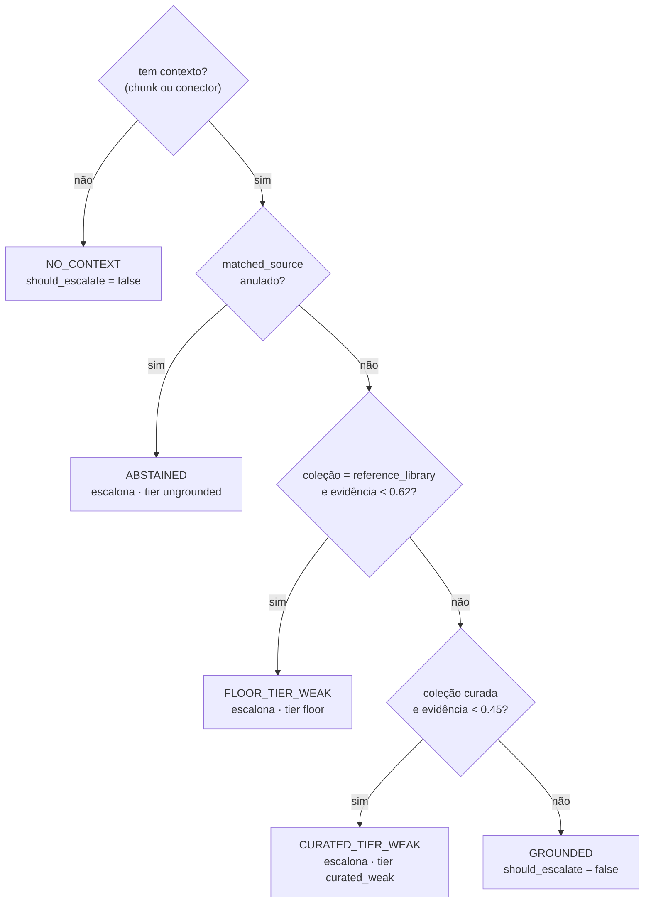

**`NO_CONTEXT` não escalona, e isso é deliberado.** Modelo maior não cria
evidência que não existe: sem chunk e sem conector, o que o tier pago produziria
não é resposta melhor — é alucinação mais confiante. É o modo de falha que a
Evidence/Trust Layer existe para conter.

### 10.2 O que o módulo não decide

`EscalationDecision.escalate_to` devolve `"cloud_premium"` ou `None`. **Qual**
provider pago atende é decisão do AI Gateway, que aplica a política de
soberania [DA-26/43] — este módulo não conhece e não pode contornar a política.

Os dois limiares (`FLOOR_TIER_MIN_EVIDENCE = 0.62`,
`CURATED_TIER_MIN_EVIDENCE = 0.45`) estão anotados no código como **ponto de
partida explícito, não calibrados** contra o corpus completo. É uma limitação
declarada, não um número medido.

`EscalationDecision.as_log_fields` existe para auditoria: só o veredito e os
números que o produziram, sem conteúdo de documento e sem PII.

### Veja executar — os cinco estados em um comando

```bash
uv run python -c "
from app.agent.escalation import compute_escalation_signal as sig
from app.connectors.base import ConnectorResult
mock = ConnectorResult(source_system='RFC', status='ok', error_code=None,
                       message='m', raw='{}', is_mock=True)
casos = {
 'sem contexto':      {},
 'abstencao':         {'connector_data': mock, 'diagnosis': {'matched_source': None}},
 'piso fraco':        {'retrieved_context': [{'collection': 'sap_reference_library',
                                              'rerank_score_calibrated': 0.38}],
                       'diagnosis': {'matched_source': 'x.md'}},
 'curado fraco':      {'retrieved_context': [{'collection': 'sap_incident_docs',
                                              'rerank_score_calibrated': 0.30}],
                       'diagnosis': {'matched_source': 'x.md'}},
 'fundamentado':      {'retrieved_context': [{'collection': 'sap_incident_docs',
                                              'rerank_score_calibrated': 0.97}],
                       'diagnosis': {'matched_source': 'idoc_status_51.md'}},
}
for nome, st in casos.items():
    d = sig(st)
    print(f'{nome:<16} {d.reason:<18} escalona={d.should_escalate}  tier={d.tier}')
"
```

Esperado, nesta ordem: `no_context` (não escalona), `abstained`,
`floor_tier_weak`, `curated_tier_weak`, `grounded`.

| # | Breakpoint em | Linha (commit `79510c0`) | O que inspecionar |
|---|---|---|---|
| 1 | `app/agent/escalation.py::compute_escalation_signal` | 199 | `collection`, `top_evidence`, `abstained` |
| 2 | `app/agent/escalation.py::_top_evidence` | 187 | sempre `rerank_score_calibrated`, nunca o logit cru |

**Aprofundar:** DA_AULA_12_ESCALATION.md.

---

## 11. GraphRAG: o histórico que o grafo acumula

**O que este capítulo responde:** o que muda quando `GRAPH_RAG_ENABLED=true`, e
por que ele é desligado por default.

### 11.1 Dois nós a mais

Com a flag ligada, `build_graph` acrescenta `graph_enrich` (antes do
diagnóstico) e `graph_write` (depois):

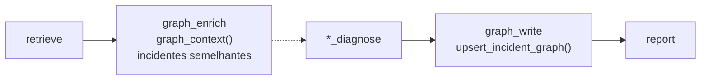

- **Degradação graciosa** [DA-21]: `(DriverError, TransientError)` → histórico
  vazio e o pipeline continua; `Neo4jError` de verdade não é engolido. A
  distinção está em `app/rag/graph_store.py::GRAPH_UNAVAILABLE_EXCEPTIONS`.
- **`VERIFIED_AS`** [DA-28]: `POST /incidents/{id}/verify` registra o veredito
  humano e alimenta o grafo (`::verify_incident`). Hipóteses que nunca se
  confirmam são podadas (`::prune_ungrounded_hypotheses`).
- **Invariante 13:** `verified` ≠ `verified_at`. O endpoint grava `verified_at`
  sempre, mas `diagnosis_correct=None` fica NULL. Coagir para `True` inflaria a
  acurácia nos dashboards.
- `incident_id` só volta na resposta quando o GraphRAG está ligado **e** o
  incidente foi de fato gravado — devolver sempre sugeriria que há algo para
  verificar.

### Veja executar — ligar, e ver falhar bonito

```bash
docker compose --profile graphrag up -d neo4j
# .env: GRAPH_RAG_ENABLED=true e NEO4J_PASSWORD definido
uv run pytest tests/test_graph_store.py -v
```

Lembre do capítulo 0: `NEO4J_AUTH` só vale na **primeira** inicialização do
volume. Sem `NEO4J_PASSWORD` no `.env`, o serviço sobe com o placeholder
`neo4j/REQUIRED_SET_IN_ENV` e falha em `verify_connectivity()`; com
`GRAPH_RAG_ENABLED=true` e sem a senha, o **boot da API falha de propósito**
(`app/main.py::_ensure_graph_rag_password_configured`).

Teste a degradação: com a flag ligada, derrube o Neo4j
(`docker compose stop neo4j`) e rode um diagnóstico. Esperado: resposta normal,
sem histórico de grafo, e **sem exceção** — o breakpoint em
`app/rag/graph_store.py::graph_context` (linha 395) mostra o `except` que
devolve lista vazia.

Use a configuração **"Debug: pytest (só GraphRAG)"** do `launch.json` para
parar dentro das consultas Cypher.

**Aprofundar:** [`ARCHITECTURE.md`](ARCHITECTURE.md) ·
[`TUTORIAL_FASE9_MULTIVENDOR_GRAPHRAG_A2A.md`](TUTORIAL_FASE9_MULTIVENDOR_GRAPHRAG_A2A.md).

---

## 12. As outras portas: MCP, A2A, eventos e fila

**O que este capítulo responde:** como outro agente — ou um event mesh — usa o
mesmo pipeline sem passar pela UI.

### 12.1 Quatro transportes, um pipeline

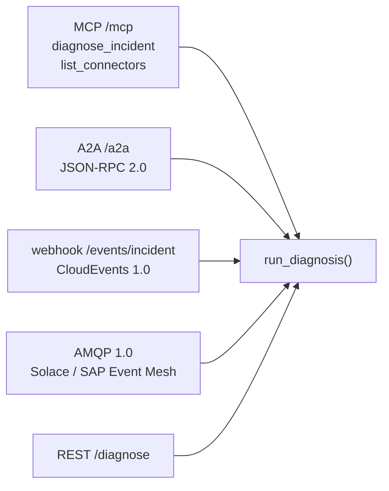

| Transporte | Detalhe que importa |
|---|---|
| **MCP** [DA-19] | Streamable HTTP montado em `/mcp` **dentro** do app FastAPI — não é processo stdio. Exige a mesma `X-API-Key`, por isso ela precisa estar **fixa** no `.env`. `StreamableHTTPSessionManager.run()` só pode ser chamado uma vez por processo |
| **A2A 0.3** [DA-14] | `POST /a2a` (JSON-RPC 2.0) + card em `/.well-known/agent-card.json`. Tarefa tem ciclo `submitted → working → completed/failed` (`app/a2a/task_manager.py::TERMINAL_STATES`) |
| **Webhook** [DA-23] | `POST /events/incident` com CloudEvents 1.0, tipo `com.sap.integration.incident.detected.v1` |
| **AMQP 1.0** [DA-40] | `python-qpid-proton` com wrapper asyncio. O diagnóstico roda **fora do reactor** (RQ quando há `REDIS_URL`, senão `ThreadPoolExecutor`); `AMQP_MAX_REDELIVERIES` manda para a DMQ |
| **Fila assíncrona** | `POST /diagnose/async` devolve `job_id`; `GET /diagnose/async/{job_id}` consulta. Precisa de `REDIS_URL` e do serviço `worker` (perfil `async`) |

**Capability Registry é FAIL-CLOSED** [DA-27]: ferramenta sem entrada em
`app/mcp/policy.py` é negada. As skills vêm de `data/skills/*.yaml` [DA-63] —
os mesmos arquivos que o supervisor usa para rotear (capítulo 4).

**Idempotência** [DA-23/32/41]: `app/events/idempotency.py::is_duplicate` usa
Redis com TTL e um cache local de reserva; evento repetido não gera segundo
diagnóstico.

### 12.2 Configurar um cliente MCP

| Ferramenta | Arquivo | Dialeto |
|---|---|---|
| Claude Code | `.mcp.json` | `type: http` + `${API_KEY}` |
| OpenCode | `opencode.json` | `type: remote` + `{env:API_KEY}` |
| Codex | `~/.codex/config.toml` | `[mcp_servers.copilot-mcp]` (global) |

Config MCP **não** é hot-reload: reinicie a ferramenta. E a API precisa estar
no ar, senão o cliente falha ao conectar.

### Veja executar — as três portas, em sequência

```bash
# A2A: o card que outro agente lê para descobrir as capacidades
curl -s http://127.0.0.1:8000/.well-known/agent-card.json | python3 -m json.tool | head -30

# A2A: uma tarefa JSON-RPC
curl -s -X POST http://127.0.0.1:8000/a2a \
  -H "X-A2A-Api-Key: $A2A_API_KEY" -H 'Content-Type: application/json' \
  -d '{"jsonrpc":"2.0","id":"1","method":"message/send","params":{"message":{"role":"user",
       "parts":[{"kind":"text","text":"IDoc travado em status 51 (RFC-IDOC-51-DEMO)"}]}}}' \
  | python3 -m json.tool | head -30

# Evento CloudEvents
curl -s -X POST http://127.0.0.1:8000/events/incident \
  -H "X-Event-Mesh-Api-Key: $EVENT_MESH_API_KEY" -H 'Content-Type: application/json' \
  -d '{"specversion":"1.0","type":"com.sap.integration.incident.detected.v1",
       "source":"/manual/cap12","id":"evt-manual-001",
       "data":{"description":"IDoc travado em status 51","interface_type":"rfc",
               "identifier":"RFC-IDOC-51-DEMO"}}'
```

Repita o último comando **com o mesmo `id`**: esperado é a idempotência
reconhecer a duplicata em vez de diagnosticar de novo.

| # | Breakpoint em | Linha (commit `79510c0`) | O que inspecionar |
|---|---|---|---|
| 1 | `app/mcp/policy.py::enforce` | 165 | a decisão fail-closed |
| 2 | `app/a2a/task_manager.py::TaskManager.handle_message` | 151 | a tarefa mudando de estado |
| 3 | `app/events/consumer.py::handle_incident_event` | 106 | o envelope virando `IncidentRequest` |
| 4 | `app/events/idempotency.py::is_duplicate` | 150 | a chave do evento e o veredito |

Teste automatizado pronto: **"Debug: pytest (só A2A)"** no `launch.json`.

**Aprofundar:** DA_AULA_13_MCP_A2A_EVENTS.md ·
a2a-interoperability-layer.md ·
[`USER_GUIDE.md`](USER_GUIDE.md).

---

## 13. Banco, administração e correlação

**O que este capítulo responde:** onde o incidente fica depois de respondido, e
como ele se liga ao catálogo de sistemas.

### 13.1 O que é opcional

Todo o PostgreSQL é **opt-in**: sem `DATABASE_URL`, `record_incident` é no-op
(`app/services/incident_recorder.py::record_incident`). Com ela, o boot passa a
exigir a chave de criptografia de evidência (capítulo 3).

São **13** migrations em `alembic/versions/` neste checkout. As que explicam o
desenho:

| Migration | O que trouxe |
|---|---|
| `001_create_incidents_table.py` | a tabela `incidents` |
| `002_fix_evidence_strength_type.py` | `evidence_strength` passou a **FLOAT** — invariante 22: nunca usar predicado textual (`IN ('high','critical')`) em query de dashboard |
| `003_create_admin_tables.py` | registro de modelos e credenciais [DA-46/47] |
| `004_create_integration_systems.py` | catálogo de sistemas integrados [DA-49] |
| `005_create_system_contracts.py` | baseline de contratos, **append-only** [DA-52] |
| `006_incident_prompt_provenance.py` | `prompt_version` / `prompt_digest` no incidente [DA-53] |
| `007_create_web_users.py` | usuários da UI, ativação em duas etapas [DA-55] |
| `008_create_web_search_sources.py` | fontes de busca web como configuração [DA-57] |
| `009_encrypt_evidence_json.py` | `evidence_json` cifrado com Fernet + redação de PII [DA-60] |
| `011_system_contracts_append_only.py` | trigger que nega UPDATE/DELETE |
| `013_grafana_read_only_role.py` | papel somente-leitura para o Grafana |

### 13.2 Credenciais e tokens

- `app/admin/crypto.py::encrypt_secret` cifra credencial de provider em repouso
  com Fernet; a master key vive no `.env` (`LLM_CREDENTIALS_MASTER_KEY`) e nunca
  em runtime [DA-47].
- `::encrypt_evidence` **redige a PII reconhecível antes de cifrar**
  (`app/redaction.py::redact_pii_deep`) — quem decifra para a tela de incidentes
  não recebe o dado pessoal. Sem master key, levanta `ConfigurationError` em vez
  de gravar em claro [DA-60].
- **Metering real** [DA-48]: tokens vêm de `usage_metadata` da resposta, não de
  estimativa (`app/admin/metering.py`).

### 13.3 Correlação é fail-closed

`app/admin/correlation.py::correlate` liga o incidente ao catálogo:

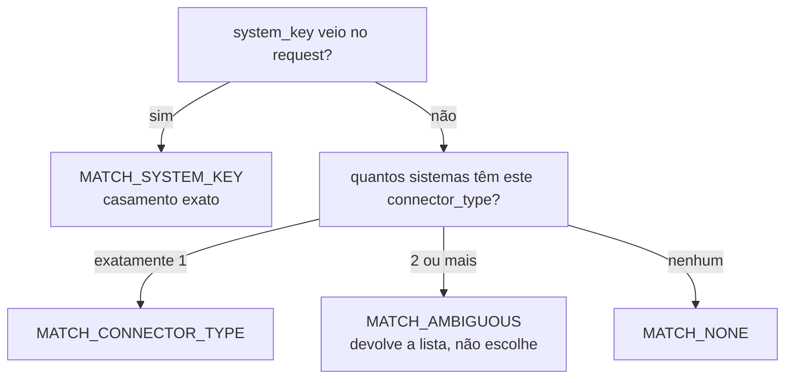

Invariante 12: **nenhuma superfície** — UI, API ou dashboard — escolhe um
sistema por conta própria quando há ambiguidade.

### Veja executar — subir o banco e ver a linha nascer

```bash
docker compose --profile observability up -d postgres
# .env (modo nativo): DATABASE_URL=postgresql://postgres:<senha>@127.0.0.1:5432/iic
uv run alembic upgrade head
uv run alembic current        # esperado: a revisão 013 como head
```

Rode um diagnóstico e confira a linha gravada:

```bash
uv run python -c "
import os, sqlalchemy as sa
e = sa.create_engine(os.environ['DATABASE_URL'])
with e.connect() as c:
    for r in c.execute(sa.text('''select incident_id, interface_type, llm_provider_used,
        evidence_strength, prompt_version, prompt_digest
        from incidents order by created_at desc limit 3''')):
        print(r)
"
```

Esperado no caso do capítulo 1: `llm_provider_used='rule_engine'` e
`prompt_version`/`prompt_digest` **NULL** — invariante 21, um diagnóstico sem
LLM não foi produzido por prompt nenhum.

| # | Breakpoint em | Linha (commit `79510c0`) | O que inspecionar |
|---|---|---|---|
| 1 | `app/services/incident_recorder.py::build_incident_row` | 51 | a linha antes do INSERT |
| 2 | `app/admin/crypto.py::encrypt_evidence` | 82 | a evidência redigida e cifrada |
| 3 | `app/admin/correlation.py::correlate` | 59 | qual dos quatro vereditos saiu |
| 4 | `app/db.py::get_sync_session_factory` | 79 | o cache **chaveado pela URL** (invariante 19) |

A UI de administração fica em `/admin` (telas de modelos, uso, sistemas,
incidentes e busca web).

**Aprofundar:** DA_AULA_21_DATABASE.md ·
DA_AULA_3_PERSISTENCIA.md.

---

## 14. Drift de contrato: avisar antes de quebrar

**O que este capítulo responde:** como o sistema percebe que o SAP mudou um
serviço OData — e por que "não consegui ler" não é "não mudou".

### 14.1 O fluxo

`app/contracts/observe.py::observe`: probe → normalização → diff → baseline →
evento.

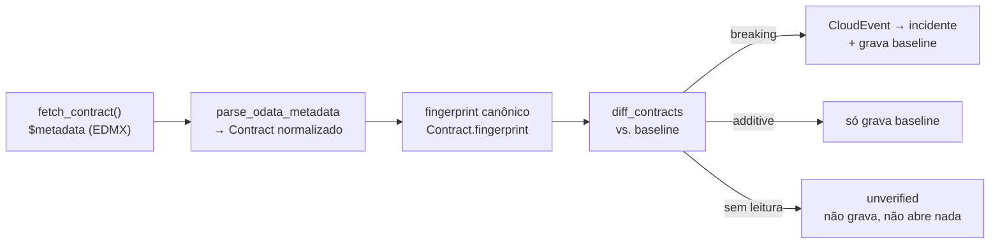

### 14.2 As quatro verdades do módulo

1. **Quatro estados, não dois** (`app/contracts/diff.py::ObservationStatus`):
   `clean`, `drift`, `first_observation` (sem baseline) e `unverified` (sem
   leitura). Invariante 15: **ausência de evidência nunca é "sem drift"**, e
   `unverified` nunca abre incidente nem grava/apaga baseline.
2. **Só `breaking` abre incidente.** `additive` não. Rename provável é
   *breaking com `hint`* (`::_pair_renames`): para o consumidor o efeito é o
   mesmo de remover o campo, e o hint evita dois alarmes. `cosmetic` existe no
   vocabulário mas **não é emitido** hoje.
3. **Fingerprint nunca é do XML bruto** (invariante 18): propriedades,
   entidades e anotações entram como `tuple` ordenada, e namespace/versão
   volátil ficam de fora. Sem isso, o SAP republicando o serviço geraria drift
   todos os dias.
4. **`system_contracts` é append-only e sem FK** (invariante 16): é histórico de
   observação, não cadastro. A migration 011 instala um trigger que nega
   UPDATE/DELETE. E breaking cuja **entrega falha não grava baseline** — a
   próxima observação re-detecta e reemite.

A introspecção é **interface segregada**: só quem sabe ler contrato implementa
`fetch_contract` (hoje `app/connectors/odata_connector.py::fetch_contract`); os
outros herdam `None` de `app/connectors/base.py::SAPConnector.fetch_contract`, e
o detector registra `nao_introspectavel` como estado próprio.

### Veja executar — provocar um drift

```bash
uv run python scripts/check_contract_drift.py --help
uv run pytest tests/test_contracts_diff.py tests/test_contracts_odata.py -v
```

Os testes de diff são a forma mais rápida de ver as severidades: eles comparam
EDMX com e sem campo, com campo renomeado e com o serviço republicado sem
mudança real (que **não** deve gerar drift). Os e2e
(`tests/test_contracts_e2e.py`) exigem `IIC_TEST_DATABASE_URL` com PostgreSQL
real.

| # | Breakpoint em | Linha (commit `79510c0`) | O que inspecionar |
|---|---|---|---|
| 1 | `app/contracts/odata.py::parse_odata_metadata` | 158 | o EDMX virando `Contract` |
| 2 | `app/contracts/model.py::Contract.fingerprint` | 140 | o hash canônico (sem namespace/versão) |
| 3 | `app/contracts/diff.py::diff_contracts` | 309 | a severidade atribuída |
| 4 | `app/contracts/observe.py::observe` | 118 | qual dos quatro estados saiu |

**Aprofundar:** [`DECISOES_DE_ARQUITETURA.md`](DECISOES_DE_ARQUITETURA.md)
(DA-52) · [`CASOS_DE_USO.md`](CASOS_DE_USO.md) (UC-09).

---

## 15. Observabilidade: logs, métricas, traces e painéis

**O que este capítulo responde:** onde olhar quando algo deu errado em
produção — e o que é desligado por default.

### 15.1 As quatro camadas

| Camada | Liga com | Onde |
|---|---|---|
| **Log estruturado** | sempre | logger de cada módulo; PII redigida por `app/redaction.py::redact_pii_text` e truncamento inteligente de exceção [DA-30] |
| **Métricas Prometheus** | `PROMETHEUS_ENABLED=true` (+ `METRICS_TOKEN`) | `app/metrics.py::setup_metrics` → `/metrics` |
| **Tracing Langfuse** | `LANGFUSE_PUBLIC_KEY` + `LANGFUSE_SECRET_KEY` (+ `LANGFUSE_HOST`) | `app/config.py::Settings.langfuse_configured` |
| **Painéis SQL** | perfil `observability` | `deploy/grafana/dashboards/` (COI, SOC, iPaaS, sistemas) |

As métricas de negócio, todas com prefixo `iic_`
(`app/metrics.py::observe_diagnosis`):

| Métrica | Pergunta que responde |
|---|---|
| `iic_diagnosis_total`, `iic_diagnosis_latency_seconds` | volume e latência, por domínio/provider/força de evidência |
| `iic_rule_engine_hit_total` | quantos incidentes nunca chegaram ao LLM |
| `iic_llm_fallback_total` | com que frequência o primário caiu |
| `iic_circuit_breaker_state`, `iic_circuit_breaker_open_total` | circuitos abertos, por sistema |
| `iic_connector_request_total` | saúde dos conectores |
| `iic_pii_detected_total`, `iic_redaction_applied_total`, `iic_sensitive_incident_total` | o painel SOC |
| `iic_diagnosis_verified_total` | feedback humano chegando |

**Prometheus é desligado por default** (`PROMETHEUS_ENABLED=false`): sem a flag,
`setup_metrics` é no-op e não existe `/metrics`. Sem `METRICS_TOKEN` ele avisa
no log em vez de expor a rota sem proteção.

### 15.2 Os painéis, e a razão de eles serem testados

`scripts/validate_dashboards.py` roda as **45 queries** dos painéis contra um
PostgreSQL real no job `migrations_and_dashboards` do CI. Existe por causa da
invariante 22: `evidence_strength` é FLOAT desde a migration 002, e uma query
com predicado textual passaria pela revisão humana e devolveria zero linhas em
silêncio.

Relatórios operacionais: `scripts/generate_reports.py`.

### Veja executar — da métrica ao painel

```bash
docker compose --profile observability up -d postgres grafana
# .env: PROMETHEUS_ENABLED=true e METRICS_TOKEN=<token>
uv run uvicorn app.main:app
```

```bash
# métricas de negócio depois de um diagnóstico
curl -s -H "Authorization: Bearer $METRICS_TOKEN" http://127.0.0.1:8000/metrics | grep '^iic_'

# Grafana
curl -sf http://localhost:3001/api/health

# as 45 queries contra o Postgres real
uv run python scripts/validate_dashboards.py --dsn "$DATABASE_URL"
```

Esperado: `iic_diagnosis_total{...} 1` logo após o primeiro diagnóstico,
`iic_rule_engine_hit_total` subindo no caso do capítulo 1 e
`iic_llm_fallback_total` em zero enquanto o Ollama estiver no ar.

Com Langfuse configurado, confira a procedência no próprio retorno
(`prompt_digest`) e o span correspondente no dashboard.

| # | Breakpoint em | Linha (commit `79510c0`) | O que inspecionar |
|---|---|---|---|
| 1 | `app/metrics.py::observe_diagnosis` | 229 | os rótulos da série temporal |
| 2 | `app/redaction.py::redact_pii_text` | 153 | o que sai do log |
| 3 | `app/main.py::_probe_infra_services` | 483 | o readiness real, com GET nos serviços [DA-35] |

**Aprofundar:** DA_AULA_6_MONITORING.md ·
DA_AULA_16_OPERATIONAL.md ·
DA_AULA_20_MONITORING.md ·
[`TROUBLESHOOTING.md`](TROUBLESHOOTING.md).

---

## 16. Testes, gates e avaliação

**O que este capítulo responde:** o que o build verifica — e, principalmente,
**o que ele não verifica**.

### 16.1 A suíte

```bash
uv run pytest tests/ -m "not integration" -v     # unitários, sem infra
uv run pytest tests/ -v                          # tudo (precisa Qdrant/Ollama)
uv run pytest tests/ -m "not integration" --collect-only -q | tail -1   # total atual
```

O CI roda `-m "not integration"` com `--cov-fail-under=80`. No último build
registrado no [`README.md`](../README.md): **1525 testes, 82 % de cobertura**.
O número muda a cada commit — use o `--collect-only` acima em vez de confiar em
qualquer documento, inclusive este.

Marcadores (`pyproject.toml`): `integration` (stack viva), `browser`
(Playwright), `rag_quality`, `neo4j_smoke`. Testes de integração são **pulados
automaticamente** quando a infra não está lá; os 9 e2e da DA-52 só rodam com
`IIC_TEST_DATABASE_URL`.

### 16.2 Os 21 gates determinísticos

`app/evaluation/gates.py::GATES` — sem LLM, sem infra, rodam em qualquer CI:

```bash
uv run python scripts/quality_gate.py
uv run python scripts/quality_gate.py --json quality-gate.json
```

| Família | Gates |
|---|---|
| Avaliação de RAG | `rag_dataset_schema`, `corpus_coverage`, `dataset_difficulty_mix`, `index_manifest` |
| Invariantes de modelo | `reranker_invariant`, `prompt_digest_measured`, `promptfoo_configs`, `llm_baseline`, `deployed_model_evaluated`, `preflight_delegates` |
| Livro-razão das DAs | `implemented_das_documented`, `da_registered`, `das_index_current`, `candidate_das_fresh` |
| **Integridade da documentação** | `docs_markup_integrity`, `docs_code_references`, `docs_env_vars` |
| Conectores | `connector_reachable`, `connector_validation_matrix`, `connector_coverage` |
| Interfaces (i18n, DA-73) | `ui_i18n` |

Os três gates de documentação são o motivo de este manual citar código como
app/arquivo.py::simbolo entre backticks: `docs_code_references` confere que o símbolo existe
de fato, `docs_markup_integrity` confere fences balanceadas e links `.md`
resolvendo, e `docs_env_vars` confere que toda variável de ambiente citada é
lida pelo projeto. O caso real que criou o último: um guia mandava configurar
OAUTH2_CLIENT_ID, ODATA_BASE_URL e RFC_USER — nenhuma existia, e quem seguisse
ficava em **modo mock silencioso**.

### 16.3 O que os gates não verificam

Isto é tão importante quanto a lista acima, e está em
[`QUALITY_GATES.md`](QUALITY_GATES.md):

- **A prosa.** Nenhum gate lê o sentido de um parágrafo. O resto é revisão
  humana.
- **A verdade da matriz de validação.** `connector_validation_matrix` exige que
  a afirmação exista para cada conector, não que ela seja verdadeira.
- **Lacunas de cobertura.** `connector_coverage` reprova por **incoerência**
  (conector sem linha, produto fantasma, doc desatualizado), nunca por lacuna:
  as 76 lacunas do mapa são o relatório, não um defeito.
- **O placar do LLM.** O baseline oficial está em
  `data/eval/promptfoo_baseline.json` e casos resolvidos pelo rule engine
  **não medem o LLM** — `metadata.path` no YAML distingue.

### Veja executar — reprovar um gate de propósito

```bash
uv run python scripts/quality_gate.py            # tudo verde no checkout limpo
uv run pytest tests/test_quality_gate.py -v
```

Agora provoque uma reprovação controlada: cite, em qualquer documento de
`docs/`, uma variável de ambiente que o projeto não lê (por exemplo
ODATA_BASE_URL, entre backticks) e rode o gate de novo. Esperado:
`docs_env_vars` reprova nomeando o arquivo e a variável. Desfaça a edição.

Avaliação de retrieval e comparação de modelos:

```bash
uv run python scripts/eval_rag.py                # Hit@1 / Hit@3 / MRR
npx promptfoo eval -c promptfooconfig.yaml       # placar entre modelos
```

| Configuração do `launch.json` | Para |
|---|---|
| **Debug: pytest (só unitários, rápido)** | laço curto de desenvolvimento |
| **Debug: pytest (tudo)** | com infra viva |
| **Debug: pytest (só A2A)** / **(só GraphRAG)** | focar em um subsistema |

**Aprofundar:** [`QUALITY_GATES.md`](QUALITY_GATES.md) ·
DA_AULA_15_TESTS.md ·
DA_AULA_22_TESTING.md ·
[`RERANKER_BENCHMARK.md`](RERANKER_BENCHMARK.md).

---

## 17. Deploy

**O que este capítulo responde:** como isto sai da sua máquina — e o que falta
para rodar no SAP BTP.

### 17.1 Docker Compose

Perfis do `docker-compose.yml` (nada sobe sem perfil, exceto o essencial):

| Perfil | Serviços | Para |
|---|---|---|
| *(nenhum)* | `api`, `qdrant` | o caminho mínimo |
| `observability` | `postgres`, `grafana`, `redis` | persistência e painéis |
| `graphrag` | `neo4j` | histórico de incidentes [DA-21/28] |
| `async` | `worker` | fila RQ de diagnóstico |
| `container-ollama` | `ollama` | quando o Ollama **não** é nativo |
| `mailpit` / `messagepit` | `mailpit`, `messagepit` | ativação de usuário da UI [DA-55] |

```bash
./scripts/start-docker.sh                 # stack completa
docker compose build api && docker compose up -d api
docker compose logs -f api
```

O `Dockerfile` é multi-stage e inclui o build do frontend
(`frontend/static/dist/`); o `.dockerignore` exclui
`data/reference_library/`, por isso o contexto de build é pequeno e a
**ingestão do acervo grande é feita separada**, como container descartável.

Depois de `docker compose down -v`, reindexe com `--reset`: o estado da
ingestão vive em disco, não no Qdrant.

### 17.2 Kyma (SAP BTP)

`deploy/kyma/` tem os manifests declarativos [DA-24]: `namespace`, `configmap`,
`secret.example`, `deployment`, `worker`, `service`, `apirule`, `hpa`,
`kustomization`.

```bash
kubectl apply -f deploy/kyma/namespace.yaml
# edite um secret real a partir de deploy/kyma/secret.example.yaml
kubectl apply -f deploy/kyma/
kubectl -n sap-integration-copilot get pods,hpa,apirule
```

**O modelo do Kyma não é o canônico, e isso é deliberado.**
`deploy/kyma/configmap.yaml` declara `LLM_MODEL: "gpt-4o-mini"` — exceção
consciente ao modelo canônico, registrada no próprio arquivo. O gate
`deployed_model_evaluated` **avisa** (WARN, não FAIL) que esse modelo não tem
baseline de qualidade medido: os únicos números do projeto vêm de modelos
locais. O aviso existe para a lacuna ficar visível, não para ser silenciado.

**Limite honesto:** os manifests foram aplicados num Kubernetes real (k3d,
§17.3), mas não num Kyma gerenciado: `APIRule`, Istio e OIDC do BTP seguem sem
validação. A **DA-31** (registrar o copiloto no SAP AI Agent Hub via MCP + A2A)
está **bloqueada** por isso: exige um tenant Kyma provisionado. As duas superfícies locais (MCP e A2A) já existem; o que falta é
só o cadastro externo.

`tests/test_kyma_manifests.py` valida os manifests, e o gate `index_manifest`
amarra o `configmap` ao manifesto de índice.

### 17.3 Kubernetes local (k3d)

`deploy/local/` aplica o **mesmo** bundle de `deploy/kyma/` num k3s local, sem
cópia: remove o `APIRule`, inclui Qdrant e Redis, usa o Ollama do host com
soberania `strict`. `scripts/k3d-validate.sh` cria o cluster, aplica, indexa
dentro do Pod e roda o smoke test, gravando a evidência em `reports/`.

```bash
scripts/k3d-validate.sh            # 1ª vez
scripts/k3d-validate.sh --skip-build
scripts/k3d-validate.sh --delete
```

A validação de 2026-10-18 achou dois bugs que o Compose não mostrava: `/app/data`
sem escrita para o `appuser` (o ingest falhava dentro do Pod) e o Secret regerado
a cada execução (senha do Redis divergente). O passo a passo, a leitura da
evidência e os sintomas estão em
[`TUTORIAL_K3D_KUBERNETES_LOCAL.md`](TUTORIAL_K3D_KUBERNETES_LOCAL.md).

### Veja executar — a stack inteira, e a saída de dentro do container

```bash
./scripts/start-docker.sh
docker compose ps                                     # api, qdrant, postgres, grafana
curl -s http://localhost:8000/health | python3 -m json.tool
docker compose exec api python -m app.config          # configuração efetiva, mascarada
```

O `python -m app.config` (`app/config.py::_print_effective_config`) é a forma
canônica de responder "qual configuração este processo realmente está usando",
com os segredos mascarados por `::_mask`. A configuração do `launch.json`
**"Ver configuração efetiva (app.config)"** faz o mesmo na sua máquina — e é o
primeiro comando a rodar quando o sintoma é "mas eu configurei".

**Aprofundar:** [`DEPLOY.md`](DEPLOY.md) (caminho Compose) ·
[`TUTORIAL_K3D_KUBERNETES_LOCAL.md`](TUTORIAL_K3D_KUBERNETES_LOCAL.md) (Kubernetes local) ·
[`DEPLOYMENT.md`](DEPLOYMENT.md) (cenários completos) ·
DA_AULA_18_CONTAINERS.md ·
DA_AULA_19_KYMA.md ·
DA_AULA_XX_DEPLOY.md.

---

## Apêndice A — As 14 configurações de debug

`.vscode/launch.json`. As sete primeiras rodam `python -m app.agent.graph` com
`--debug`, sem HTTP no caminho: é a via mais curta para dentro do pipeline.

| Configuração | Exercita |
|---|---|
| Debug: graph.py (caso IDoc travado) | `rfc` + `RFC-IDOC-51-DEMO` → rule engine, caminho SAP |
| Debug: graph.py (ServiceNow - alerta ITSM) | `servicenow` + `INC0010001` → caminho SaaS |
| Debug: graph.py (RFC - pool esgotado) | `rfc` + `RFC-GWY-POOL-TIMEOUT-DEMO` |
| Debug: graph.py (Salesforce - Case sem sync SAP) | `salesforce` + `SF-CASE-00847-DEMO` |
| Debug: graph.py (Workday - falha de sync SuccessFactors) | `workday` + `WD-SYNC-FAIL-DEMO` |
| Debug: graph.py (Ariba - PO bloqueado por fornecedor) | `ariba` + `ARIBA-PO-BLOCKED-DEMO` |
| Debug: graph.py (texto livre) | pede a descrição e **vai ao LLM** (nenhuma regra casa) |
| Debug: FastAPI (uvicorn) | o servidor com breakpoints: auth, handlers, lifespan |
| Debug: pytest (tudo) | suíte completa, precisa de infra |
| Debug: pytest (só unitários, rápido) | `-m "not integration"` |
| Debug: pytest (só A2A) | `tests/test_a2a.py` |
| Debug: pytest (só GraphRAG) | `tests/test_graph_store.py` |
| Ver configuração efetiva (app.config) | imprime a configuração em uso, mascarada |
| Debug: Frontend (React) + Backend | Vite em `5173` + API junto |

---

## Apêndice B — Mapa de sintoma → breakpoint

Linhas medidas no commit `79510c0`; o símbolo é a referência estável.

| Sintoma | Comece em | Linha | Pergunta que o breakpoint responde |
|---|---|---|---|
| "configurei e não pegou" | `app/config.py::_print_effective_config` | 669 | a configuração em uso é a que eu acho que é? |
| 401 em toda chamada | `app/main.py::verify_session_or_api_key` | 76 | a chave chegou? é a mesma do `.env`? |
| 422 sem explicação | `app/main.py::_validation_error_handler` | 369 | qual campo o Pydantic recusou? |
| incidente foi para o especialista errado | `app/agent/supervisor.py::classify_domain` | 128 | `_DOMAIN_INDEX` tem este `interface_type`? |
| "está inventando dado do sistema" | `app/agent/nodes.py::connector_node` | 125 | `is_mock` / `is_fallback` |
| documento errado como fonte | `app/rag/retriever.py::_evidence_admission_score` | 369 | qual score admitiu este chunk? |
| nenhum documento recuperado | `app/rag/retriever.py::_retrieve_hybrid` | 164 | a coleção está indexada? a identidade do embedding casa? |
| LLM não foi chamado (ou foi, e não devia) | `app/agent/rules.py::match_known_error` | 602 | alguma regra casou? |
| confiança alta sem evidência | `app/agent/nodes.py::_apply_confidence_guardrails` | 855 | o teto `evidence_strength + 0.25` |
| `PolicyViolationError` | `app/llm/gateway.py::_select_allowed_providers` | 261 | sobrou algum provider permitido? |
| trocou de provider sem motivo | `app/llm/factory.py::invoke_with_hybrid_fallback` | 270 | foi falha de transporte mesmo? |
| escalonou (ou não) sem razão clara | `app/agent/escalation.py::compute_escalation_signal` | 199 | qual das quatro regras casou primeiro? |
| gate `prompt_digest_measured` reprovou | `app/agent/prompts.py::compute_digest` | 230 | o que mudou no prompt (inclusive um `Field(description=)`)? |
| incidente não foi gravado | `app/services/incident_recorder.py::build_incident_row` | 51 | há `DATABASE_URL`? a chave de evidência existe? |
| dashboard com zero linhas | `scripts/validate_dashboards.py` | — | predicado textual sobre `evidence_strength` FLOAT? |
| evento processado duas vezes | `app/events/idempotency.py::is_duplicate` | 150 | há `REDIS_URL`? a chave do evento é a mesma? |
| drift todo dia sem mudança real | `app/contracts/model.py::Contract.fingerprint` | 140 | namespace/versão entrou no hash? |
| GraphRAG silenciosamente vazio | `app/rag/graph_store.py::graph_context` | 395 | caiu no `except` de degradação? |

---

## Apêndice C — Capítulo → aula → decisão

Este manual é a espinha dorsal; as aulas são o detalhe exaustivo. Os nomes em
texto simples são arquivos **locais, não versionados** (ver nota em "Como usar
este manual"); os entre colchetes são documentos do repositório.

| Capítulo | Aula correspondente | DAs principais |
|---|---|---|
| 0 · Bancada | DA_AULA_1_PYTHON.md | — |
| 1 · Ponta a ponta | [`CASOS_DE_USO.md`](CASOS_DE_USO.md) | DA-22/33/53 |
| 2 · Contratos | DA_AULA_1_PYTHON.md | DA-53 |
| 3 · Porta de entrada | DA_AULA_2_FASTAPI_HTTP.md, MODOLO_2_FASTAPI_GATEWAY.md | DA-18/54/55 |
| 4 · Supervisor | DA_AULA_9_LANGGRAPH.md | DA-22/63 |
| 5 · Conectores | [`CONNECTORS.md`](CONNECTORS.md) | DA-34/41/56/59 |
| 6 · RAG | [`RERANKER_BENCHMARK.md`](RERANKER_BENCHMARK.md) | DA-1/17/25/29/38/42/45 |
| 7 · Rule Engine | DA_AULA_11_RULES.md | DA-33/61/62 |
| 8 · LLM e gateway | DA_AULA_8_LLMS.md | DA-2/20/26/39/43/45/53 |
| 9 · Evidência | DA_AULA_10_NODES.md | DA-3/15/16/25/30 |
| 10 · Escalonamento | DA_AULA_12_ESCALATION.md | DA-42/44 |
| 11 · GraphRAG | [`TUTORIAL_FASE9_MULTIVENDOR_GRAPHRAG_A2A.md`](TUTORIAL_FASE9_MULTIVENDOR_GRAPHRAG_A2A.md) | DA-21/28 |
| 12 · MCP, A2A, eventos | DA_AULA_13_MCP_A2A_EVENTS.md | DA-14/19/23/27/32/40/63 |
| 13 · Banco e admin | DA_AULA_21_DATABASE.md, DA_AULA_3_PERSISTENCIA.md | DA-46/47/48/49/50/55/57/60 |
| 14 · Drift de contrato | [`DECISOES_DE_ARQUITETURA.md`](DECISOES_DE_ARQUITETURA.md) | DA-52 |
| 15 · Observabilidade | DA_AULA_6_MONITORING.md, DA_AULA_16_OPERATIONAL.md, DA_AULA_20_MONITORING.md | DA-30/35/48 |
| 16 · Testes e gates | [`QUALITY_GATES.md`](QUALITY_GATES.md), DA_AULA_15_TESTS.md, DA_AULA_22_TESTING.md | DA-29/51/58 |
| 17 · Deploy | DA_AULA_18_CONTAINERS.md, DA_AULA_19_KYMA.md, DA_AULA_25_K3D.md, DA_AULA_XX_DEPLOY.md, [`TUTORIAL_K3D_KUBERNETES_LOCAL.md`](TUTORIAL_K3D_KUBERNETES_LOCAL.md) | DA-24, DA-31 (bloqueada) |
| UI (transversal) | DA_AULA_23_UI.md, DA_AULA_17_FRONTEND.md | DA-54/55 |
| Debug (transversal) | DA_AULA_23_DEBUG.md, [`TUTORIAL_ARQUITETURA_DEBUG.md`](TUTORIAL_ARQUITETURA_DEBUG.md) | — |

---

## Apêndice D — Os números deste manual, e como reconferi-los

Tudo abaixo foi lido do código em 2026-10-15, commit `79510c0`. Nenhum número
deste manual precisa de confiança: cada um tem um comando.

| Afirmação | Valor | Comando que reconfere |
|---|---|---|
| versão do projeto | 1.2.0 | `grep -m1 '^version' pyproject.toml` |
| regras hardcoded | 22 | `uv run python -c "from app.agent.rules import KNOWN_ERROR_RULES as r; print(len(r))"` |
| regras com taxonomia SKOS | 28 no total, segundo o README | `uv run python -c "from app.agent.ontology_loader import load_error_rules_combined as f; print(len(f()))"` |
| conectores registrados | 10 | `uv run python -c "from app.connectors import _REGISTRY as r; print(len(r), sorted(r))"` |
| migrations | 13 (head `013`) | `uv run alembic heads` |
| gates de qualidade | 20 | `uv run python -c "from app.evaluation.gates import GATES; print(len(GATES))"` |
| testes | 1525 no último build de CI | `uv run pytest tests/ -m "not integration" --collect-only -q \| tail -1` |
| configurações de debug | 14 | contar `"name"` em `.vscode/launch.json` |
| playbooks RAG curados | 15 | `ls data/sample_docs/*.md \| wc -l` |
| limiares de escalonamento | 0.62 / 0.45 | `app/agent/escalation.py::FLOOR_TIER_MIN_EVIDENCE`, `::CURATED_TIER_MIN_EVIDENCE` |
| margem de confiança | 0.25 | `app/agent/nodes.py::EVIDENCE_CONFIDENCE_MARGIN` |

**Divergências encontradas na documentação existente** (registradas aqui, não
corrigidas por este manual): a
TRILHA_ESTUDOS_AGENTES_IA.md cita "68 testes",
"21 regras", "2 migrations", o modelo `qwen3-coder-next:latest` e o script
`scripts/start-local.sh`, que não existe neste checkout; o `CLAUDE.md` fala em
"13 configurações" de debug, e são 14. O [`README.md`](../README.md) está
atualizado.

---

## Apêndice E — O que este projeto não garante

Limites aceitos e registrados. Lê-los é parte de usar o sistema com honestidade
— e é o que separa um portfólio técnico de uma peça de marketing.

1. **Implementado não é validado.** RFC (logon), ServiceNow, Salesforce e CAP
   foram exercitados contra instância real; OData, Workday, Ariba,
   SuccessFactors e PO/PI **não**; o schema do `apim` é **especulativo**. A
   matriz de `docs/ARCHITECTURE.md` é a fonte, e o gate garante que a afirmação
   exista — não que seja verdadeira.
2. **Os limiares de escalonamento não foram calibrados** contra o corpus
   completo (anotado no próprio código).
3. **A redação de PII é por regex.** Dado empresarial fora dos padrões (nomes,
   números de contrato) continua dentro do cifrado.
4. **O fallback da taxonomia SKOS é silencioso**: TTL ausente ou inválido cai
   nas regras hardcoded sem registrar erro — exige monitoramento manual.
5. **Kyma não tem evidência de execução em cluster**; a DA-31 está bloqueada por
   falta de tenant.
6. **Circuit breakers são por processo** quando não há `REDIS_URL`; não são
   compartilhados entre réplicas.
7. **`StreamableHTTPSessionManager.run()` só pode ser chamado uma vez por
   processo** — limita como o MCP é montado.
8. **`cosmetic` não é emitido** pelo detector de drift (a normalização descarta
   anotação, versão e namespace).
9. **O placar do LLM precisa ser re-medido** quando o modelo canônico muda:
   casos resolvidos pelo rule engine não medem o modelo.

---

*Quando este manual divergir do código, o código vence. Corrija o manual no
mesmo commit em que descobrir a divergência — e, se for decisão, registre a DA.*
