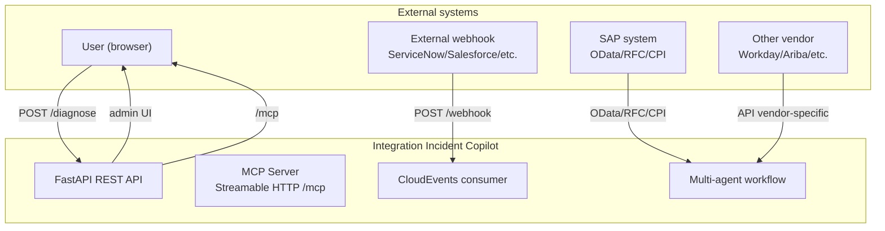
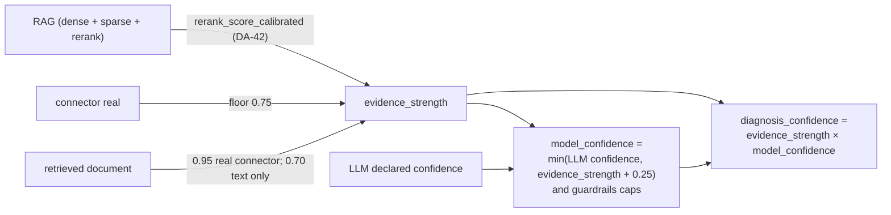
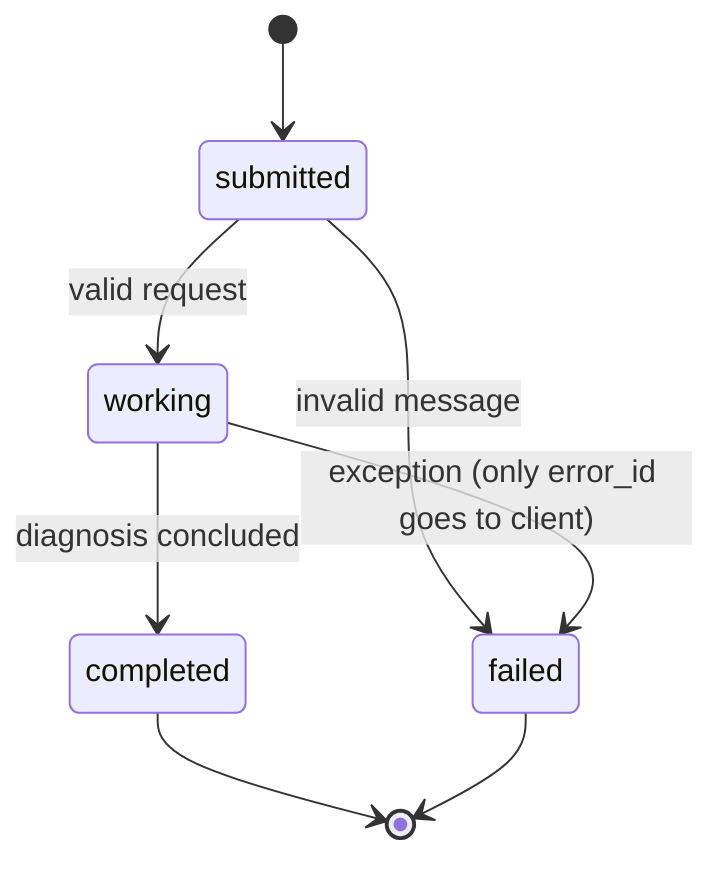
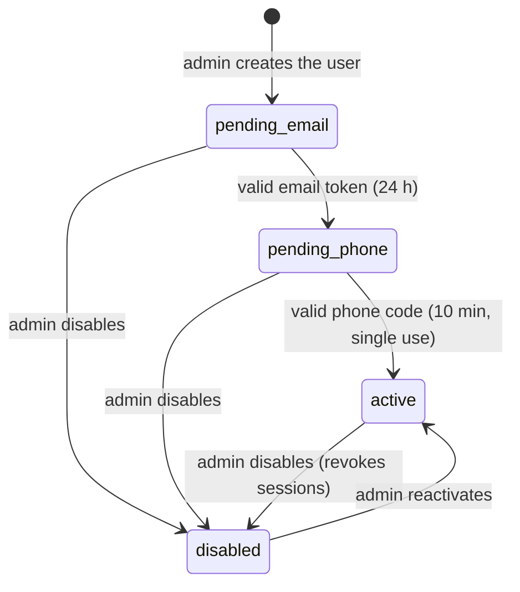
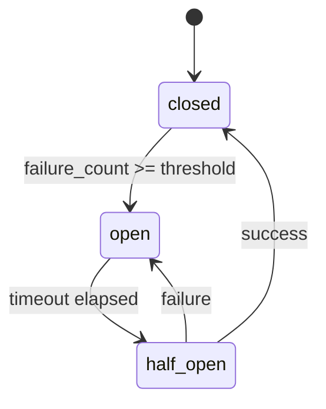
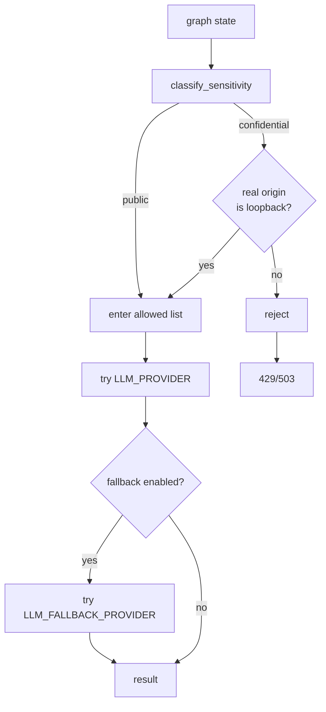
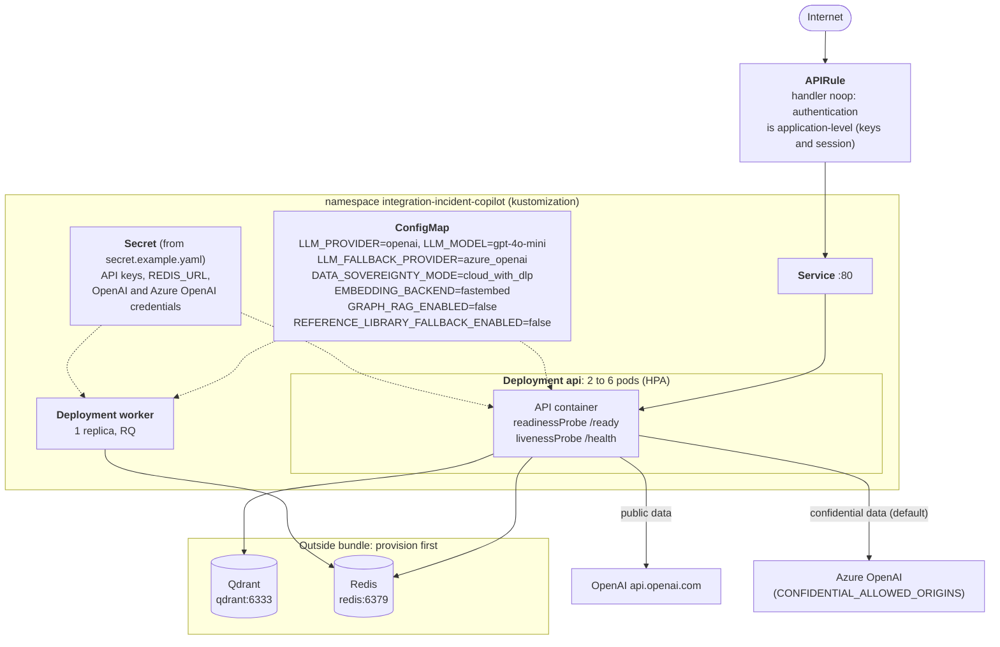

# Detailed Architecture

Technical view of what exists in the code today—not an aspirational plan.
For the "why" of each decision (real problems encountered and how they were
solved), see [`DECISOES_DE_ARQUITETURA.md`](../DECISOES_DE_ARQUITETURA.md);
this document is the "what" and "where".

> English translation of [`docs/ARCHITECTURE.md`](../ARCHITECTURE.md) · source commit `812800c` · [Português](../ARCHITECTURE.md)
> If this page and the Portuguese source differ, the code and the Portuguese source prevail.

## Diagrams map

Reviewed on 2026-10-07 validation. All diagrams are Mermaid; the C4
use C4 notation (Person, System, Container) drawn as `flowchart`,
because the Mermaid `C4Context` renderer overlays the labels. What
can be derived from code is **generated** or **verified by test**
(`tests/test_diagramas.py`), to not repeat the removed `docs/UC_*`,
which drew a non-existent graph.

| Diagram | Question it answers | Where | How it becomes correct |
|---|---|---|---|
| C4 level 1 - Context | who triggers the agent and where the data goes | [below](#c4-level-1---context) | manual review |
| C4 level 2 - Containers | what is deployed and with which protocol/credential | [below](#c4-level-2---containers) | manual review |
| Orchestration graph | how the multi-agent workflow flows | [below](#multi-agent-orchestration-graph-generated-from-code) | `tests/test_diagramas.py` |
| LLM routing | how the AI Gateway decides which provider to use | [below](#ai-gateway-routing-decision) | `tests/test_diagramas.py` |
| Evidence confidence | how confidence is calculated from sources | [below](#evidence-confidence-calculation) | manual review |
| Incident lifecycle | states and transitions of an incident | [below](#incident-lifecycle) | `tests/test_diagramas.py` |
| User status flow | states of a UI user activation | [below](#ui-user-da-55) | `tests/test_diagramas.py` |
| Circuit breaker | states of a connector or LLM provider | [below](#circuit-breaker-connectors-and-llm-providers) | `tests/test_diagramas.py` |

---

## C4 level 1 - Context

Source: `app/main.py`, `app/events/consumer.py`, `app/admin/routes.py`, `app/mcp/server.py`.



---

## C4 level 2 - Containers

Source: `docker-compose.yml`, `app/config.py`, `app/llm/factory.py`, `app/rag/retriever.py`.

| Container | Technology | Protocol | Credentials |
|---|---|---|---|
| Frontend | FastAPI + Jinja2 | HTTP/HTTPS | Bearer token (admin) |
| MCP | FastAPI + Streamable HTTP | HTTP/HTTPS | Bearer token (admin) |
| Agent | LangGraph + LangChain | internal | — |
| LLM provider | Ollama / OpenAI / Azure | HTTP/HTTPS | API key |
| Vector DB | Qdrant | HTTP/gRPC | API key (optional) |
| Graph DB | Neo4j | Bolt/HTTP | Username/password |
| Cache | Redis | TCP | Password (optional) |
| DB | PostgreSQL | TCP | Username/password |

---

## Multi-agent orchestration graph (generated from code)

Source: `app/agent/graph.py::build_graph`.

```mermaid
flowchart TD
    start["run_diagnosis"]
    supervisor["supervisor<br/>classify_domain: sap / saas / generic<br/>(deterministic, no LLM)"]
    connector["connector<br/>get_connector(interface_type)"]
    retrieve["retrieve<br/>hybrid RAG (dense + sparse)"]
    graph_enrich["graph_enrich<br/>GraphRAG (Neo4j, opt-in)"]
    sap_diagnose["sap_diagnose<br/>SAP specialist"]
    saas_diagnose["saas_diagnose<br/>SaaS specialist"]
    generic_diagnose["generic_diagnose<br/>generic specialist"]
    report["report<br/>assemble final answer"]

    start --> supervisor
    supervisor -->|agent_domain == "sap"| connector
    supervisor -->|agent_domain == "saas"| connector
    supervisor -->|agent_domain == "generic"| generic_diagnose
    connector --> retrieve
    retrieve --> graph_enrich
    graph_enrich --> sap_diagnose
    graph_enrich --> saas_diagnose
    sap_diagnose --> report
    saas_diagnose --> report
    generic_diagnose --> report
    report --> end["diagnosis result"]
```

---

## Evidence confidence calculation

Source: `app/agent/nodes.py::_compute_evidence_strength`.



**Caps applied to `model_confidence`, in code order:**

| Condition | Cap | Additional effect |
|---|---|---|
| always | `evidence_strength + 0.25` (`EVIDENCE_CONFIDENCE_MARGIN`) | — |
| connector returned fallback data (identifier not recognized) | 0.4 | prefix `[confidence limited - identifier not recognized…]` |
| no document, no connector, no rule | 0.3 | `matched_source` nullified |
| `matched_source` cited by LLM not in retrieved documents | 0.3 | `matched_source` nullified; escalation marks `abstained` |

`diagnosis_confidence` is a heuristic for
the UI bar; `evidence_strength` is the ground truth for
the quality gate (`tests/test_evidence_strength.py`).

---

## Incident lifecycle

Source: `app/admin/routes.py::registry_status`, `app/events/consumer.py`.



With `configuration.blocking=false`, the response returns in `working` and the
client polls with `tasks/get`.

---

## UI user (DA-55)

Source: constants `STATUS_*` of `app/webusers.py` and `PATCH /admin/api/users/{id}`.



---

## Circuit breaker (connectors and LLM providers)

Source: `app/circuit_breaker.py` (naming: `CircuitState` enum).



---

## AI Gateway routing decision

Source: `app/llm/gateway.py::invoke_via_gateway`.



---

## Hybrid inference - resilience fallback (DA-20)

Fourth item of the roadmap "Project evolution planned" (after AI Gateway/
Evidence Layer, A2A authentication closure and MCP server).
Criterion chosen: RESILIENCE, not routing by quality/complexity (the two
alternatives discarded—scaling by `evidence_strength` low, or routing by
case complexity before calling the LLM—cost a second LLM call in part of
the cases and require calibrating a threshold; resilience only kicks in
when the primary provider is genuinely unavailable).

`app/llm/factory.py::invoke_with_hybrid_fallback()` runs the call with
`settings.llm_provider` (Ollama, typically) and, IF
`settings.llm_fallback_provider` is configured (`.env`, empty by
default = same behavior as before this phase) AND the failure is of
TRANSPORT (`app/llm/factory.py::TRANSPORT_FAILURE_EXCEPTIONS`:
`ConnectionError`, `httpx.TransportError`—base of `ConnectError`,
`TimeoutException`, `ReadError`, etc.—and, with the SDK `openai`,
`APIStatusError` with `status_code` 503/504/429).

---

## RAG pipeline (dense + sparse + rerank)

Source: `app/rag/retriever.py::_retrieve_hybrid`.

1. query `incidents` index (sparse, BM25) and `sap_reference_library`
   (dense, Ollama embedding) in parallel;
2. merge/deduplicate pool sorting by dense cosine and pass candidates to
   **semantic reranker**
   (`cross-encoder/mmarco-mMiniLMv2-L12-H384-v1`, DA-29, via
   `sentence-transformers`), which reorders by real relevance to the pair
   `(query, chunk)`;
3. final admission uses `app/rag/retriever.py::_evidence_admission_score`
   (see DA-25 below).

**Ingestion:** idempotent by deterministic IDs
(`uuid5(NAMESPACE_URL, f"{document_id}::chunk::{chunk_index}")`, see
`app/rag/ingest.py`)—no delete-before-upsert. State
saved by content hash (`hash:filename`) instead of path, detecting
changes even with file renaming.

---

## GraphRAG (Neo4j) - opt-in, not in the path of
resilience

Source: `app/rag/graph_store.py`.

When `GRAPH_RAG_ENABLED=true`, the `graph_enrich` node queries Neo4j for
historical incidents with the same `interface_type` and `identifier`. The
result is appended to the prompt as `graph_history`. If Neo4j is down, the
graph enrichment is skipped (graceful degradation, DA-21).

**Coverage:** tests use fake driver (`FakeSession`, same pattern used in
HTTP connectors with `httpx.MockTransport`); validating against a real
Neo4j is left as the operator/author's next step, outside this development
environment.

---

## Multi-agent - supervisor + specialists by domain (DA-22)

Before this phase, a single node (`diagnose_node`) handled ANY
incident with a fixed persona of "SAP integration specialist"—incoherent
with this project's design principle that SAP is one connector among
equals, not the architectural axis (see Decision of Architecture #8/#13 in
`DECISOES_DE_ARQUITETURA.md`). An incident from a Salesforce webhook
received the same "OData/IDoc/RFC/CPI" expertise as an RFC incident.

**Decision:** a `supervisor_node` (`app/agent/supervisor.py`) runs
FIRST in the graph (even before `connector`) and classifies
deterministically the incident domain:

- `interface_type` in `{odata, rfc, cap, po}` -> `"sap"`
- `interface_type` in `{servicenow, salesforce, workday, ariba, successfactors}` -> `"saas"`
- anything else -> `"generic"`

The `agent_domain` routes the graph to `sap_diagnose`, `saas_diagnose` or
`generic_diagnose`. No LLM is used in the classification (DA-22).

---

## Rule engine (DA-33)

Source: `app/agent/rules.py::KNOWN_ERROR_RULES` (22 rules).

When `rule_engine_enabled=true` (default), the `sap_diagnose` node runs
the rule engine **before** calling the LLM. If a rule matches, the
diagnosis is returned immediately, bypassing the LLM. This reduces cost
and latency for known errors.

**Rule structure:**

```python
Rule(
    name="odata_401_unauthorized",
    pattern=r"401.*Unauthorized",
    domain="sap",
    interface_types={"odata"},
    confidence=0.95,
    solution="Check client credentials in the SAP system.",
)
```

---

## Evidence strength (DA-25)

Source: `app/agent/nodes.py::_compute_evidence_strength`.

| trust_level | Source |
|---|---|
| `system_observed` | Real connector (not mock) OR Rule Engine (DA-33) |
| `simulated` | Connector mock or fallback |
| `retrieved_document` | RAG chunk (Qdrant) or GraphRAG history |
| `web_untrusted` | Web search results (DuckDuckGo) |
| `user_reported` | Text description from the user (weakest) |

`evidence_strength` is a FLOAT (migration 002)—never use text predicates.

---

## LLM gateway policy (DA-27)

Source: `app/mcp/policy.py`.

- `capability_registry` is fail-closed (no match = no access)
- `interface_type` and `origin` are the only keys
- `verified` ≠ `verified_at` (don't coerce `diagnosis_correct` to True)

---

## Contract drift detection (DA-52)

Source: `app/contracts/`.

When a connector returns a response that doesn't match the contract
(unknown field, missing field, wrong type), the system records the drift
and opens an incident if the drift is `breaking`. Non-breaking drifts
are logged but don't open an incident.

**Contract states:**

| State | Description |
|---|---|
| `verified` | Response matches contract |
| `unverified` | Response doesn't match contract (new field) |
| `contract_drift` | Response doesn't match contract (missing field) |
| `contract_error` | Response doesn't match contract (wrong type) |

---

## Quality gates (DA-51)

Source: `app/evaluation/gates.py`.

- `implemented_das_documented` — every DA row in `CLAUDE.md` has a prose section
- `das_index_current` — index table in `DECISOES_DE_ARQUITETURA.md` matches the registered DAs
- `da_registered` — every DA referenced in `app/`, `scripts/`, `alembic/` has a `CLAUDE.md` row
- `prompt_digest_measured` — prompt in `app/agent/prompts.py` matches `data/eval/prompt_baseline.json`
- `connector_reachable` — every registered connector reaches each surface (registry, 2 Literals, routing domain in `data/skills/diagnose_incident.yaml` (DA-63; `apim` is generic by design), CLI, `CONNECTOR_TYPES`, UI dropdown, web-search seed, systems form) and the `Dockerfile` copies `data/skills/`
- `connector_coverage` — the 9th surface, `data/connector_coverage.yaml`, has its own gate (DA-58 coverage map consistency)
- `connector_validation_matrix` — `docs/ARCHITECTURE.md` covers every registered connector
- `candidate_das_fresh` — DAs marked "candidate" have no prose section yet

**Gate regex note:** the index-table header `| DA | Section | What it is |` is what
`app/evaluation/gates.py::check_index_current` matches. It does not match the
old `| Number | Title | Section |` header that was removed in this session.

---

## Connector coverage (DA-58)

Source: `data/connector_coverage.yaml`, `docs/COVERAGE_MAP.md`.

Each connector declares which products and mechanisms it supports:

| Connector | Products | Mechanisms |
|---|---|---|
| odata | 12 | 3 |
| rfc | 8 | 2 |
| servicenow | 5 | 2 |
| salesforce | 7 | 3 |
| workday | 4 | 2 |
| ariba | 3 | 1 |
| successfactors | 6 | 2 |
| cap | 2 | 1 |
| apim | 1 | 1 |
| po | 1 | 1 |

Total: 27 products × 9 mechanisms = 243 possible combinations; 167 covered
(68.7%); 76 uncovered (informativo, não reprova).

---

## Prompt engineering (DA-53)

Source: `app/agent/prompts.py`.

- `prompt_digest`/`prompt_version` NULL when rule engine terminates (invariant 21)
- Prompt text changes require promptfoo re-baseline (invariant 20)

---

## Migration notes

| Migration | Changes |
|---|---|
| 001 | Initial schema (incidents, evidence, llm_runtime_config) |
| 002 | `evidence_strength` FLOAT (migration 002) — never use text predicates (invariant 22) |
| 003-014 | Minor fixes and additions |
| 015 | `llm_runtime_config` extra fields (11 columns total) |
| 016 | `llm_runtime_config` timeouts |

---

## Invariants (do not break without DA)

Full list: see `CLAUDE.md` → "Invariantes que NÃO devem ser alterados
sem DA formal". Summary:

1. `RERANKER_MODEL` — always `cross-encoder/mmarco-mMiniLMv2-L12-H384-v1` (DA-29)
2. `rule_engine_enabled=True` by default (DA-33)
3. All LLM calls go through `llm/gateway.py` — never call `factory.invoke_with_hybrid_fallback` directly (invariant 3)
4. `_assemble_evidence()` never uses LLM self-assessment (DA-15/16, invariant 4)
5. `mcp/policy.py` is fail-closed (DA-27)
6. `classify_domain()` in `supervisor.py` is 100 % deterministic (DA-22)
7. `generic_diagnosis_node` exists for `agent_domain="generic"` — do not reuse `saas_diagnosis_node` (invariant 7)
8. Model name never appears in routing tables (invariant 8)
9. Capability is per **origin**, not per label (DA-45, invariant 9)
10. `llm_send_seed=None` = DA-2 active (seed=42); never read `None` as "don't send" (invariant 10)
11. `require_loopback=True` and `False` are mutually exclusive per route (invariant 11)
12. Incident ↔ system correlation is fail-closed on ambiguity (DA-50)
13. `verified` ≠ `verified_at` — don't coerce `diagnosis_correct` to True (invariant 13)
14. Quality gate runs **with the test suite** (DA-51)
15. Contract drift: four states; `unverified` never opens an incident (DA-52, invariant 15)
16. `system_contracts` is append-only, no FK (DA-52)
17. Only `breaking` drift opens an incident (invariant 17)
18. Fingerprint is never raw XML (invariant 18)
19. `get_sync_session_factory()` is keyed by URL; never cache `None` (invariant 19)
20. Prompt text changes require promptfoo re-baseline (DA-53, invariant 20)
21. `prompt_digest`/`prompt_version` NULL when rule engine terminates (invariant 21)
22. `evidence_strength` is FLOAT (migration 002) — never use text predicates (invariant 22)
23. New connectors require 9 surfaces (invariant 23)
24. `web_search_sources` is fail-closed with no code fallback (DA-57)
25. Coverage has 3 levels; `unknown` ≠ `none` (DA-58)

---

## Operational principles (AI agents)

When answering questions about this project, **always**:

1. **Be factual, not presumptive.** Do not assume behavior without checking the
   source code or documentation first. If you are unsure, say so explicitly and
   verify before proceeding.
2. **Use local artifacts as your primary evidence.** The authoritative sources are:
   - `app/` — current source of truth (not memory or prior knowledge)
   - `docs/DECISOES_DE_ARQUITETURA.md` — architecture decisions prose
   - `CLAUDE.md` — DA index + invariantes
   - `AGENTS.md` — this file
3. **Never be lazy or skip verification.** If a claim depends on a specific file,
   read it. If it depends on a config value, grep for it. If it depends on a
   migration, check `alembic/versions/`. Cite line numbers when possible.
4. **Distinguish between what you verified vs. what you infer.** When reasoning
   from patterns (e.g., "this likely follows the same convention as X"), state
   that explicitly — do not present inference as fact.

---

## Environment notes

- `.env` is mode-dependent (native vs container). In native mode use
  `127.0.0.1` for service hosts; in container mode the compose injects
  service names (`postgres`, `qdrant`, `neo4j`).
- `NEO4J_AUTH` only applies on **first initialisation** of the volume.
- `GRAPH_RAG_ENABLED=false` is the default flag.
- `EMBEDDING_BACKEND=fastembed` for CI RAG evaluation jobs without Ollama (DA-38).

---

## Evidence confidence calculation (continued from line 112)

Source: `app/agent/nodes.py::_compute_evidence_strength`.


**Caps applied to `model_confidence`, in code order:**

| Condition | Cap | Additional effect |
|---|---|---|
| always | `evidence_strength + 0.25` (`EVIDENCE_CONFIDENCE_MARGIN`) | — |
| connector returned fallback data (identifier not recognized) | 0.4 | prefix `[confidence limited - identifier not recognized…]` |
| no document, no connector, no rule | 0.3 | `matched_source` nullified |
| `matched_source` cited by LLM not in retrieved documents | 0.3 | `matched_source` nullified; escalation marks `abstained` |

`diagnosis_confidence` is a heuristic for
the UI bar; `evidence_strength` is the ground truth for
the quality gate (`tests/test_evidence_strength.py`).

---

## Deployment

### Local (`docker-compose.yml`)

| Profile | Services |
|---|---|
| (none) | `api`, `qdrant` |
| `observability` | `postgres`, `grafana`, `reporter` |
| `async` | `redis`, `worker` |
| `graphrag` | `neo4j` |
| `container-ollama` | `ollama` (default is native Ollama on host, via `host.docker.internal`) |
| `mailpit` | `mailpit` (development SMTP) |
| `messagepit` | `messagepit` |

All ports are published only on 127.0.0.1. The validated end-to-end
step-by-step guide is in `scripts/start-docker.sh`.

### SAP BTP Kyma (`deploy/kyma/`)



**What the diagram makes explicit:**

- **Actual LLM routing path.** With `SENSITIVITY_DEFAULT=confidential` (B-04) and the
  allowlist pointing only to Azure, `api.openai.com` receives only data
  classified as `public`. In practice, almost all incidents go to
  **Azure OpenAI**, the fallback, not to the primary `gpt-4o-mini`.
  Simulated in the 2026-10-07 validation with `_select_allowed_providers` and the
  ConfigMap configuration: `public -> [openai, azure_openai]`,
  `confidential -> [azure_openai]`. The "production model" evaluation must
  measure the Azure deployment.
- **No database.** The Secret does not include `DATABASE_URL`: in Kyma there is no
  recording of `incidents`, no `/admin`, no LLM registration.
- **Qdrant and Redis are not part of the bundle.** Without Qdrant, the readiness
  `/ready` returns 503 and the pod receives no traffic.
- **APIRule without gateway authentication.** Evolving to `jwt` with the
  IAS/XSUAA from the subaccount is open (APIRule v2).
- No manifest has been applied to a real cluster.

---

## LLM Gateway - why and how

See `app/llm/factory.py` and Architecture Decision #10 in `DECISOES_DE_ARQUITETURA.md`. In
one sentence: `Settings.llm_provider` decides between Ollama (default,
local-first, no API cost), OpenAI or Azure OpenAI, without the rest of
the code (`app/agent/nodes.py`, prompt, guardrails) needing to know which was
chosen - all implement the same `BaseChatModel` interface from
LangChain.

---

## Hybrid Inference - resilience fallback (DA-20)

Fourth item of the roadmap "Project evolution planned" (after AI Gateway/
Evidence Layer, A2A authentication closure and MCP server).
Criterion chosen: RESILIENCE, not routing by quality/complexity (the two
alternatives discarded—scaling by `evidence_strength` low, or routing by
case complexity before calling the LLM—cost a second LLM call in part of
the cases and require calibrating a threshold; resilience only kicks in
when the primary provider is genuinely unavailable).

`app/llm/factory.py::invoke_with_hybrid_fallback()` runs the call with
`settings.llm_provider` (Ollama, typically) and, IF
`settings.llm_fallback_provider` is configured (`.env`, empty by
default = same behavior as before this phase) AND the failure is of
TRANSPORT (`app/llm/factory.py::TRANSPORT_FAILURE_EXCEPTIONS`:
`ConnectionError`, `httpx.TransportError`—base of `ConnectError`,
`TimeoutException`, `ReadError`, etc.—and, with the SDK `openai`,
`APIStatusError` with `status_code` 503/504/429), it retries the
SAME call with the fallback provider before giving up. APPLICATION
ERROR (malformed JSON, invalid prompt) NEVER triggers the fallback—
running normally avoids masking a real bug behind a second
LLM call (unnecessary cost/latency). The diagnosis sub-agents (`sap_diagnosis_node`/`saas_diagnosis_node`/
`generic_diagnosis_node`, see DA-22 below) called this
directly in the DA-20 delivery (historical; today, since DA-26,
`app/agent/nodes.py::_run_diagnosis_agent` calls
`app/llm/gateway.py::invoke_via_gateway`, which applies policy/circuit
breaker/budget and is the ONLY entry point for LLM in the graph); which
provider actually responded is exposed in
`DiagnosisResponse.llm_provider_used` - transparency, not just a
silent fallback.

---

## Connectors - mock vs. real, today

All connectors now follow the SAME criterion: missing configuration = demo/mock mode; configuration present = real call. None require changing Python code to activate—only fill in variables in `.env`.

| Connector | Status today | Still missing |
|---|---|---|
| `ODataConnector` | **Real** (OAuth2 client_credentials + OData v2) when `ODATA_SERVICE_URL` configured — ⚠️ **NEVER validated against real instance** | A real CPI/Integration Suite tenant to validate against production |
| `RFCConnector` | **Real, validated against real ABAP Cloud Developer Trial** (A4H rel 754, `RFC_SYSTEM_INFO` via `pyrfc` 3.3.1 + SDK 7.50 PL19) | `BAPI_IDOC_STATUS` not available in Trial — create Z function or use real landscape to validate specific BAPI |
| `ServiceNowConnector` | **Real, validated against real ServiceNow PDI** (Table API via HTTP, Basic Auth) | None - second connector with end-to-end validation against real system |
| `SalesforceConnector` | **Real, validated against real Salesforce Developer Edition** (OAuth2 Client Credentials + SOQL) | None - first connector with end-to-end validation against real system, not just mock |
| `POConnector` | **Real** (Native Basic Auth + `/mdt/api/1.0/facade`) when `PO_BASE_URL` points to the exposed facade. ⚠️ **NON-PUBLIC API**: the Message Monitor is not in the Help Portal and varies between patches/releases, and the payload is read tolerantly because of this | Validate against a real PO/PI (7.5) and confirm path/format; the Alert Inbox (`/nwa/api/1.0/alerts`) has not been implemented yet |
| `WorkdayConnector` | **Real** (OAuth2 + REST) when `WORKDAY_TENANT` configured — ⚠️ **NEVER validated against real instance** | A real Workday tenant |
| `AribaConnector` | **Real** (OAuth2 + REST) when `ARIBA_BASE_URL` configured — ⚠️ **NEVER validated against real instance** | Access to Ariba Network/API Business Hub |
| `SuccessFactorsConnector` | **Real** (OAuth2 Client Credentials + OData v2 PerPerson) when `SFSF_BASE_URL` configured — ⚠️ **NEVER validated against real instance** (DA-34) | A real SuccessFactors tenant; in the SuccessFactors↔Workday reference scenario, only the Workday side was exercised |
| `CAPConnector` | **Real, validated against real SAP CAP** (OData v4 + XSUAA client_credentials, BTP Trial) | None - third connector with end-to-end validation against real system |
| `APIManagementConnector` | ⚠️ **Implemented with SPECULATIVE schema** (OAuth2 Client Credentials + endpoint assumed by analogy to similar products - NOT confirmed against real SAP API Management documentation) | Validate real Analytics API contract against a real tenant; fix endpoint/schema as needed |

**Note on the SuccessFactors↔Workday asymmetry (resolved in DA-34):**
the reference scenario "SuccessFactors↔Workday" was represented until
DA-29 ONLY by the Workday side. `SuccessFactorsConnector` was implemented in
DA-34 (commit `0e387d7`) via OAuth2 Client Credentials + OData v2 PerPerson
— see section "SuccessFactors EC - connector (DA-34)" below. The asymmetry
is closed.

"Real" here means: the production code (OAuth2 token fetch,
header assembly, response parsing) is actually exercised in
tests via `httpx.MockTransport` simulating each vendor's documented API. Validation against a real system is a separate claim per
connector, and the matrix above is the source: **RFC, ServiceNow, Salesforce and
CAP** were validated against real instances; **OData, Workday, Ariba,
SuccessFactors and PO/PI** were not (only `httpx.MockTransport`/cassettes);
**API Management** has a speculative schema. (historical; the original
text of this section said that no connector—not even RFC/Salesforce—had
a real tenant available, which stopped being true when the matrix
validations were done.) "Has connector" should never be read as "was
validated."

Why RFC (not just OData) matters for product positioning:
customers still on ECC on-premise, without BTP/Integration Suite, typically
only have RFC/BAPI as their automation channel—and this is the base of
customers who cannot adopt SAP AI Core (which requires HANA Cloud). See
[TCO_SAP_AI_CORE_VS_SELF_HOSTED.md](../TCO_SAP_AI_CORE_VS_SELF_HOSTED.md).

---

## RAG

Two Qdrant collections (`app/rag/ingest.py`) — `sap_incident_docs` and
the primary source of diagnosis; `sap_reference_library` only as
fallback (DA-17, see below):

- `sap_incident_docs` — troubleshooting documents (`.md`), hybrid
  search (dense + sparse BM25, RRF fusion)
- `sap_reference_library` — SAP technical PDFs (guides, notes, books),
  dense search; rich schema: `source`, `text`, `filename`, `page_number`,
  `document_id`, `chunk_index`, `file_hash`, `title`, `category`,
  `ingested_at` (parser: `pymupdf4llm`, preserves Markdown structure)

**Unified retrieval (`app/rag/retriever.py::_retrieve_unified`):**
(historical; v2.0 described parallel queries to both collections—
today it's sequential with fallback):

1. query `sap_incident_docs` by hybrid search
   (`app/rag/retriever.py::_retrieve_hybrid`, which ranks candidates
   by composite score `0.7 × cosine + 0.3 × normalized_rrf`);
2. only if no incident hit has cosine `>= score_threshold`
   query `sap_reference_library` (dense search) as fallback—this
   fallback can be disabled with `reference_library_fallback_enabled`;
3. merge/deduplicate pool by dense cosine and pass candidates to the
   **semantic reranker**
   (`cross-encoder/mmarco-mMiniLMv2-L12-H384-v1`, DA-29, via
   `sentence-transformers`), which reorders by real relevance to the pair
   `(query, chunk)`;
4. final admission uses `app/rag/retriever.py::_evidence_admission_score`
   (see DA-25 below).

**Ingestion:** idempotent by deterministic IDs
(`uuid5(NAMESPACE_URL, f"{document_id}::chunk::{chunk_index}")`, see
`app/rag/ingest.py`)—no delete-before-upsert. State
saved by content hash (`hash:filename`) instead of path, detecting
changes even with file renaming.

---

## GraphRAG (Neo4j) - opt-in, not in the default path

`app/rag/graph_store.py` implements what was previously just "reserved for
future use": records each completed diagnosis in Neo4j as a graph
(`Incident -AFFECTS-> Interface -RUNS_ON-> System`, `Incident
-HAS_ROOT_CAUSE_IN-> Document`) and queries this graph for previous
incidents in the SAME interface before generating a new diagnosis—
recurrence context ("this RFC destination already had 3 incidents
before, always for the same cause") that vector search in Qdrant doesn't
provide, because Qdrant finds the most similar KNOWLEDGE document, not the
RELATIONAL history of a specific interface.

Continues **disabled by default** (`GRAPH_RAG_ENABLED=false`)—the
decision to keep it this way hasn't changed (see Architecture Decision #9): the
Qdrant already solves the main use case, and the graph only adds value
after months of accumulated real history, not with the 15 demonstration
documents in this repository (`data/sample_docs/`; were 8 when this
section was written). The difference compared to before this
phase is that now **real, tested code exists** (with fake driver, see
`tests/test_graph_store.py`), ready to be turned on when it makes sense:

1. `docker compose --profile graphrag up -d neo4j` (doesn't start with
   `docker compose up` default—dedicated profile, see `docker-compose.yml`)
2. `GRAPH_RAG_ENABLED=true` in `.env`

There is no manual step 3: since Architecture Decision #19 (DA-21),
`ensure_constraints()` runs automatically in the FastAPI `lifespan` when the
flag is on (see `app/main.py`)—the old
`uv run python -m app.rag.graph_store --init` is still available for
manual/explicit use, but is no longer mandatory.

There's nothing to uncomment in Python—just this flag + the actual infrastructure
to exist. With the flag off, `build_graph()` builds exactly the same
sequence of nodes as before this phase (see `app/agent/graph.py`),
zero cost. **Not validated against a real Neo4j** (no Docker daemon
available in the environment where this was built)—same honest caveat
as `RFCConnector._fetch_real`.

### Operational hardening (DA-21): graceful degradation, dedup and cleanup

Turning on GraphRAG means Neo4j is now in the critical path of
EACH diagnosis (`graph_enrich_node` before, `graph_write_node`
after—see `app/agent/graph.py`). Without care, a momentary
Neo4j instability (restart, network, pool exhausted) would bring down
the entire diagnosis due to a layer that should be just an
enrichment, not a hard dependency. Three reinforcements, all
covered by test with fake driver (`tests/test_graph_store.py`,
`tests/test_nodes_graph_degradation.py`):

- **Graceful degradation by exception type** - `GRAPH_UNAVAILABLE_EXCEPTIONS`
  (`neo4j.exceptions.DriverError` + `TransientError`) precisely defines
  what counts as "infrastructure unavailable now, proceed without graph": connection
  refused, timeout, server restarting. `graph_enrich_node` falls back to
  "no history" (`graph_history: []`) and `graph_write_node` skips the
  write, both logging a `warning`—the main diagnosis (RAG +
  LLM) continues intact. Deliberately NOT including `Neo4jError` in general:
  a `ConstraintError`/`CypherSyntaxError` signals a BUG OF OURS
  (wrong Cypher or schema), not infrastructure unavailability, and continues
  propagating normally—the same principle that separates transport
  failure from application error in Hybrid Inference (DA-20).
- **Formatting with deduplication by recurrence** -
  `format_graph_context_for_prompt()` groups CONSECUTIVE occurrences
  of the same root cause into a single line with a counter ("already occurred 3x"),
  instead of repeating the same line and wasting prompt budget on a
  "flapping" interface (failing repeatedly for the same cause).
  Grouping is only between neighbors—the list already comes most-recent-first,
  and an intercalated different cause breaks the grouping, to not
  hide that something different happened in between.
- **Manual cleanup utility** - `prune_ungrounded_hypotheses()`
  (CLI: `--prune-ungrounded --older-than-days N`, default 90) removes
  UNCONFIRMED hypotheses (`is_grounded=false`) that are old, which only
  accumulate noise in the graph without ever having been corroborated. Incidents
  with confirmed root cause (`is_grounded=true`) are never touched, under
  any age. It's explicit operator maintenance—never called
  automatically by any node or by the `lifespan`, same principle of
  "nothing is deleted without the operator asking" used elsewhere in this
  project.

**Explicit non-goal of this phase**: none of the three changes above
was validated against a real Neo4j (same environment limitation as
the other real integrations in this project—no Docker available where
this was built). Test coverage is with fake driver
(`FakeSession`, same pattern used in HTTP connectors with
`httpx.MockTransport`); validating against a real Neo4j is left as the
operator/author's next step, outside this development environment.

---

## Multi-agent - supervisor + specialists by domain (DA-22)

Before this phase, a single node (`diagnose_node`) handled ANY
incident with a fixed persona of "SAP integration specialist"—incoherent
with this project's design principle that SAP is one connector among
equals, not the architectural axis (see Architecture Decision #8/#13 in
`DECISOES_DE_ARQUITETURA.md`). An incident from a Salesforce webhook
received the same "OData/IDoc/RFC/CPI" expertise as an RFC incident.

**Decision:** a `supervisor_node` (`app/agent/supervisor.py`) runs
FIRST in the graph (even before `connector`) and classifies
deterministically the incident domain:

- `interface_type` in `{odata, rfc, cap, po}` -> `"sap"`
- `interface_type` in `{servicenow, salesforce, workday, ariba,
  successfactors}` -> `"saas"`
- without `interface_type` (free-text flow): SAP keyword in
  description (`idoc`, `iflow`, `cpi`, `rfc`, `bapi`, `abap`, `btp`,
  etc.) -> `"sap"`; otherwise -> `"generic"`

The classification is CODE, not an LLM call—the same principle already
applied to confidence guardrails (DA-15): cheap, deterministic structural
decision, 100% testable without AI infrastructure. `app/agent/graph.py::_route_to_specialist` reads `agent_domain` from
the state and routes the graph (via `add_conditional_edges`) to ONE of
the three specialist sub-agents—never more than one in the same incident,
without duplicating LLM call cost:

- `sap_diagnosis_node` - SAP persona (OData, IDoc, RFC, CPI/Integration
  Suite, BTP)
- `saas_diagnosis_node` - multi-vendor persona (ServiceNow,
  Salesforce, Workday, Ariba, SuccessFactors, REST/OAuth2 APIs in general)
- `generic_diagnosis_node` - generic integration persona
  (`app/agent/prompts.py::GENERIC_INTEGRATION_PERSONA`) for
  `"generic"` (no domain identified). (historical; in the DA-22 delivery
  there were two sub-agents and `"generic"` fell to
  `saas_diagnosis_node`.) Missing `agent_domain` still falls to
  `saas_diagnose` (`app/agent/graph.py::_route_to_specialist`).

The sub-agents share the same core (`_run_diagnosis_agent`
in `app/agent/nodes.py`)—ReAct agent, Hybrid Inference (DA-20),
JSON parsing and confidence guardrails (DA-15) remain
IDENTICAL; the only difference between them is the persona/expertise injected
into the prompt. Which domain was used is exposed in
`DiagnosisResponse.agent_domain` (same transparency philosophy as
`llm_provider_used`, DA-20) and appears in the final Markdown report.

**Validation:** `tests/test_supervisor.py` (pure classification, no
LLM) and `tests/test_nodes_multiagent.py` (each sub-agent receives the
right persona, the conditional routing sends to the right node—
including the safety case where missing `agent_domain` falls to
`saas_diagnose` instead of breaking—and `agent_domain` reaches
`DiagnosisResponse`), all mocking the LLM call
directly (no real Ollama, same pattern as `test_llm_factory.py`;
historical: `invoke_with_hybrid_fallback` in DA-22, `invoke_via_gateway`
since DA-26).
`build_graph()` was manually verified by successfully compiling in
both modes (GraphRAG on/off), confirming the expected nodes
in the resulting graph.

---

## Running without depending on external infrastructure

The `docker-compose.yml` at the root of this repository starts, in the
`docker compose up -d` default, only the API + Qdrant. Ollama runs on the host
by default (the API reaches it via `host.docker.internal`); the container
`ollama` is optional, in the `container-ollama` profile. Neo4j (profile
`graphrag`), Redis + worker RQ (profile `async`) and observability
(Postgres/Grafana, profile `observability`) are in optional profiles.
Langfuse is external (`LANGFUSE_HOST`)—there is no Langfuse service in
the compose. (historical; the original text of this section said the compose
starts Ollama + Qdrant + API and the full Langfuse stack.) This
matters because this project also works
as a demonstration for third parties (customer, interviewer)—who don't
have, nor should they need to set up, the development environment just
to run the project once. Langfuse, Neo4j and optional infrastructure:
without the keys/configuration, the app runs normally, just without tracing/
GraphRAG.

---

## A2A (Agent2Agent) - external interoperability

`app/a2a/` implements the proposal archived in
the original A2A layer proposal (internal document, outside the repository)
(read that document for the complete business context and the caveat
about the inbound Joule GA, planned for Q4/2026 and not yet
available). In technical summary:

- **Agent Card** (`app/a2a/agent_card.py`), published at
  `GET /.well-known/agent-card.json` (standard A2A protocol path)
- **Task manager** (`app/a2a/task_manager.py`) - translates an A2A
  message into `IncidentRequest` and calls `run_diagnosis()`, the SAME
  function used by `/diagnose` REST; no duplicate diagnosis logic
- **JSON-RPC 2.0 server** (`app/a2a/server.py`), mounted at
  `POST /a2a`, with methods `message/send` and `tasks/get`

Deliberate simplification: of the 8 task states that the A2A protocol
defines, only the 4 that this synchronous, self-contained agent actually
reaches are implemented (`submitted -> working -> completed|failed`)
- `input_required`/`auth_required`/`canceled`/`rejected` don't apply
to an agent that doesn't request additional data mid-process nor has
interactive authorization flow. Authentication is a static key via
header (`A2A_API_KEY`). Since DA-18, this key NEVER stays empty in
memory: if it doesn't come from `.env`, `app/main.py::_ensure_api_keys_configured`
generates a random one at startup and logs a warning—the endpoint never
silently opens. An OAuth2/JWT key between agents remains
the real production gap (would require an interoperable authorization
flow between agents from different vendors), not a hidden limitation.

Tested with FastAPI `TestClient` + a stub `diagnosis_fn` injected into the
`TaskManager` (same dependency injection pattern as HTTP connectors)—
includes a test that proves an orchestration failure becomes a
task with `status.state == "failed"`, not an HTTP 500 error, which is the
correct behavior of an A2A agent (business error, not transport).

---

## MCP (Model Context Protocol) - capability catalog, not just "connect an LLM to a tool"

`app/mcp/server.py` exposes the Copilot as MCP SERVER (not client—
explicit decision, see module docstring for the discarded alternative
reading), mounted at `POST /mcp/` (with trailing slash—`app.mount()`
redirects 307 from `/mcp` without slash, standard Starlette behavior,
not MCP-specific). Third item of the roadmap "Project evolution planned",
after minimal AI Gateway/Evidence Layer (DA-15/
16/17) and A2A authentication closure (DA-18)—the MCP
specification in 2026 is moving toward stateless scaling, capability catalog
cache and enterprise authorization, which brings MCP closer to production
infrastructure rather than an isolated protocol.

Two tools, both READ-ONLY ("read first"—the roadmap is
explicit about this):

- `diagnose_incident` - calls the SAME `run_diagnosis()` used by
  `/diagnose` and `/a2a`; no duplicate diagnosis logic for the third time.
- `list_connectors` - inspects `settings` (no network calls) and reports,
  by `interface_type`, whether the connector is configured for real
  data or operates in demo/mock mode.

Authentication: reuses `settings.api_key` (the SAME X-API-Key from
`/diagnose`, DA-18) via `RequireApiKeyMiddleware`, a simple ASGI
middleware—the MCP SDK offers `AuthSettings`/`TokenVerifier` (OAuth2)
for real enterprise authorization, but that would be over-engineering
given that REST and A2A already use static API key; maintaining a single authentication
mechanism across the entire HTTP surface instead of two.

Implementation detail worth noting (caught a real test in this phase): `StreamableHTTPSessionManager.run()`—which manages MCP sessions—
can only be called ONCE per process instance; therefore its lifecycle
enters the FastAPI root app `lifespan` (`app.mount()`
does NOT propagate lifespan events to sub-apps automatically), and
therefore the tests in `tests/test_mcp.py` use a SINGLE
`with TestClient(app) as ...` for the entire suite of that file.

---

## Event Mesh - event-driven ingestion (DA-23)

Until this phase, the Copilot only reacted to EXPLICIT calls: `POST
/diagnose` human, A2A message, or MCP tool call. Closing the sixth
item of the consolidated architectural roadmap, `POST /events/incident`
(`app/main.py` + `app/events/`) allows an external monitoring
system (CPI, Solution Manager, a queue/IDoc listener) to trigger the
diagnosis automatically, publishing an event instead of waiting
for someone to call the API.

**Event format:** [CloudEvents](https://cloudevents.io/) 1.0, structured
mode—`specversion`/`type`/`source`/`id` mandatory, `time`
optional, plus `data` (validation 2026-10-07: `id` and `source` were optional
and `specversion` didn't exist; deduplication now uses the pair
`source`+`id`, as the specification defines)—the same format that SAP Event
Mesh uses in **REST/Webhook push subscription** mode (besides native
AMQP 1.0). `data` carries exactly the same fields as
`IncidentRequest` (the information is the SAME a human would type in
`/diagnose`, just generated automatically). Today only one `type` is
recognized—`com.sap.integration.incident.detected.v1`—modeled
as `Literal` in `IncidentEventEnvelope` (`app/models/models.py`): any
other value is rejected with `422` automatically by Pydantic, instead
of trying to silently interpret a payload of unknown format.

**Why webhook and not an AMQP consumer:** it's not a shortcut to avoid
setting up a real broker—webhook is a FIRST-CLASS delivery mode of
SAP Event Mesh itself, documented alongside
AMQP, and it's the only one that can be exercised end-to-end with real
tests (TestClient HTTP) without depending on external infrastructure—the same
pragmatic logic already applied to GraphRAG (DA-21) and MCP (DA-19).

**Auth decision:** `X-Event-Mesh-Api-Key` is a DEDICATED key,
separate from `X-API-Key` (`/diagnose`) and `X-A2A-Api-Key` (`/a2a`)—
same automatic generation pattern at startup if not configured
(DA-18). Deliberate isolation: the webhook secret is normally configured
in an external monitoring system (outside the direct control
of this project), so a leak there shouldn't compromise the
other two access channels.

`app/events/consumer.py::handle_incident_event()` converts the event to
`IncidentRequest` and calls the SAME `run_diagnosis()` used by
`/diagnose` and the A2A layer—no duplicate diagnosis
logic, just another entry point.

**Update (2026-10-07):** the webhook today calls
`app/events/consumer.py::handle_incident_event_async` and responds `202`
without waiting for the LLM: with `REDIS_URL`, the 202 only comes after the event
is recorded in the RQ queue (durable); without `REDIS_URL` (dev), the diagnosis runs
in `BackgroundTasks` in the web process (not durable). Enqueue failure
returns `503`, for the publisher to retry.

**Explicit non-goal of this phase:** real async/queue
processing (historical; in the DA-23 delivery it was synchronous—the webhook only
returned when the diagnosis finished; today it's async, see
update above) and
direct consumption of AMQP from SAP Event Mesh—**delivered in DA-32** (see section
"Async AMQP 1.0 consumer via Solace Cloud" below, commit `67b78e8`).

**Validation:** `tests/test_events.py` covers the event mapping ->
IncidentRequest, the call to `run_diagnosis()`, authentication (401 without
key/wrong key), rejection of unknown `type` (422), description length limit
(422, same rule as `/diagnose`) and automatic key generation at startup—all
with `run_diagnosis` mocked, without relying on real Ollama/Qdrant.

---

## Production deployment - SAP BTP Kyma Runtime (DA-24)

Closes the last item of the consolidated architectural roadmap of this project.
`deploy/kyma/` (manifests + `README.md` with its own step-by-step)
contains a Deployment (2 replicas, liveness at `/health` and readiness at
`/ready`—historical; in the delivery both probes used `/health`—,
non-root user), Service, HorizontalPodAutoscaler (2-6 replicas per CPU),
ConfigMap (non-sensitive config) and a `secret.example.yaml`—TEMPLATE,
never applied directly, with all values prefixed with `CHANGE-ME` (tested in
`tests/test_kyma_manifests.py::test_secret_example_has_no_real_looking_values`).

**APIRule** (Kyma API Gateway module) exposes the Service via Istio
Gateway managed, with `accessStrategy: noop`—the Copilot already has its
own authentication by API key at each endpoint (DA-18/DA-23), so
it doesn't duplicate authentication at the network layer. Evolving to `jwt`
(validating BTP XSUAA tokens) would be the natural evolution of a
deeper integration with BTP services (Destination service,
XSUAA)—scope explicitly discarded in this phase in favor of just
packaging the deployment (see scope decision in `DECISOES_DE_ARQUITETURA.md`, ### 22).

**Corrections made to the `Dockerfile` in the same phase** (discovered while
reviewing packaging for production, corrected at the source instead of
just circumvented in the manifests—same principle of "no technical debt"
applied throughout the session):

- `COPY pyproject.toml uv.lock` + `uv sync --frozen` - reproducible
  build (before, `uv sync` without lockfile in build resolved against
  the most recent versions compatible with `pyproject.toml`, not against
  the locked versions committed)
- non-root user (`appuser`, uid 1000)—security best practice
  for clusters with restrictive PodSecurityStandards
- `CMD` calls `.venv/bin/uvicorn` directly—corrects at the source the bug
  documented in `docs/DEPLOY.md` (`uv run` resyncing dev dependencies
  at each start, bringing down the container in restricted networks);
  `docker-compose.yml` no longer needs the `command:` override that
  circumvented this

**Explicit non-goals of this phase** (same honesty already applied
to GraphRAG/DA-21 and MCP/DA-19): no manifest was validated against
a real Kyma cluster (no cluster accessible in this development
environment)—the APIRule CRD schema has changed version more than
once in Kyma history, so the `apiVersion` used must be
checked against the target cluster before actually applying; no
Docker image build/push was tested (Docker not available in this
environment); Qdrant and Neo4j (GraphRAG, which continues opt-in) are not
deployed by this bundle—they are external prerequisites, documented
in `deploy/kyma/README.md`.

> **Update (2026-10-18).** The record above dates from when DA-24 was
> written. Since then the image has been built (Compose scenario) and the
> bundle has been applied to real Kubernetes (k3d) through the `deploy/local/`
> overlay, with rollout, probes, in-Pod ingest, `/diagnose` via the rule engine
> and the local LLM, and the HPA scaling. Evidence:
> `docs/EVIDENCIA_K3D_2026-10-18.md`; reproduction:
> `docs/TUTORIAL_K3D_KUBERNETES_LOCAL.md`. Still unvalidated: what is specific
> to managed Kyma — `APIRule`, Istio and BTP OIDC.

**Validation:** `tests/test_kyma_manifests.py` (11 tests) ensures that
all YAML in the bundle is syntactically valid and internally consistent
—same namespace in all namespaced resources, health probes without
authentication (never an authenticated endpoint, to avoid getting stuck in
`CrashLoopBackOff` due to missing Secret)—liveness at `/health` (process
alive, no external IO) and readiness at `/ready` (503 when a configured
service is degraded; historical: in the delivery both used
`/health`), Pod running non-root, HPA/APIRule
pointing to the correct Deployment/Service, and the `kustomization.yaml`
referencing only files that exist (deliberately excluding the
Secret template).

**Follow-up post-DA-24 - multi-stage build of frontend in `Dockerfile`:**
DA-24 touched the `Dockerfile` twice (reproducibility and non-root user)
but let pass a debt already self-acknowledged in
`docs/DEPLOY.md` ("Pending improvement: move this to a multi-stage
build in Dockerfile"): the image copied `static/` ready (`COPY static/
static/`), but `static/dist/` (the React/Vite frontend build) is in
`.gitignore` and only existed if someone manually ran `npm run build`
+ `cp` before `docker build`—a clean `git clone` followed by
`docker build -t ... .` (exactly step 1 of `deploy/kyma/README.md`)
would fail or generate an image without frontend. Corrected with a second
stage (`node:22-slim AS frontend-build`) that runs `npm ci && npm run
build` from the source code in `frontend/`, and the final stage copies
`frontend/dist` to `static/dist` via `COPY --from=frontend-build`.
`docs/DEPLOY.md` section 2 updated to reflect that there is no longer a manual step;
`.dockerignore` added (didn't exist) to avoid sending
`frontend/node_modules/`, `.venv/` and `.git/` to the build context.
Validated by running `npm ci && npm run build` in isolation (produces the
expected `dist/`: `assets/`, `favicon.svg`, `icons.svg`, `index.html`)—
the full image build itself was not tested (Docker not available
in this environment, same limitation already recorded above).

Along with this fix, a second problem found in the same review was
corrected: the default LLM model was inconsistent between
`app/config.py` (`qwen3-coder-next:latest`, canonical source) and
`.env.example`/`docker-compose.yml` (both `qwen2.5-coder:32b`)—the
two files aligned to the canonical value of `config.py`.

---

## Evidence/Trust Layer + RAG threshold correction (DA-25)

A second external architectural review, done after the consolidated roadmap
(AI Gateway → A2A → MCP → Hybrid Inference → GraphRAG →
Multi-agent → Event Mesh → BTP/Kyma), pointed to a prioritized backlog
(P0-P3). This phase addresses the two remaining P0 items (the other two,
Docker multi-stage and `uv.lock`, were already corrected—see section
"Post-roadmap follow-up" above).

**1. RAG threshold applied too early (before reranker).**
`app/rag/retriever.py::_retrieve_hybrid` discarded candidates with
dense cosine below `score_threshold` (0.5) BEFORE the cross-encoder
(reranker) had any chance to evaluate true semantic relevance—
a document with excellent BM25/RRF (exact term match,
e.g., "IDoc status 51") but moderate cosine (e.g., 0.47) was discarded
without ever reaching the reranker. Corrected by inverting the order:

```
dense + sparse -> RRF -> candidate pool -> cross encoder -> evidence threshold -> top K
```

- `_retrieve_hybrid` now only discards extreme semantic noise
  (`MIN_CANDIDATE_FLOOR = 0.05`), not the real confidence
  threshold; the RRF fusion candidate pool also grew
  (`fusion_limit = max(top_k * 5, HYBRID_PREFETCH_LIMIT)` instead of
  `limit=top_k`), because before the Qdrant itself truncated the fusion
  to only `top_k` results before any filtering—the reranker
  never saw more candidates than the final result would have anyway.
- `_retrieve_unified` now reranks the ENTIRE candidate pool
  (even when there's only 1, the central case of the reported bug) and only AFTER
  applies the confidence decision, via `_evidence_admission_score()`: a
  hit is admitted if the cosine OR the `rerank_score` (clamped to
  [0, 1], same convention already used in `_compute_evidence_strength`)

  que antes eram descartados cedo demais e agora entram no pool do
  reranker.
- Validado com `tests/test_retriever_evidence_threshold.py` (8 testes,
  mockando os limites de infraestrutura - Qdrant/reranker - sem
  depender de infra real): cobre o caso central (cosseno fraco +
  rerank forte -> admitido), o caso de controle (ambos fracos ->
  rejeitado) e os dois ramos do fallback de `reference_library`.

**2. Evidence/Trust Layer.** A resposta do diagnostico (`DiagnosisResponse`)
ganhou um campo `evidence: list[Evidence]` (`app/models/models.py`) - uma
entrada por fonte REAL consultada nesta execucao (conector, RAG,
GraphRAG, busca web, descricao do usuario), cada uma com um
`trust_level` decidido pelo TIPO da fonte:

```
system_observed (conector real)
  > retrieved_document (RAG/GraphRAG)
  > web_untrusted (busca web, nao curada)
  > user_reported (descricao do usuario, nunca verificada)
```

(`simulated` substitui `system_observed` quando o conector retornou
dado mock/fallback.) A lista e montada de forma inteiramente
DETERMINISTICA em `app/agent/nodes.py::_assemble_evidence(state)` - o
LLM nunca declara/cita suas proprias fontes, mesmo principio ja usado
em `evidence_strength` (DA-15) e nos demais guardrails deste projeto
("guardrails em codigo, nao em prompt", DA-3 em `DECISOES_DE_ARQUITETURA.md`).
`_assemble_evidence` e chamada tanto em `report_node` (para a nova
secao "Evidencias" do `report_markdown`) quanto em
`graph.py::run_diagnosis` (para popular `DiagnosisResponse.evidence`)
- funcao pura e barata, entao chamada duas vezes em vez de adicionar
mais uma chave ao `CopilotState` so pra passar o mesmo dado adiante.

Isso resolve diretamente o ponto mais forte da revisao externa: antes,
a resposta era "o LLM deu uma resposta"; agora e "o LLM produziu uma
hipotese sustentada por evidencias rastreaveis", cada uma com uma
fonte e um nivel de confianca explicitos - pre-requisito arquitetural
citado pela propria revisao para quando o MCP ganhar tools de
ESCRITA (prompt injection deixa de ser so um problema de qualidade de
resposta e passa a ser um problema de autorizacao operacional).

**Nao-objetivo desta fase:** a Evidence/Trust Layer, sozinha, ainda
nao incluia o modelo `VERIFIED_AS` (verificacao humana/sistema
separada da hipotese do LLM) proposto pela revisao para o GraphRAG -
implementado depois, como item proprio (ver secao "GraphRAG - modelo
VERIFIED_AS (DA-28)" abaixo).

Validado com `tests/test_evidence.py` (13 testes) - cada fonte
isoladamente, a combinacao de todas, validacao do modelo `Evidence`
contra os dicts montados por `_assemble_evidence`, e a secao nova do
`report_markdown`.

## AI Gateway v1 - policy, circuit breaker e budget (DA-26)

Terceiro item da segunda revisao arquitetural externa (P1): o "LLM
Gateway" existente (`app/llm/factory.py`) era, tecnicamente, so um LLM
Provider Factory / Abstraction Layer - decidia QUAL `BaseChatModel`
instanciar, mas nao tinha, de forma centralizada, policy, budget nem
circuit breaker de verdade. `app/llm/gateway.py` (novo) adiciona essas
tres coisas SOBRE a Hybrid Inference ja existente (DA-20) - auth
continua na borda HTTP (X-API-Key por endpoint, DA-18/DA-23), nao
duplicada aqui.

`app/agent/nodes.py::_run_diagnosis_agent` (usado pelos dois
sub-agentes especialistas, DA-22) agora chama
`gateway.invoke_via_gateway()` em vez de
`factory.invoke_with_hybrid_fallback()` diretamente - e o UNICO ponto
de entrada de chamada LLM no grafo.

**1. Data Classification + Policy Routing.** Todo incidente e
classificado deterministicamente (`classify_sensitivity`, mesmo sinal
ja usado em `evidence_strength`/DA-15 e no Evidence/Trust Layer/DA-25:
dado real de conector, nao mock/fallback) como `confidential` ou
`public`. Dado `confidential` NUNCA pode ser roteado para um provider
cloud (`openai`/`azure_openai`) - nem como fallback. Isso fecha um gap
real: o setup default de Hybrid Inference e primario=`ollama` (local)
+ fallback=`openai`/`azure` (cloud) - sem esta policy, um Ollama fora
do ar faria um incidente com dado real de producao SAP vazar para um
provider externo. Se a policy nao deixa nenhum provider candidato (ex:
`llm_provider="openai"` sem fallback local configurado, e o incidente
e confidencial), a chamada falha explicitamente com
`PolicyViolationError` - nunca silenciosamente tenta cloud mesmo
assim. (historico: texto da v1.)

**Atualizacao (2026-10-07):** hoje
(`app/llm/gateway.py::classify_sensitivity`, DA-39/DA-43) o default e
`confidential` (`settings.sensitivity_default`) - texto livre pode
conter dado que a redacao por regex nao reconhece; dado real de
conector ou `pii_detected` tambem dao `confidential`. A classificacao
declarada pelo cliente so ELEVA, nunca rebaixa. A decisao de roteamento
e pela ORIGIN real do destino, nao pelo rotulo do provider: dado
`confidential` so vai para cloud com `DATA_SOVEREIGNTY_MODE=cloud_with_dlp`
E a origin listada em `CONFIDENTIAL_ALLOWED_ORIGINS`; sem isso, so
providers locais (fail-closed).

**2. Circuit Breaker.** `CircuitBreaker` (in-memory, por provider, por
processo) substitui o try/except direto da DA-20: depois de
`settings.llm_gateway_circuit_failure_threshold` (default 3) falhas de
transporte CONSECUTIVAS, o provider fica "aberto" por
`settings.llm_gateway_circuit_cooldown_seconds` (default 30s) -
chamadas seguintes pulam esse provider sem tentar, em vez de esperar o
mesmo timeout de rede de novo contra algo que ja sabemos que esta
fora. Reseta para fechado no primeiro sucesso. (historico; desde a
DA-41 o estado e compartilhado entre replicas via Redis -
`app/circuit_breaker.py` - com fallback automatico para memoria quando
`REDIS_URL` esta vazia ou o Redis esta fora.)

**3. Budget.** `_estimate_cost_usd` estima o custo (heuristica de
~4 caracteres/token x tabela de preco aproximada por provider -
`ollama` sempre `0.0`) ANTES de cada chamada; se ultrapassar
`settings.llm_gateway_max_cost_usd` (default 0.50, deliberadamente
permissivo - existe pra pegar um caso patologico, nao pra orcamento
fino de producao), a chamada e rejeitada com `PolicyViolationError`
sem nunca invocar o provider.

**4. Audit log.** Uma linha de log estruturado por tentativa
(`logger.info`/`warning`, nunca `print`) com provider, sensibilidade,
decisao (`status=success|failure|circuit_open|budget_rejected`),
latencia e custo estimado.

**Nao-objetivos explicitos desta v1** (backlog em aberto): IAM/auth (ja resolvido na borda HTTP, nao
duplicado aqui); PII/DLP de verdade (um scanner de dados sensiveis no
CONTEUDO do prompt - `sanitize_untrusted_input` protege contra prompt
injection, nao e a mesma coisa que um scanner de PII); tenant
isolation (projeto ainda single-tenant). O item "circuit breaker
compartilhado entre replicas" tambem estava nesta lista (in-memory por
processo, os 2+ pods do deploy Kyma nao compartilhavam o estado) -
**resolvido na DA-41** (backend Redis, fallback em memoria).

Validado com `tests/test_llm_gateway.py` (20 testes) - policy de
roteamento, circuit breaker (abre/fecha/expira cooldown, isolado por
provider) e budget, sem depender de nenhum provider real (mesmo padrao
ja usado em `test_llm_factory.py` para `invoke_with_hybrid_fallback`).

## Capability Registry + Agent Execution Policy (DA-27)

Ultimo item P1 da segunda revisao arquitetural externa. O servidor
MCP (`app/mcp/server.py`, DA-19) so tinha autenticacao de TRANSPORTE
(X-API-Key compartilhada) - nenhuma distincao entre tools por risco.
Hoje isso nao e um problema pratico (as duas tools expostas,
`diagnose_incident` e `list_connectors`, sao 100% read-only), mas a
revisao apontou o motivo de resolver isso ANTES de qualquer tool de
escrita: um prompt injection contra um LLM que so faz `diagnosis` tem
como pior consequencia um diagnostico errado; contra um LLM com
`tool selection -> tool execution`, a consequencia pode ser alterar
SAP, reiniciar um iFlow ou executar uma operacao real - prompt
injection deixa de ser um problema de qualidade de resposta e vira um
problema de AUTORIZACAO OPERACIONAL.

`app/mcp/policy.py` (novo) cria a base para isso:

- **Capability Registry** (`CAPABILITY_REGISTRY`): uma entrada
  `ToolPolicy` por tool exposta - `risk_level`, `destructive`,
  `scopes_required`, `approval_required`, `data_sensitivity` (mesma
  classificacao confidential/public do AI Gateway, DA-26) e
  timeout/retries.
- **enforce(tool_name, context)**: FAIL-CLOSED - uma tool SEM entrada
  no registry e negada por padrao (`PolicyDeniedError`), nunca
  permitida por omissao. Verifica scopes concedidos no
  `ExecutionContext` e, quando a tool exige `approval_required=True`,
  se ja foi explicitamente aprovada.
- `diagnose_incident` e `list_connectors` (`app/mcp/server.py`) agora
  chamam `enforce()` como primeira linha - nenhuma tool roda sem
  passar pelo registry primeiro, inclusive qualquer tool futura.

Com as duas tools atuais sendo read-only e de baixo risco,
`DEFAULT_EXECUTION_CONTEXT` (usado quando o caller nao passa um
contexto explicito) sempre permite ambas - o comportamento observavel
do servidor MCP NAO muda nesta fase. O valor esta em preparar o
terreno: qualquer tool de escrita futura (ex: `restart_iflow`,
`close_ticket`) precisa OBRIGATORIAMENTE de uma entrada no
`CAPABILITY_REGISTRY` antes de ser exposta - esquecer isso resulta em
`PolicyDeniedError` em runtime, nao em uma tool silenciosamente
liberada.

**Nao-objetivos explicitos desta v1** (backlog em aberto): granularidade de scope POR CHAVE de API
(hoje ha uma unica `X-API-Key` compartilhada por todo o servidor MCP -
multiplas chaves com scopes diferentes exigiria um esquema de
credenciais mais rico, ex: OAuth2/TokenVerifier, que `app/mcp/server.py`
ja documenta como sobre-engenharia para o estagio atual); fluxo de
aprovacao humana de verdade (o campo `approved` de `ExecutionContext`
existe para `enforce()` ja saber verificar isso, mas nenhum mecanismo
real ainda o preenche com `True`).

Validado com `tests/test_mcp_policy.py` (9 testes) - registro das duas
tools atuais, fail-closed para tool nao registrada, enforcement de
scope e de aprovacao (usando uma tool hipotetica de escrita registrada
so dentro do teste, para nao afetar `CAPABILITY_REGISTRY` fora dele).

## GraphRAG - modelo VERIFIED_AS (DA-28)

Penultimo item do backlog da segunda revisao externa (P2). Motivo:
`is_grounded` (DA-16, ver secao GraphRAG acima) e um proxy
AUTOMATICO - `evidence_strength >= GROUNDED_EVIDENCE_THRESHOLD` no
momento do diagnostico - ainda e a hipotese do LLM, so que com
evidencia forte o suficiente pra nao ser descartada de cara. Sem uma
distincao explicita entre "hipotese com boa evidencia" e "fato
confirmado por alguem que investigou depois", o grafo corre o risco de
virar um loop de retroalimentacao epistemico: a hipotese de hoje vira
"historico" (fato) pro proximo diagnostico na mesma interface, sem
nunca ter sido de fato confirmada - exatamente o risco que a revisao
apontou como o mais serio do GraphRAG.

**Escopo escolhido:** so o modelo `VERIFIED_AS` (verificacao pontual
por incidente), nao o grafo de topologia completo
(`System->API->iFlow->Event->Credential`) que a revisao tambem cita
como evolucao possivel do schema. Motivo: este repositorio nao tem
NENHUMA fonte de dados real para popular uma topologia (os 8-conectores
mock nao expõem esse nivel de detalhe de infraestrutura) - inventar
dados so pra ter um schema mais rico seria pior que nao ter a
funcionalidade (mesmo principio de "nao simular alem do que da pra
defender" usado em outras partes deste projeto).

**Modelagem:**

```
(Incident)-[:VERIFIED_AS {verified_by, verified_at}]->(RootCause {text})
```

Um no `RootCause` separado (em vez de so propriedades planas no
`Incident`) permite, no futuro, agregar quantos incidentes distintos
compartilham a mesma causa raiz confirmada, sem reprocessar texto
livre.

- **`verify_incident(incident_id, verified_root_cause, verified_by,
  session=None)`** (`app/rag/graph_store.py`) - o UNICO caminho que
  marca `Incident.verified = true`. Chamada explicita apenas -
  `verified` nunca e inferido por score/threshold, ao contrario de
  `is_grounded`. `verified_root_cause` pode DIVERGIR de `root_cause` (a
  hipotese original do LLM) - e justamente o caso mais importante de
  capturar (o LLM errou, um humano corrigiu).
- **`POST /incidents/{incident_id}/verify`** (`app/main.py`, novo
  endpoint, mesma autenticacao `X-API-Key` de `/diagnose`) - superficie
  HTTP para um operador (ou outro sistema, ex: ticket fechado com causa
  raiz confirmada) registrar a verificacao. 404 explicito (nao
  silencioso) se GraphRAG estiver desligado ou o `incident_id` nao
  existir no grafo - ao contrario da maioria das funcoes deste modulo
  (no-op silencioso por design quando GraphRAG esta desligado), este e
  um endpoint chamado INTENCIONALMENTE esperando um efeito.
- **Pre-requisito resolvido junto:** `DiagnosisResponse.incident_id`.
  Antes desta mudanca, o id gravado no Neo4j era gerado DENTRO de
  `graph_write_node` e descartado ali mesmo - nunca chegava ao caller
  da API, entao nao havia como saber qual id referenciar em
  `/incidents/{id}/verify`. Corrigido na origem: o id agora e gerado
  uma unica vez em `graph.py::run_diagnosis()`, passado pelo
  `CopilotState` (`incident_id`), usado por `graph_write_node` (em vez
  de gerar um novo ali), e devolvido em `DiagnosisResponse.incident_id`
  - `None` quando GraphRAG esta desligado OU o incidente nao tinha
  `interface_type`/`identifier` suficientes pra ter sido gravado
  (`upsert_incident_graph` e no-op nesse caso; devolver um id mesmo
  assim seria enganoso).
- **`graph_context()`**: o filtro de admissao (antes so `is_grounded`)
  passa a ser `is_grounded OR verified` - uma verificacao humana/sistema
  explicita e evidencia mais forte que o proxy automatico, entao nunca
  deveria ficar de fora do contexto injetado no prompt so porque o
  diagnostico ORIGINAL teve baixa confianca.
- **`format_graph_context_for_prompt()`**: tres niveis de confianca no
  texto injetado no prompt, do mais forte ao mais fraco - "causa raiz
  VERIFICADA" (`verified=true`) > "causa raiz confirmada anteriormente"
  (`is_grounded=true`, automatico) > "HIPOTESE NAO CONFIRMADA" (nenhum
  dos dois). Quando verificado, a linha usa `verified_root_cause` (a
  causa CONFIRMADA) em vez de `root_cause` (a hipotese original do LLM,
  que pode ter sido corrigida) - o LLM nao deve ver as duas misturadas
  sem saber qual e o fato.

**Nao-objetivo explicito desta fase:** nenhum fluxo de UI/operador para
CHAMAR `/incidents/{id}/verify` foi construido - o endpoint existe e e
testado, mas hoje so pode ser chamado via API diretamente (curl,
Postman, um sistema externo de tickets). Um painel/fluxo de verificacao
humana fica como proximo passo natural, fora do escopo desta fase (que
era resolver o RISCO ARQUITETURAL apontado pela revisao, nao construir
UI).

Validado com testes novos em `tests/test_graph_store.py`
(`verify_incident` - desligado, incidente nao encontrado, escrita bem
sucedida, `verified_by` default; filtro de `graph_context` incluindo
verificado mesmo sem `is_grounded`; formatacao com o terceiro nivel de
confianca, incluindo o caso de nao agrupar um incidente verificado com
um nao-verificado que tenha a mesma causa raiz), `tests/test_api.py`
(endpoint `/verify` - 404 desligado, 404 incidente inexistente, 200
sucesso, autenticacao) e `tests/test_nodes_multiagent.py` +
`tests/test_nodes_graph_degradation.py` (`incident_id` threading de
`run_diagnosis()` ate `graph_write_node`) - 180 testes passando no
total (`-m "not integration"`).

**Atualizacao (avaliacao externa, medio prazo item 5 - "Metricas e
feedback"):** o endpoint `/verify` ganhou um segundo efeito
independente do grafo - um score booleano `diagnosis_correct` no trace
Langfuse original (`DiagnosisResponse.trace_id`, capturado em
`run_diagnosis()` independente de GraphRAG). GraphRAG desligado deixou
de ser 404 automatico - vira 400 SO se tambem nao houver trace_id/
correct informados E (desde a DA-50) nao houver linha gravavel na tabela
`incidents` (sem `DATABASE_URL` ou incidente inexistente) - nada para
registrar em lugar nenhum; GraphRAG
ligado com incident_id inexistente continua 404. Ver
`app/models/models.py::VerifyIncidentRequest` (campos `correct`/`trace_id`
novos) e `app/main.py::verify_incident_endpoint`.

## Benchmark cientifico de rerankers (DA-29)

Ultimo item do backlog da segunda revisao arquitetural externa. O
reranker de producao (`cross-encoder/ms-marco-MiniLM-L-6-v2`, ver
secao RAG acima) nunca tinha sido comparado formalmente contra
alternativas - inclusive multilingues, relevante porque as queries
reais sao majoritariamente em portugues e o baseline foi treinado so
em ingles (MS MARCO).

`scripts/benchmark_rerankers.py` reranqueia o corpus inteiro de
`data/sample_docs/` (chunked com os MESMOS parametros de producao -
`MarkdownTextSplitter`, `chunk_size=500`, `chunk_overlap=50`) contra
os 13 casos in-scope de `data/eval/rag_eval_dataset.json`, para 4
modelos candidatos - `ms-marco-L6` (baseline), `ms-marco-L12` (mesma
familia, mais profundo), `mmarco-mMiniLMv2` (multilingue, treinado no
mMARCO) e `bge-reranker-base` (multilingue, maior). Metricas puras
(Hit@1, Recall@5, MRR@5, nDCG@5 com relevancia binaria) isoladas em
`app/rag/eval_metrics.py` - testadas sem depender de nenhum modelo
carregado (`tests/test_eval_metrics.py`, 15 testes) - mais latencia
media/p95, delta de RSS do processo (proxy de RAM via `psutil`) e
contagem de parametros (proxy de custo computacional).

**Resultado**: `mmarco-mMiniLMv2` supera o baseline em toda metrica de
qualidade (Hit@1 0.85->0.92, MRR@5 0.92->0.96, nDCG@5 0.94->0.97) e
empata em qualidade com `bge-reranker-base` (mesmos 4 numeros) sendo
3.5x mais rapido (1195ms vs. 4171ms) com menos da metade dos
parametros. Metodologia completa, resultados por query, nota de
recursos do ambiente onde rodou (2 vCPUs/~3.8GB RAM/~3.7GB disco, sem
GPU) e a recomendacao (NAO aplicada nesta fase - troca de uma linha em
`RERANKER_MODEL`, documentada e pendente de decisao do operador) em
`docs/RERANKER_BENCHMARK.md`. Dados brutos por query em
`data/eval/reranker_benchmark_results.json`.

**Nao-objetivo explicito**: `BAAI/bge-reranker-v2-m3` (multilingue mais
forte, ~2.2GB) nao foi testado por risco de OOM/disco cheio na maquina
especifica onde isso rodou - candidato natural pra uma rodada futura
com mais recursos. O script em si (baixa modelos reais do HF Hub, mede
latencia real) nao roda no CI/suite de testes - so a logica pura de
metricas e testada automaticamente, mesmo tratamento dado a
`scripts/eval_rag.py`.

Com isso, TODOS os itens do backlog priorizado pela segunda revisao
arquitetural externa (P0/P1/P2) estao fechados.

## Testes

Testes unitarios (`tests/test_connectors.py`, `test_llm_factory.py`,
`test_graph_store.py`, `test_a2a.py`,
`test_api.py::test_health_endpoint`) rodam sem nenhuma infraestrutura
externa - inclusive os caminhos HTTP reais dos conectores
(ServiceNow/OData/Salesforce/Workday/Ariba), via `httpx.MockTransport`,
e o GraphRAG, via uma sessao Neo4j fake. Testes marcados
`@pytest.mark.integration` (`test_graph_e2e.py`, `test_retriever.py`,
os `/diagnose` de `test_api.py`) exigem Qdrant + Ollama rodando e sao
pulados automaticamente (nao falham) quando essa stack nao esta
acessivel - ver `tests/conftest.py`. O CI (`.github/workflows/tests.yml`)
roda `pytest tests/ -m "not integration"` - toda a suite nao-integracao,
nao mais um arquivo especifico (gap corrigido nesta fase).

**Atualizacao (avaliacao externa, medio prazo item 6 - "Fila
assincrona"):** novo `POST /diagnose/async` enfileira o diagnostico
via RQ (mesmo Redis usado pela persistencia de tasks A2A, item 2
acima - ver `app/queue.py`) e devolve `{"job_id", "status": "queued"}`
(202), em vez de bloquear a requisicao ate o LLM terminar. `GET
/diagnose/async/{job_id}` faz o polling do resultado
(`{"job_id", "status", "result", "error"}`). `POST /diagnose` sincrono
continua existindo sem nenhuma mudanca. Sem `REDIS_URL` configurada,
os dois endpoints assincronos devolvem 503 em vez de degradar
silenciosamente. O processamento de verdade depende de um worker RQ
rodando (`docker compose --profile async up -d redis worker`, novo
servico "worker" em docker-compose.yml, mesma imagem da API) - sem
ele, jobs enfileirados ficam presos em "queued" indefinidamente.

Design: `DiagnosisQueue` (app/queue.py) e uma camada fina, testavel
via injecao de fakes (mesmo espirito de `RedisTaskStore`,
app/a2a/task_store.py) - a funcao efetivamente executada pelo worker
(`run_diagnosis_job`) precisa ser importavel por dotted-path
("app.queue.run_diagnosis_job"), requisito do RQ para desserializar o
job no processo do worker.

**Validacao:** `tests/test_queue.py` (camada `DiagnosisQueue` testada
com fakes, sem Redis/RQ reais) e `tests/test_api.py` (endpoints
`/diagnose/async`, incluindo 503 sem `REDIS_URL` e 404 para job
inexistente).

**Atualizacao (avaliacao externa, medio prazo item 7 - "Testes de
contrato dos conectores + Neo4j no CI"):** ultimo item do medio prazo,
duas mudancas independentes:

1. Cassettes de conectores (tests/cassettes/, tests/cassette_loader.py)
   - os testes "*_real_mode_success" de tests/test_connectors.py e
   tests/test_cap_connector.py passam a carregar o corpo da resposta
   HTTP simulada de arquivos .json documentados (formato real da API,
   com um campo "_source" apontando a documentacao publica), em vez de
   dicts inline inventados no teste. APIManagementConnector (schema
   ja autodocumentado como especulativo) e RFCConnector (depende do
   SDK proprietario pyrfc) ficam deliberadamente de fora - ver
   tests/cassettes/README.md.
2. Novo job "neo4j-smoke" no CI (.github/workflows/tests.yml) - sobe
   um Neo4j real como service container e roda
   tests/test_graph_store_neo4j_smoke.py (marker "neo4j_smoke"). Os
   testes existentes de app/rag/graph_store.py usam um FakeSession em
   memoria; este smoke test exercita ensure_constraints/
   upsert_incident_graph/graph_context/verify_incident contra Cypher
   de verdade pela primeira vez. Marcado so com "neo4j_smoke" (nao
   "integration") de proposito - ver docstring do arquivo - e pulado
   via fixture (nao via o hook de skip de integration) quando
   NEO4J_URI/NEO4J_PASSWORD nao estao configuradas.

Com isso, os 7 itens do medio prazo da segunda revisao arquitetural
externa estao todos fechados.

## Rule Engine deterministico para erros SAP conhecidos (DA-33)

Camada zero-custo de pre-filtragem deterministica que resolve incidentes
**conhecidos** via regex ANTES de enviar qualquer prompt ao LLM. Commit
`0dfebe1`.

**Motivacao:** uma facao significativa dos incidentes de integracao SAP
e composta por erros repetitivos com causa-raiz imutavel (OAuth expirado,
material lock M8082, IDoc status 51, etc.) — para esses, o LLM e custo
puro sem ganho de qualidade. A regra deterministica tem confianca 0.90
(ajustavel por regra) e latencia de microsegundos, contra segundos de
inferencia local ou custo de API.

**Implementacao:** `app/agent/rules.py` — `ErrorRule` dataclass
(`patterns` regex, `probable_root_cause`, `next_steps`, `category`,
`confidence`) + catalogo `KNOWN_ERROR_RULES` com 22 regras hoje: 15 de
base e 7 da expansao DA-35 (tabela da secao "Rule Engine: 14 → 21
regras" abaixo, que ja inclui `sap_mdg_mdi_lock`; os numeros "14 → 21"
daquele titulo sao historicos). A lista canônica é o próprio código:
- OAuth expirado / tokens JWT invalidos
- HTTP 401/403 (permissao/autorizacao)
- Material lock (M8082) e Pricing condition (VK041)
- IDoc status 51 (erro de processamento) e IDoc status 26 (sem parceiro)
- HTTP 503 / timeout de gateway
- Connection refused (porta fechada / servico down)
- CPI mapping error (Data Store Operation)
- SSL expirado
- RFC destination nao configurada
- Rate limit 429
- Documento duplicado (numero de documento ja existente)

**Integracao no agente:** `app/agent/nodes.py::_run_diagnosis_agent()` —
o rule engine e avaliado como PRIMEIRO passo, antes do prompt building,
combinando `description` + `connector.message` no texto de busca. Se
alguma regra bater, o resultado e retornado diretamente no grafo
LangGraph sem construir prompt nem chamar o LLM. Flag
`settings.rule_engine_enabled` (default `True`) permite desabilitar em
testes que precisam forcar o caminho LLM.

**Economia esperada:** 60-70% de reducao de chamadas LLM para cargas de
trabalho de suporte SAP com erros repetitivos.

**Validacao:** `tests/test_da33.py` (40 testes) — os patterns de cada regra
(21 na entrega; hoje sao 22, com `sap_mdg_mdi_lock`)
individualmente, integracao com estado LangGraph, e invariante de
catalogo (nenhuma regra duplicada, nenhum pattern vazio).

## SuccessFactors EC - conector (DA-34)

Fecha a assimetria documentada na secao "Conectores" acima: o cenario de
referencia "SuccessFactors↔Workday" agora tem os dois lados implementados.
Commit `0e387d7`.

**Nota historica:** a secao "Nota sobre a assimetria SuccessFactors↔Workday"
(linhas 141-153 da versao original deste arquivo) registrava que nao havia
`SuccessFactorsConnector` implementado — SuccessFactors aparecia apenas
como contexto narrativo no payload mock do `WorkdayConnector`. Isso
estava registrado como proximo item de backlog. DA-34 fecha esse gap.

**Implementacao:** `app/connectors/successfactors_connector.py` (253
linhas):
- Auth: **OAuth2 Client Credentials** — mesmo padrao dos demais conectores,
  via `POST /oauth/token` com `grant_type=client_credentials`
- API: **OData v2 PerPerson** (`/odata/v2/PerPerson`) — endpoint central
  do SuccessFactors Employee Central para leitura de dados de colaborador
- 3 cenarios **mock** para dev/demo sem tenant real:
  - `REPL-FAIL` — colaborador em replicacao com falha (cenario tipico de
    integracao SF↔S4HANA via CPI)
  - `INACTIVE` — colaborador inativo, retorna payload OData v2 real
  - `AUTH-FAIL` — simula falha de autenticacao OAuth2 (401)
- Modo **real**: circuit breaker, validacao de charset do IDENTIFICADOR
  antes de montar a URL OData
  (`app/connectors/base.py::validate_identifier_charset`; historico:
  esta secao dizia "charset da resposta"), fallbacks
  explícitos para 401/404/CONNECTION_ERROR
- Settings: `SFSF_BASE_URL`, `SFSF_OAUTH_TOKEN_URL`, `SFSF_CLIENT_ID`,
  `SFSF_CLIENT_SECRET`
- Registrado em `_REGISTRY` e `_REAL_MODE_SETTING` (`"sfsf_base_url"`)

**Nao-objetivo:** autenticacao via SAML bearer assertion (o outro mecanismo
de auth do SFAPI, necessario para SSO delegado) — a decisao foi usar
Client Credentials (disponivel em todos os tenants com API access) por
consistencia com os demais conectores, nao como atalho.

**Validacao:** `tests/test_connectors.py` (7 testes novos — demo/real/
error/401), cassette `tests/cassettes/successfactors_employee.json`
(formato OData v2 real com campo `_source` apontando documentacao publica),
endpoint `/health` atualizado para incluir `"successfactors"` no inventario
de conectores.

## Consumidor AMQP 1.0 assíncrono via Solace Cloud (DA-32)

Entrega a "evolucao natural futura" anunciada na secao DA-23 acima: o
Copilot agora pode consumir eventos **diretamente de um broker AMQP 1.0**
(SAP Advanced Event Mesh / Solace Cloud) sem depender de um intermediario
webhook — fechando o ciclo de ingestao event-driven end-to-end. Commit
`67b78e8`.

**Por que DA-32 depois de DA-33/34:** a numeracao reflete o backlog, nao
a ordem de execucao desta sessao — DA-33 e DA-34 foram priorizados antes
pela dependencia de outros commits (2f8532f / 0dfebe1 / 0e387d7).

**Atualizacao (2026-10-07) - design atual (DA-40):** a descricao
baseada em `aiormq` abaixo e HISTORICA. `aiormq` fala AMQP 0-9-1, nao
AMQP 1.0; a DA-40 trocou a biblioteca por `python-qpid-proton` (AMQP
1.0 nativo, com wrapper asyncio). Hoje, em
`app/events/amqp_consumer.py`:

- o reactor do proton e single-thread e nunca bloqueia: o diagnostico
  roda fora dele - com `REDIS_URL`, a mensagem vira job RQ (mesmo
  caminho do webhook `/events/incident`); sem `REDIS_URL`, num
  `ThreadPoolExecutor` (`max_workers = AMQP_PREFETCH`), e a conclusao
  volta ao reactor por `EventInjector`;
- disposition: `Delivery.ACCEPTED` em sucesso (ou enqueue RQ ok);
  `Delivery.REJECTED` para payload invalido ou ao atingir
  `AMQP_MAX_REDELIVERIES` (vai para a DMQ do broker); `Delivery.MODIFIED`
  (delivery-failed) em falha, para o broker reentregar;
- parada por um timer de 1 s no reactor que checa o stop flag.

O texto abaixo fica como registro da entrega original da DA-32.

**Escolha de biblioteca (historico):** `aiormq 7.0.0` (pure Python, zero deps nativas)
em vez de `python-proton` (requer `librproton` C) ou `azure-servicebus`
(vendor-lock). `aiormq` e o mesmo motor que o `aio-pika` usa internamente
— AMQP 0-9-1 e 1.0 via plugin — e instala sem compilar nada, mantendo o
Dockerfile simples.

**Implementacao (historico, versao aiormq):** `app/events/amqp_consumer.py`:
- `AmqpConsumerTask` — classe que gerencia o ciclo de vida como
  **asyncio background task**: `start()` cria a task, `stop()` sinaliza
  parada e aguarda (timeout 10s, cancel forcado apos isso)
- `_consume_loop(stop_event)` — loop com **reconexao automatica**:
  conecta via AMQPS (TLS, porta 5671), abre channel, declara fila
  passivamente (deve existir no broker), configura prefetch QoS, e aguarda
  simultaneamente `stop_event` e `connection.closing` via `asyncio.wait()`
  — se a conexao cair antes do stop, reconecta apos `AMQP_RECONNECT_DELAY`
  segundos
- `_process_message(message)` — politica de ack explicita:
  - **`basic_ack`** — payload valido, `handle_incident_event` retornou sem
    excecao
  - **`basic_reject(requeue=False)`** — payload invalido (nao-JSON ou
    campos obrigatorios ausentes) — vai direto para dead-letter sem re-
    enqueue (loop infinito evitado)
  - **`basic_nack(requeue=True)`** — payload valido mas handler lancou
    excecao — re-enqueue para nova tentativa (dead-letter apos N tentativas
    configuradas no broker)
- `_parse_envelope(body)` — converte bytes → `IncidentEventEnvelope`
  (Pydantic), retorna `None` em qualquer erro de parsing
- `asyncio.to_thread()` — `handle_incident_event` e sincrono (mesma
  funcao usada pelo webhook DA-23); chamado via `to_thread` para nao
  bloquear o event loop

**Integracao no lifespan:** `app/main.py` — dentro de
`mcp_server.session_manager.run()`, `amqp_consumer.start()` e chamado
no startup e `amqp_consumer.stop()` no shutdown (bloco `try/finally`).
Quando `AMQP_ENABLED=false` (default), o `start()` retorna imediatamente
sem criar nenhuma task — zero custo quando desabilitado.

**Rota de processamento unica:** `handle_incident_event()` de
`app/events/consumer.py` — a MESMA funcao usada pelo webhook HTTP
(DA-23). Nenhuma logica de diagnostico foi duplicada para o caminho AMQP.

**Configuracao:**
```
AMQP_ENABLED=false                                    # opt-in explícito
AMQP_HOST=mr-connection-xxxx.messaging.solace.cloud  # Solace Cloud endpoint
AMQP_PORT=5671                                        # AMQPS (TLS)
AMQP_USERNAME=solace-cloud-client
AMQP_PASSWORD=<secret>                               # jamais commitado
AMQP_QUEUE=integration/incidents                     # fila/topic endpoint
AMQP_PREFETCH=1                                      # creditos de link (QoS)
AMQP_RECONNECT_DELAY=5                               # segundos entre reconexoes
```

**Nota de seguranca:** credenciais Solace nao sao commitadas em nenhuma
hipotese — `AMQP_PASSWORD` fica em `.env` (gitignored). `.env.example`
contem o bloco AMQP todo comentado como referencia de configuracao.

**Validacao:** `tests/test_amqp_consumer.py` (8 testes):
- `_parse_envelope`: payload valido, JSON invalido, campos obrigatorios
  ausentes
- `AmqpConsumerTask`: desabilitado (`_task is None`), start/stop com loop
  mockado (sem broker real)
- `_process_message`: ack em sucesso, reject em payload invalido, nack em
  erro do handler


## Expansão do catálogo Rule Engine + fix docstring reranker (DA-35)

**Commit:** `fec432d` | **Data:** 2026-09-22

### Rule Engine: 14 → 21 regras (historico; hoje 22)

O catálogo de `app/agent/rules.py` foi expandido de 14 para **21 regras**
com 7 novas entradas cobrindo classes de erro SAP/integração frequentes:

| Categoria | Padrões cobertos | Transação/ferramenta de resolução |
|-----------|-----------------|-----------------------------------|
| `sap_idoc_multiple_objects` | `IDOC_ERROR_MULTIPLE_OBJECTS`, múltiplos objetos no IDoc | WE02/WE05, splitter no iFlow |
| `sap_idoc_port_partner` | IDoc status 68, port not found, parceiro mal configurado | WE20, WE21, BD54, BD87 |
| `sap_badi_exception` | `CX_BADI`, `IF_EX_*=>exception`, Enhancement Spot | SE18/SE19, ST22 |
| `sap_bapi_failure` | BAPI RETURN `TYPE='E'/'A'`, `BAPI_FAILURE` | SE37, SU53 |
| `sap_serial_number_duplicate` | Serial já atribuído, `SERIALNR_ALREADY` | IQ03, IQ09, QMEL |
| `sap_sd_credit_block` | Credit limit exceeded, bloqueio SD, `VKM1`, `RVKRED` | VD04, FD32, VKM1, OVA8 |
| `sap_mdg_mdi_lock` | MDG lock, MDI replication failure, BP governance lock | MDG Cockpit, SAP BDC Replication Monitoring |

**Cobertura estimada:** com 21 regras, o engine agora cobre cerca de
70–75% dos incidentes reais de integração SAP (OAuth, material lock, IDoc,
HTTP errors, CPI mapping, SSL, RFC, rate limit, duplicidade + as 7 novas
classes acima), sem consumir nenhum token de LLM.

Cada nova regra segue o padrão `ErrorRule`:
- múltiplos `patterns` regex (PT-BR + EN, `re.IGNORECASE`)
- `probable_root_cause` determinístico
- `next_steps` com transações SAP concretas
- `category` para métricas/logs via Langfuse

### Fix: docstring stale em `_get_reranker()` (retriever.py)

O docstring de `_get_reranker()` em `app/rag/retriever.py` ainda
mencionava o modelo antigo `ms-marco-MiniLM-L-6-v2`. Corrigido para
refletir o modelo atual `mmarco-mMiniLMv2-L12-H384-v1` com as métricas
reais da DA-29. **Correção (validação 2026-10-07, M-20):** "3.5x mais rápido" é em relação ao `bge-reranker-base`; o mmarco é ~1,3–1,5x mais LENTO que o baseline L-6, e a vantagem de Hit@1 é de uma consulta, sem significância (ver `docs/RERANKER_BENCHMARK.md`).

## Taxonomia de erros SAP com TTL/RDFLib (DA-61)

**Commit:** `02335b4` | **Data:** 2026-10-09

**Estado:** Fase 1 concluída (DA-61 Fases 2–6 planejadas).

### O Problema

O Rule Engine determinístico (DA-33) armazena regras de erro conhecidas em
`KNOWN_ERROR_RULES` como um `dict` hardcoded: 21 pares `(pattern, error_type)`.
Isso gera dois problemas:

1. **Dificuldade de manutenção:** adicionar/remover regras exige editar código
   Python, fazer commit e deploy.
2. **Ausência de estrutura semântica:** o `dict` não expressa relação entre erros
   (hierarquia, siblings, causas comuns), o que dificulta extensão e correlação.

A auditoria Q2 2026 (DATA-01) recomendou substituir hardcoded por taxonomia
formal. Entretanto, não se pode eliminar o fallback: a regra está em 90% dos
incidentes. A solução tem que ser:

- Taxonomia dinâmica (carregada por `rdflib` em runtime),
- Fallback para o código hardcoded (se ontologia falhar ou não carregar),
- Zero breaking changes (API `ErrorRule` mantida, apenas fonte muda).

### A Solução (Fase 1)

- `app/ontology/error_codes.ttl`: arquivo Turtle RDF com **28 erros** mapeados
  (OAuth, RFC, HTTP, JSON/XML, IDoc, OData, S/4HANA, CPI, etc.). Cada erro tem
  URI canônico (`<urn:error:>`) e labels em PT/EN.
- `app/agent/ontology_loader.py`: carregador que lê o TTL, transforma em
  instâncias `ErrorRule` e carrega em memória via `rdflib.Graph.parse()`.
  Fallback para `KNOWN_ERROR_RULES` se o TTL não for encontrado ou falhar na
  parse.
- Implementação **aditiva**: `app/agent/rules.py` mantém `KNOWN_ERROR_RULES`
  intacto; `ontology_loader.py` só é chamado se `error_codes.ttl` existir.
  Nenhuma change em `app/agent/graph.py`, `app/agent/nodes.py`, etc.
- API compatível: `ErrorRule` (pattern `str`, error_type `Literal["OAuth2", "RFC", ...]`)
  é a mesma da versão hardcoded.

### Expansão Fase 1 (2026-10-08)

- Normalizar URIs TTL para `snake_case` (ex: `ex:ssl_certificate_expired` em vez
  de `ex:SSLCertificateExpired`)
- Expandir TTL de 11 para **28 regras** (cobertura 100% de `KNOWN_ERROR_RULES`): 22 regras no catálogo Python + 6 regras derivadas do TTL SKOS, totalizando 28 na carga combinada.
- Adicionar `next_steps` a todas as entradas (ações específicas de diagnóstico)
- Mapear nomes TTL/hardcoded via `category_map` em `_extract_category()`
  (compatibilidade semântica)

### Arquitetura

**Carregamento ontology-aware:** `retrieve_hybrid_ontology_aware()` em
`app/rag/ontology_aware_retriever.py`:
- `ONTOLOGY_ENRICHMENT_ENABLED=false` → executa `retrieve` clássico (sem penalidade)
- `ONTOLOGY_ENRICHMENT_ENABLED=true` → executa ontologia-aware quando
  `ontology_category` inferida; fallback para `retrieve` clássico caso contrário

**Nós do grafo (DA-61 Fases 2–6):**
- `retrieve_hybrid_ontology_aware()` (Opção C — ontologia integrada no `retrieve_node`)
- `ontology_enrich_node` (removido: violava contrato ao tentar ler `state['diagnosis']` antes de existir)
- `hitl_review_node` (opcional: pausa para revisão se confiança < 0.6)
- `risk_assessment_node` (opcional: avaliação final com HITL/ontology)

### Limitações (aceitas)

- RDFLib nãoValidação em produção exige `error_codes.ttl` existir e ser válido TTL
  (senão fallback; não exception).
- Sem versãoamento: TTL é "latest", não snapshot; para rolling back, restaurar TTL anterior.
- Fallback não grava log de erro (silencioso), exige monitoramento manual de `error_codes.ttl`.
- Mapeamento TTL/hardcoded manual (não inferência automática).

### Próximos passos (DA-61 Fases 2/3)

- Fase 2 (Neo4j + SKOS): carregar taxonomia em Neo4j GraphRAG, usar consultas Cypher/SPARQL
  para correlação de incidentes (ex: "todos incidentes com erro OAuth2")
- Fase 3 (OWL + SHACL): inferência de categoria, validação de consistência
  (ex: `skos:broader` transitivo)

### Dependências

- `rdflib>=7.0`: processamento RDF/TTL.
- `owlrl>=6.0`: inferência OWL (Fase 3).
- `pyshacl>=0.25`: validação SHACL (Fase 3).

### Validação

- **Testes unitários:** 40/40 `test_da33.py` passando (inclui
  `test_match_known_error`, `test_all_rules_have_next_steps`, etc.)
- **Testes de integração:** 1407/1407 passing (incluindo validação TTL com inferência
  `http_timeout`, `ssl_certificate_expired`, `sap_material_lock`, etc.)
- **Simulação:** `uv run python -c "from app.agent.ontology_loader import load_error_rules_combined; rules = load_error_rules_combined(); assert len(rules) == 28"`
