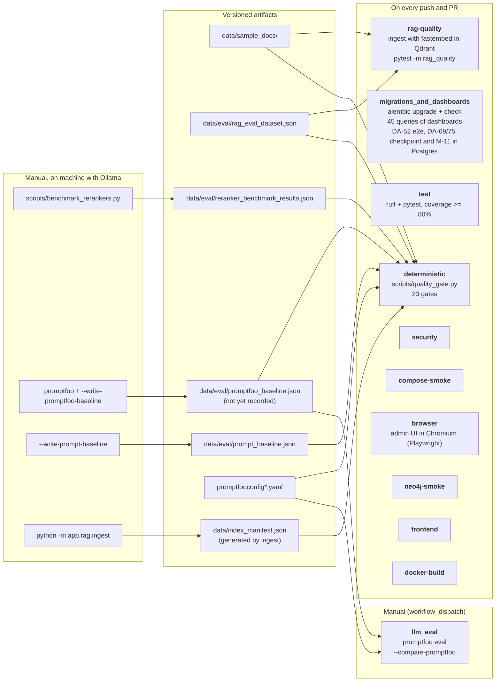

# Quality Gates (DA-51)

> English translation of [`docs/QUALITY_GATES.md`](../QUALITY_GATES.md) · source commit `e0640be` · [Português](../QUALITY_GATES.md)

The test suite answers "does the code do what it promises?". The gates answer
another question: **"what does the project claim about its own quality remains
true?"** Before DA-51, the strongest claims of the README — "10/10 in
promptfoo", "hit@1 0.923 of mmarco", "45 queries of dashboards" — were
verified by hand, once, and never again.

## Gate map

| Gate | What it protects | Cost | Where it runs |
|---|---|---|---|
| `rag_dataset_schema` | `data/eval/rag_eval_dataset.json`: required fields, `interface_type` within the pipeline Literal, minimum of 15 cases | instantaneous | every push/PR |
| `corpus_coverage` | every `expected_sources` exists in `data/sample_docs/` | instantaneous | every push/PR |
| `dataset_difficulty_mix` | at least one `hard` case and one `out_of_scope` case | instantaneous | every push/PR |
| `reranker_invariant` | the production model was measured, clears the hit@1 floor, and no candidate is significantly better (paired exact McNemar, p < 0.05); a non-significant point lead only warns; without per-query data, the minimum margin applies | instantaneous | every push/PR |
| `promptfoo_configs` | promptfoo configs are valid YAML, have `prompts`/`tests`/`providers`, and the referenced `exec:` scripts exist | instantaneous | every push/PR |
| `llm_baseline` | there is a versioned promptfoo baseline (LLM regression comparison) | instantaneous | every push/PR |
| `candidate_das_fresh` | no DA marked as "candidate" in `CLAUDE.md` is already delivered in `docs/ARCHITECTURE.md` | instantaneous | every push/PR |
| `implemented_das_documented` | every DA registered in `CLAUDE.md` has locatable prose (section `### N. ... (DA-N)` in `docs/DECISOES_DE_ARQUITETURA.md`, or `docs/ARCHITECTURE.md` as declared alternative location) — and, in the reverse sense, no orphan `(DA-N)` section | instantaneous | every push/PR |
| `das_index_current` | the DA index of `docs/DECISOES_DE_ARQUITETURA.md` is unique (no pasted table twice), lists exactly the same set as the `CLAUDE.md` registry, each line points to an existing section, and the Section column number is the real heading number (not the neighbor section's) | instantaneous | every push/PR |
| `da_registered` | every DA cited in product code (`app/`, `scripts/`, `alembic/`) has a row in the DA table of `CLAUDE.md`. Nine DAs were outside the ledger with the prose only in the docstring: three of them (data sovereignty, AMQP 1.0, Redis circuit breaker) are among the most architectural of the project and invisible to those navigating the DAs | instantaneous | every push/PR |
| `preflight_delegates` | the RAM preflight of the harness is `app/evaluation/ram_preflight.py`, not python inline in `scripts/promptfoo_remote.sh` | instantaneous | every push/PR |
| `prompt_digest_measured` | the production prompt (`app/agent/prompts.py`) has the same digest as the prompt **measured** in `data/eval/prompt_baseline.json` | instantaneous | every push/PR |
| `docs_markup_integrity` | balanced code fences and relative `.md` links resolving, in `docs/`, `README.md` and `CLAUDE.md` | instantaneous | every push/PR |
| `docs_code_references` | referências `app/x.py::símbolo` e `app/x.py:N` citadas na documentação existem no código e na linha, e toda citação de arquivo .md em backticks existe em lugar real (raiz, `docs/`, `data/sample_docs/` ou ao lado do doc) | instantâneo | todo push/PR |
| `docs_env_vars` | every environment variable cited in documentation (`VAR=` in code block or in backticks, and name in backticks with this project's prefix) is read by the project: field of `Settings`, compose, manifests, workflows or `.env.example`. Reason: the old `CONNECTORS.md` instructed to configure non-existent variables and the connector would fall into demo mode without warning | instantaneous | every push/PR |
| `connector_reachable` | every connector registered in `app/connectors/__init__.py` is accepted by the `interface_type` Literal, by the `--interface` CLI choices, by the web UI dropdown (`SYSTEMS` in `frontend/src/components/DiagnoseView.tsx`), is documented in `app/models/models.py`/`app/admin/models.py`, and has domain in `data/skills/*.yaml` read by the same parser as runtime (`app/mcp/skill_registry.py`; except `apim`, cross-vendor by decision); with declarative supervisor (DA-63), also fails if `data/skills/` is missing or if the `Dockerfile` does not copy the directory to the image | instantaneous | every push/PR |
| `ui_i18n` | both UIs ready for i18n (DA-73): `pt-BR`/`en` catalogs with the same keys and the same `{{x}}` variables; every key used in React, in the templates and in the admin JS exists; no visible text outside the catalog (`app/i18n/inventory.py`; heuristic, `i18n-ignore` with a reason for false positives) | instantaneous | every push/PR |
| `content_i18n` | diagnosis content exists in every supported language (DA-74): `content.<language>.json` catalogs with the same keys and variables, every rule-engine category (TTL + `rules.py`) with root cause and steps in each non-default language, and every language with a language instruction in the prompt | instantaneous | every push/PR |
| `connector_validation_matrix` | every connector registered in `app/connectors/__init__.py` has a row in the validation matrix of `docs/ARCHITECTURE.md` — the only source of truth about what was tested against real instance — and no orphan row remains for removed connector. It rotted silently once: `successfactors` remained months without a row, with all gates green | instantaneous | every push/PR |
| `connector_coverage` | the coverage map (DA-58) still corresponds to the code: every registered connector has a row in `data/connector_coverage.yaml` (9th surface of invariant 23), no declaration points to non-existent product or connector, and `docs/COVERAGE_MAP.md` — which is **generated**, not edited — is up to date with the data. Fails by **incoherence**, never by gap: requiring full coverage would require 76 new connectors for the CI to be green | instantaneous | every push/PR |
| `migrations_and_dashboards` (job) | `alembic upgrade head` in clean DB + the 45 queries of the 4 dashboards | ~1 min | every push/PR |
| `llm_eval` (job) | promptfoo against the baseline; fail on regression case | runner with Ollama+Qdrant | manual (`workflow_dispatch`) |

## Evaluation pipeline

How a change in model, prompt, reranker or corpus and measurement before
reaching production. The job names are from `.github/workflows/tests.yml`
and `.github/workflows/quality.yml`, and `tests/test_diagramas.py` fails if the
diagram and workflows diverge.



**Reading:**

- **What is deterministic runs on every push:** dataset shape, corpus,
  reranker invariant, prompt digest, promptfoo configs,
  documentation, connector coverage. No LLM and no infrastructure.
- **What measures the LLM runs manually** (`llm_eval`) and compares with the recorded
  baseline; without baseline, the `llm_baseline` gate warns instead of passing.
- **What only runs on your machine** (Ollama 80B, reranker with more
  queries, corpus ingestion) generates the artifacts that the gates check
  later. Changing the prompt without re-recording `prompt_baseline.json` fails the
  `prompt_digest_measured` (invariant 20).

## Running locally

```bash
# all deterministic gates
uv run python scripts/quality_gate.py

# one gate only
uv run python scripts/quality_gate.py --only reranker_invariant

# JSON report (same artifact that CI publishes)
uv run python scripts/quality_gate.py --json /tmp/quality-gate.json

# promote warning to failure
uv run python scripts/quality_gate.py --strict
```

Exit code `1` = failure. The report goes to `$GITHUB_STEP_SUMMARY` in CI.

```bash
# migrations + dashboards job, local, against a disposable DB
docker exec <container-postgres> createdb -U iic iic_ci_check
DATABASE_URL="postgresql://iic:<password>@localhost:5432/iic_ci_check" uv run alembic upgrade head
uv run python scripts/validate_dashboards.py --dsn "postgresql://iic:<password>@localhost:5432/iic_ci_check"
```

## The LLM gate, with honesty

The promptfoo of this repository runs **local model** via `exec:` provider
(`scripts/promptfoo_provider.py`). A hosted GitHub runner has no Ollama
nor the 51 GB model, so the `llm_eval` job only runs **manually**, on a runner
with Ollama and Qdrant with the corpus ingested. It does not run on the
schedule: scheduling it on a hosted runner only produced a daily failure.

Without infrastructure, the job **does not turn green**: it writes "NOT EXECUTED" in the summary
and fails with an explicit message. A gate that
reports success without having run is worse than not existing.

To close the cycle when running locally:

```bash
npx promptfoo eval -c promptfooconfig.yaml -o results.json
uv run python scripts/quality_gate.py --write-promptfoo-baseline results.json  # records data/eval/promptfoo_baseline.json
git add data/eval/promptfoo_baseline.json
```

After that, `--compare-promptfoo results.json` fails when a case that
passed in the baseline fails now, warns when a case disappears from the result and
ignores new cases (that are not yet in the baseline). Malformed payload is
rejected with exit 1 — never interpreted as "zero regressions".

## What these gates **do not** cover

- **Real RAG quality.** `reranker_invariant` confirms that the production model is the *measured winner before*. Re-running the benchmark requires Qdrant with
  the corpus ingested and the cross-encoder; this lives in `scripts/benchmark_rerankers.py`,
  run manually. A gate that depended on this would only run in CI with GPU.
- **The promptfoo in every PR.** Due to cost and the local model, it does not
  run on PRs; it is manual on a prepared runner.
- **Visual result of dashboards.** `validate_dashboards.py` proves that the query
  runs; it does not prove that the dashboard shows what someone expects.
- **Errors that only appear with a specific filter selected.** The validator
  replaces template variables with "All".
- **`prompt_digest_measured` does not prove that the measurement is still valid.** The gate
  compares the production digest with the recorded digest. It proves that the text
  did not change *since the last time someone re-recorded the file* — but nothing
  prevents someone from running `--write-prompt-baseline` without having executed the
  promptfoo. The file is a declaration, not proof; the value is that it
  is versioned and reviewable in the diff. A natural evolution is to tie the digest to
  the promptfoo result in `data/eval/promptfoo_baseline.json`, so that
  recording a digest requires a measurement result along with it.
- **The digest does not cover the variable content of the prompt.** Logs, payload, chunk
  RAG and connector data come in with each incident. Two incidents with the
  same digest used the same *template*, not necessarily the same
  context.
- **If the DA number in code is the correct DA.** `da_registered` requires that `DA-N` appears in
  the table of `CLAUDE.md`; it does not verify that the line describes what the code does. A DA
  registered with the prose swapped passes. It is the same limitation of all versioned documentation:
  the gate guarantees the linkage, not the truth.
- **The prose itself.** `implemented_das_documented` verifies that the section
  *exists* and that the DA is linked to it. It does not evaluate if the text explains the
  problem, the solution and the limitations — a style documentation gate would
  fail by writing, and disabling a gate is
  exactly what it exists to avoid.
- **Sections marked as `(informal note — no DA)`.** These are real decisions that
  never received numbering and therefore escape the check. The marker is
  explicit so that the omission is visible in the diff, but nothing enforces that
  they remain informal.
- **The legitimacy of the alternative location.** `implemented_das_documented` accepts
  `docs/ARCHITECTURE.md` for DA-32/33/34/35 without asking if the text there
  is up to date. It confirms presence, not timeliness.
- **A prosa fora de `app/x.py::símbolo`.** `docs_code_references` só verifica a
  way to cite code, which is what the debug documentation uses to send
  opening a breakpoint. Identifiers in loose prose
  (`ANTHROPIC_API_KEY`, `RFC_SYSTEM_INFO`, `${QDRANT_HOST_PORT:-6333}`) are
  deliberately ignored: the first does not exist, the second is ABAP Function
  Module, the third is shell variable. A gate that accuses these three is
  a gate that someone disables.
- **If the documentation is *correct*, only outdated.**
  `docs_code_references` proves that `report_node` is defined in
  `app/agent/nodes.py`; it does not prove that the tutorial tells to open the
  right file, nor that the text around the link is correct. It catches broken
  reference, not equivalent wrong.
- **Balanced fences do not mean valid markdown.** `docs_markup_integrity`
  counts open/close of code block. Malformed tables, nested lists
  wrong and `#link` anchors that do not exist pass.
- **Identifiers cited inside code block.** The gate looks for
  `app/...py::symbol` anywhere in the markdown, even inside
  fences ```; an illustrative example in a fence can be accused.
- **If the SAP product capability matrix is correct.** `connector_coverage`
  (DA-58) confirms that the map is **coherent with the code** — registered
  connector has declaration, declared product exists, generated doc up to date. It confirms
  nothing about the capability matrix: it was transcribed from a source of
  reference **without published citation and without SAP release** (`data/sap_products.yaml`),
  and the translation of the glyphs (`✓✓`→`native`, `✓/scenarios`→`conditional`) is
  our interpretation. The gate guarantees that the map did not age; it does not know
  if the underlying claim is true. The same limitation of
  `connector_validation_matrix`: requires that the matrix *exists* and covers all
  registered connector, not that the claim of it is true.
- **If the connector works against a real tenant.** `connector_reachable`,
  `connector_validation_matrix` and `connector_coverage` confirm presence and
  coherence: that every
  registered connector has a row in the matrix of
  [docs/ARCHITECTURE.md](ARCHITECTURE.md#connectors---mock-vs-real-today)
  and that no orphan row remains. None of the two confirms the **truth** of
  the claim "validated". `connector_validation_matrix` is the gate that prevents it from
  rotting, not the one that attests: it requires that the matrix * exists* and covers all
  registered connector, because `SuccessFactorsConnector` (DA-34) remained months
  without any row with all gates green. The matrix is a versioned claim,
  reviewable in the diff — the same limitation of `prompt_digest_measured`
  (see above). Attesting the validation would require the artifact of real execution
  (log of the call against the tenant, date, product version), which today does not
  exist versioned for any of the ten connectors, nor for the four
  validated.

## Lessons from the process

1. **The first gate errs the premise.** The first version rejected
   `expected_sources: []` — but the two `out_of_scope` cases have this list
   empty on purpose ("out of scope, should not retrieve anything"). The gate
   was right about the form and wrong about the meaning, and would have been
   disabled in the first week. Today `out_of_scope` *requires* empty list, and
   filled list in this case is failure: the case contradicts itself.
2. **A gate that accepts "no result" is a false green.**
   `normalize_promptfoo_results` refuses empty or unknown payload.
3. **The first `candidate_das_fresh` accused DA-32** — listed as
   "candidate, awaiting Kyma" in `CLAUDE.md` although delivered in `67b78e8`. It was
   a real documentation bug that no suite caught.
4. **The gate itself broke with its own documentation.** After the
   line of DA-51 in the DA table started citing "of the candidate DAs" in a
   cell, the search for the *first occurrence* of the phrase matched there, cut out
   a block without any `DA-N` and returned empty list: the gate turned into a warning and the
   list of candidates ceased to be verified without anyone noticing. The
   regex now anchors in the title, at the beginning of the line, with regression
   test that reproduces the real case.
5. **Green test does not prove that the code runs.** The RAM preflight was a
   heredoc of 92 lines inside `scripts/promptfoo_remote.sh`, without
   coverage: the arithmetic that decides if the suite loads 48 G could only be
   confirmed with the RAM by hand. The calculation was moved to
   `app/evaluation/ram_preflight.py` (pure core, 15 tests), and
   `preflight_delegates` watches that the script continues delegating — without it, the
   math could return inside the shell with the suite still green,
   testing a module that no one calls. And the inverse also holds: **the job that runs does not
   prove that the thing measured is measured.** The `rag-quality` ran with
   `EMBEDDING_BACKEND=fastembed` (DA-38) because GitHub Actions has no
   Ollama, but the *ingestion* ignored this variable and indexed with
   `OllamaEmbeddings` fixed. The retriever queried with bge-small (384 dims)
   in a collection created with nomic-embed-text (768), and the search died with
   `Wrong input: Vector dimension error: expected dim: 768, got 384`. The job
   was green because it never retrieved anything — the failure was of non
   measurable, and only appeared when the gate started to be run for real.
   Two corrections: the ingestion now uses the same embedder resolver
   as the query (`retriever._get_embeddings`), and `_FastEmbedWrapper` gained
   `embed_documents`, which only the query used — without it the ingestion failed
   with `'_FastEmbedWrapper' object has no attribute 'embed_documents'`.
6. **The threshold needs to discriminate the groups, not exist.** The
   `oos_rejection_rate` measured `hits[0]["score"] < 0.7`, and `score` is pure dense cosine. Measured in the evaluation corpus: in-scope goes from 0.719 to 0.871,
   out-of-scope gives 0.753 and 0.779 — **the groups overlap**, and the only
   threshold that would separate them (0.780) would reject together 4 of the 13 in-scope. The gate
   measured cosine similarity and called this rejection. The signal that
   discriminates is `rerank_score_calibrated` (DA-42): in-scope ≥ 0.975,
   out-of-scope ≤ 0.050. The gate now measures the same number that decides the
   admission in the pipeline, at the neutral point of the sigmoid (σ(0) = 0.50), which is
   at 0.45 on both sides. And when the hit comes without this field — rerank did not
   run — the gate **fails** instead of treating the absence as 0.0, which would be
   a false green by rule 2. Verified by perturbation: with the sigmoid
   forced to 0.99 the gate fails, and with the `rerank()` neutralized it raises `RuntimeError`.
   **Update (validation 2026-10-07):** until RAG-01, the *pipeline* did not
   follow this lesson: the admission was `max(cosine, sigmoid)`, and an out-of-scope case with cosine 0.753 and sigmoid 0.0067 was admitted while the
   gate reported rejection. Today `app/rag/retriever.py::_evidence_admission_score`
   uses only the sigmoid when there is reranker, and gate and pipeline measure the same
   number. The dataset went from 2 to **10** out-of-scope cases (M-19); 9 of
   10 are rejected.
7. **Gate that only checks one direction passes through the hole.** `candidate_das_fresh`
   asks "has this DA marked as candidate already been delivered?". It never asked the
   inverse question — "has the delivered DA the locatable prose?" — and therefore
   15 decision sections of `README.md` survived without `(DA-N)` label,
   invisible to any `grep "DA-15"`, and DA-30 remained without its own section
   anywhere. The prose existed; the linkage did not. A unidirectional gate
   is not half the verification, it is a verification that gives
   a feeling of coverage.
8. **Counting wrong is worse than not counting.** Auditing the documentation of
   DA-52, the text said "five states" and the invariant 15 of `CLAUDE.md`
   repeated the number, while the enum `ObservationStatus` had four and the
   limitations section of the README itself affirmed that the two extra states
   do not exist. Three artifacts, three claims, one false. Therefore
   `TestEstadosDocumentados` compares the table and the README count with the
   enum instead of fixing a literal — the number is a consequence, not constant.
