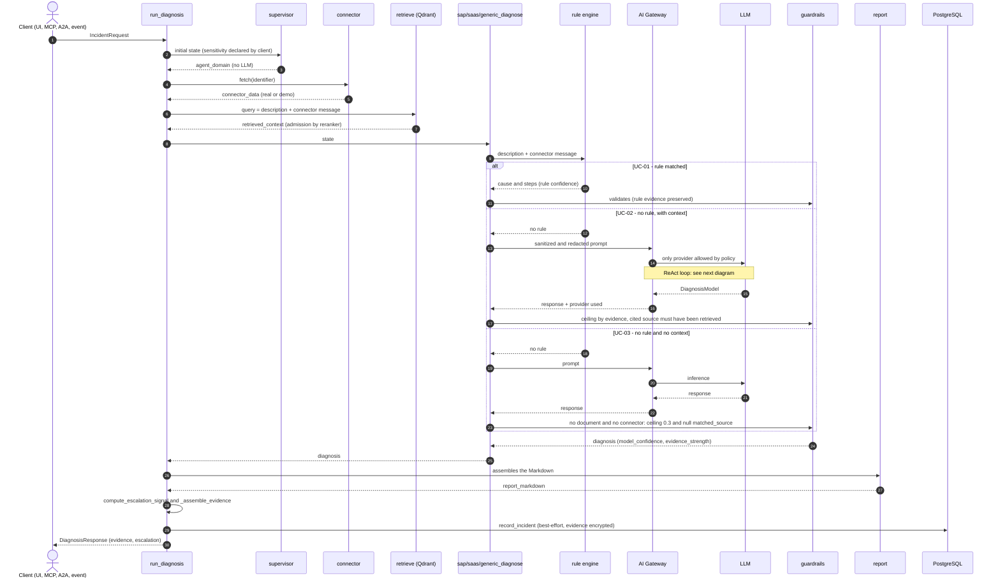
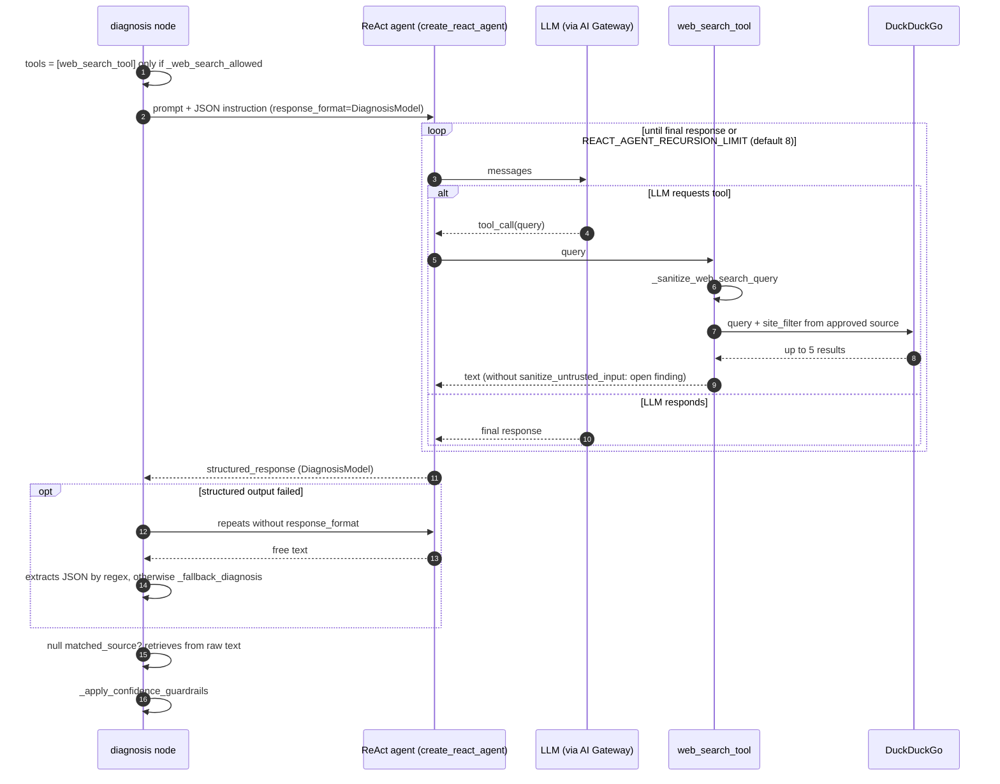

# Use Cases — Functional and Technical

> English translation of [`docs/CASOS_DE_USO.md`](../CASOS_DE_USO.md) · source commit `c5c06d8` · [Português](../CASOS_DE_USO.md)

> **What this document is.** Nine scenarios of use of the Integration Incident
> Copilot. Each brings:
>
> - the business objective;
> - what goes in;
> - the real path in the code (`file.py::symbol`, checked by the gate
>   `docs_code_references`);
> - the observed result;
> - the limitations;
> - the test that supports the claims.
>
> **Why it replaced the `docs/UC_01..09`.** In the 2026-10-07 validation (Block 5,
> DOC-01) the nine files were replaced by this one. They showed code that does not exist (`graph.ainvoke`, `rules_node`, `create_mock_connector`,
> `/events/webhook`, `PROMPT_VERSION = "v2.1.0"`...) and claimed, for example,
> that "IDoc in status 51" does not match any rule, when it does.
>
> **Rule of this document.** No code snippet here is "illustrative".
> Where there is a number, it came from `tests/test_casos_de_uso.py`, which runs the real graph
> with two substitutions:
>
> - the search in Qdrant returns a snippet of `data/sample_docs`;
> - the call to the LLM returns a fixed response.
>
> In cases where the LLM **should not** be called, the substitute fails if it is.

## Overview of the pipeline

The graph and state machines are in [`ARCHITECTURE.md`](ARCHITECTURE.md)
(the graph is generated from code). Here is the **temporal order**: who calls whom,
and where the path is deterministic or passes through inference.

### Diagnosis sequence: three paths



The rule engine runs **after** the connector and the RAG: the text it evaluates
includes the connector message. The three paths correspond to the tests of
UC-01, UC-02 and UC-03 below.

### ReAct loop and tool call

Inside the diagnosis node, no rule matched
(`app/agent/nodes.py::_run_diagnosis_agent`):



Without an approved source for the `interface_type`, the tools list is empty
and the loop ends on the first LLM response.

| Stage | Where | What it does |
|---|---|---|
| Domain | `app/agent/supervisor.py::classify_domain` | `sap`, `saas` or `generic`, no LLM (invariant 6) |
| Connector | `app/agent/nodes.py::connector_node` | data from the source system; in demo mode, simulated scenario (`is_mock=True`) |
| RAG | `app/agent/nodes.py::retrieve_node` → `app/rag/retriever.py::retrieve` | hybrid search + reranker; admission by calibrated score (DA-25/42) |
| Diagnosis | `app/agent/nodes.py::_run_diagnosis_agent` | **rule engine first** (`app/agent/rules.py::match_known_error`); only without rule calls the LLM, via AI Gateway (`app/llm/gateway.py::invoke_via_gateway`) |
| Guardrails | `app/agent/nodes.py::_apply_confidence_guardrails` | confidence ceiling by evidence, cited source must have been retrieved |
| Evidence | `app/agent/nodes.py::_assemble_evidence` | list of sources with `trust_level` (never LLM self-assessment) |
| Escalation | `app/agent/escalation.py::compute_escalation_signal` | deterministic signal returned in `escalation` (informative) |
| Persistence | `app/services/incident_recorder.py::record_incident` | row in `incidents` (best-effort, only with `DATABASE_URL`) |

**Two confidences in the response:**

- `model_confidence` is what the LLM said, already cut by the guardrails;
- `diagnosis_confidence` is `evidence_strength × model_confidence`, calculated by the pipeline.

Neither is a calibrated probability.

---

## UC-01 — IDoc in status 51, with RFC connector

**Objective.** The SAP support analyst opens an incident "IDoc stuck".
The response should come in seconds and without LLM cost, because the pattern is
known.

**Input.** `description="IDoc stuck with status 51"`,
`interface_type="rfc"`, `identifier="RFC-IDOC-51-DEMO"` (RFC connector
demo scenario).

**Path.**

1. `classify_domain` responds `sap`.
2. `app/connectors/rfc_connector.py::RFCConnector` returns the simulated
   scenario. Without `SAP_ASHOST`, the mode is demo.
3. `match_known_error` matches the rule `sap_idoc_status_51` (confidence 0.9). The
   text evaluated is the description **plus** the connector message.
4. Early return: the LLM **is not** called.

**Observed result.**

| Field | Value |
|---|---|
| `matched_source` | `rule_engine:sap_idoc_status_51` |
| `llm_provider_used` | `rule_engine` |
| `model_confidence` | 0.9 |
| `prompt_version` / `prompt_digest` | `null` (invariant 21: no prompt produced this) |
| evidence | `rule_engine/system_observed`, `connector/simulated`, document and description |

**Limitations.**

- In demo mode the connector data is **simulated**.
- In real mode, the function called (`BAPI_IDOC_STATUS`) was never executed
  against a real SAP system. See the docstring of `app/connectors/rfc_connector.py`.

**Test:** `tests/test_casos_de_uso.py::test_uc01_idoc_51_resolvido_pelo_rule_engine`.

---

## UC-02 — Incident coming from ServiceNow

**Objective.** An incident opened in the ITSM (ServiceNow) cites an SAP failure.
The Copilot crosses the call with the knowledge base.

**Input.** `interface_type="servicenow"`, `identifier="INC0010001"`
(demo scenario).

**Path.**

1. `classify_domain` responds `saas`.
2. `app/connectors/servicenow_connector.py::ServiceNowConnector` returns the
   scenario.
3. No rule matches, so `saas_diagnosis_node` calls the LLM via the gateway.
4. `_apply_confidence_guardrails`:
    - accepts `matched_source` only if the document was retrieved;
    - limits confidence by evidence strength.

**Observed result** (fixed LLM response: confidence 0.8, citing the
retrieved document):

- `agent_domain = "saas"`;
- `matched_source = "servicenow_itsm_alert.md"`;
- `model_confidence = 0.8`: the demo scenario is recognized and the evidence
  (0.88) supports this value;
- `diagnosis_confidence = 0.88 × 0.8 ≈ 0.70`;
- `prompt_version` = the one of `app/agent/prompts.py`;
- `escalation.escalation = "grounded"`.

**Variant: identifier that the connector does not recognize** (`INC9999999`). The
connector returns fallback data, and the guardrail limits confidence to 0.4,
with the prefix `[confidence limited - identifier not recognized…]` in the
probable cause.

**Variant: the LLM cites a document that was not retrieved.** The guardrail
zeros `matched_source`, limits confidence to 0.3, and the escalation signal
marks `abstained=True`, `should_escalate=True`.

**Tests.**

- `tests/test_casos_de_uso.py::test_uc02_servicenow_passa_pelo_llm`
- `tests/test_casos_de_uso.py::test_uc02_identificador_desconhecido_limita_a_confianca`
- `tests/test_casos_de_uso.py::test_uc02_fonte_inventada_pelo_llm_e_descartada`

---

## UC-03 — Free text, no connector nor document

**Objective.** The user describes a problem that the base does not cover. The system
needs to **say it does not know**, instead of making it up.

**Path.**

1. `classify_domain` responds `generic`.
2. `retrieve` does not admit anything.
3. `generic_diagnosis_node` calls the LLM.
4. Without document and without connector, the guardrail limits confidence to 0.3 and nullifies
   `matched_source`.

**Observed result.**

- `diagnosis_confidence = 0.0`;
- the evidence is only the description (`user/user_reported`);
- `escalation.escalation = "no_context"`.

**Web search.** It is *fail-closed*. With `WEB_SEARCH_POLICY=approved` (the
default), `app/agent/nodes.py::_web_search_allowed` only allows if there is an
approved source for the `interface_type` in `web_search_sources` (DA-57). Without
database, there is no search.

**Tests.**

- `tests/test_casos_de_uso.py::test_uc03_generico_sem_contexto`
- `tests/test_casos_de_uso.py::test_uc03_busca_web_e_fail_closed_sem_fonte_aprovada`

---

## UC-04 — Rule engine (diagnosis without LLM)

**Objective.** Recurrent integration patterns are solved deterministically, auditably and without cost.

**Catalog.** There are **22 rules** in `app/agent/rules.py::KNOWN_ERROR_RULES`.
The source is the code; there is no table maintained by hand:

```bash
uv run python -c "from app.agent.rules import KNOWN_ERROR_RULES as R; print([r.category for r in R])"
```

**Behaviors that matter** (validation 2026-10-07, M-02):

- The patterns match in a **short window within the same sentence**, not in
  free `.*`.
- **Direct negation** discards the match ("not expired token").
- A generic `401` becomes `auth_unauthorized` (confidence 0.75), not "token
  expired".
- The strength of evidence of the rule (0.95 with real connector data, 0.70 only with
  text) is not overridden by the guardrail (M-03).

**Test:** `tests/test_casos_de_uso.py::test_uc04_catalogo_e_negacao`.

---

## UC-05 — Weak evidence: fallback to `reference_library`

**Objective.** When the curated base has nothing strong, the system consults the
reference library (DA-17).

**Path.** In `app/rag/retriever.py::_retrieve_unified`:

1. If no candidate from `sap_incident_docs` passes the threshold, the search goes to
   `sap_reference_library` with its own fallback threshold (0.665).
2. The result enters the reranker pool.
3. The non-existent collection degrades without error.

**Disabling** (validation 2026-10-07, M-24). The library is assembled from
**third-party** material. Therefore `REFERENCE_LIBRARY_FALLBACK_ENABLED=false`
prevents the query, and the `deploy/kyma/configmap.yaml` (public demo) comes with
`false`.

**Limitation.** The threshold 0.665 was measured against an index that is not
registered. The `index_manifest` gate warns until `data/index_manifest.json` exists
(M-23).

**Test:** `tests/test_casos_de_uso.py::test_uc05_fallback_da_reference_library` (enabled and disabled).

---

## UC-06 — Ollama down: fallback to cloud provider

**Objective.** The diagnosis continues when the local LLM goes down, **without**
confidential data going to the cloud.

**Path** (`app/llm/gateway.py::invoke_via_gateway`):

1. **Sensitivity** (`app/llm/gateway.py::classify_sensitivity`): real connector data is `confidential`. What the client declares only **elevates** (GOV-01).
2. **Eligible providers** (`app/llm/gateway.py::_select_allowed_providers`):
    - evaluated by **real origin** (DA-43), not by label;
    - `confidential` only goes to an origin in the allowlist
      (`CONFIDENTIAL_ALLOWED_ORIGINS`) or local.
3. **Transport failure** (network, `httpx`, `openai.APIConnectionError`/`InternalServerError`):
    - opens the provider circuit;
    - applies backoff;
    - tries the next eligible provider (R01).
4. **Effective policy:** `GET /llm/policy` (`app/llm/gateway.py::describe_effective_policy`).

**Tests** (in `tests/test_llm_gateway.py`):

- `test_public_data_falls_back_to_cloud_on_transport_failure`
- `test_confidential_data_never_reaches_cloud_even_when_local_configured_as_primary`
- `test_confidential_data_with_only_cloud_configured_raises_policy_violation`
- `test_open_circuit_skips_provider_without_invoking_it`

---

## UC-07 — Event from SAP Event Mesh (CloudEvents)

**Objective.** An external monitor (CPI, Solution Manager, Event Mesh) fires
the diagnosis without anyone opening a call.

**Input.** `POST /events/incident` with `X-Event-Mesh-Api-Key`, or an
AMQP 1.0 message (`app/events/amqp_consumer.py::AmqpConsumerTask`). The
envelope is **strict CloudEvents 1.0** (M-16):

```json
{
  "specversion": "1.0",
  "type": "com.sap.integration.incident.detected.v1",
  "source": "/sap/cpi/monitor",
  "id": "evt-0001",
  "data": {"description": "IDoc stuck with status 51", "interface_type": "rfc"}
}
```

**Path.**

1. `app/events/consumer.py::handle_incident_event_async` decides the execution:
    - with `REDIS_URL`, queues in RQ (durable);
    - without `REDIS_URL`, runs in background in the process.
2. Deduplication uses the pair `(source, id)`: `app/events/idempotency.py::event_key`.

**Observed result.**

- The same event sent twice receives 202 twice, but generates **one**
  diagnosis.
- Without `specversion`, the response is 422 and points to the field, without echoing the value.

**Limitations.**

- AMQP against a real Solace/Event Mesh broker was not tested in this
  environment.
- The DMQ depends on the queue configuration on the broker.

**Test:** `tests/test_casos_de_uso.py::test_uc07_webhook_cloudevents`.

---

## UC-08 — GraphRAG (incident history in Neo4j)

**Objective.** Remember similar incidents already diagnosed and,
mainly, those **verified by human**.

**Graph form.** It is decided in construction
(`app/agent/graph.py::build_graph`):

- with `GRAPH_RAG_ENABLED=true` enter `graph_enrich` (before diagnosis) and
  `graph_write` (after);
- without it (default), the graph is linear.

**Rules (AI-01):**

- **Fact:** only an incident verified by human
  (`POST /incidents/{id}/verify` → `app/rag/graph_store.py::verify_incident`)
  returns to the prompt as fact.
- **Hypothesis:** the unverified hypothesis appears labeled as **NOT
  verified** (`app/rag/graph_store.py::format_graph_context_for_prompt`).
- **Prune:** `app/rag/graph_store.py::prune_ungrounded_hypotheses` never deletes
  a verified incident.
- **Redaction:** the description is redacted before going to Neo4j.

**Limitation.** The tests use a fake Neo4j session; the smoke against real Neo4j
runs only in the CI `neo4j-smoke` job.

**Tests.**

- `tests/test_casos_de_uso.py::test_uc08_graphrag_muda_o_grafo`
- `tests/test_graph_store.py`

---

## UC-09 — OData contract change (breaking drift)

**Objective.** Detect that the SAP republished an OData service with one less
property **before** the consumer breaks in production.

**Path** (`scripts/check_contract_drift.py` → `app/contracts/observe.py::check_connector`):

1. `app/connectors/odata_connector.py::ODataConnector` reads `$metadata`
   (`fetch_contract`).
2. `app/contracts/odata.py::parse_odata_metadata` normalizes the contract. The
   fingerprint ignores namespace and version (invariant 18).
3. `app/contracts/diff.py::diff_contracts` classifies the change:
    - **breaking:** property removed or renamed, type changed,
      `MaxLength` new or smaller;
    - **additive:** the rest.
4. Only `breaking` becomes an incident, with a single emission point
   (`app/contracts/observe.py::emit_incident`). If the delivery fails, the
   old baseline remains and the next round detects it again.
5. `system_contracts` is append-only, guaranteed by trigger (migration 011).

**Possible states.** `clean`, `drift`, `first_observation` and `unverified`.
The `unverified` occurs when SAP is down or baseline unreadable: never opens
incident nor touches the baseline.

**Tests.**

- `tests/test_contracts_e2e.py`: full cycle against real PostgreSQL, with
  `IIC_TEST_DATABASE_URL`;
- `tests/test_bloco2_contracts_db.py`.

---

## How to keep this document true

- **Changed a behavior described here?** Change the corresponding test in
  `tests/test_casos_de_uso.py` **in the same commit**.
- **Code references:** always in the format `file.py::symbol`. The gate
  `docs_code_references` fails on non-existent symbol.
- **Environment variables:** the `docs_env_vars` gate checks the ones that appear
  here against `app/config.py`, the compose and the manifests.
