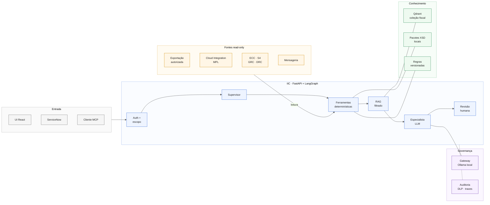
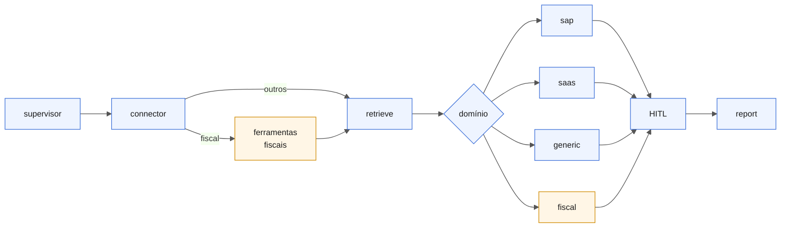
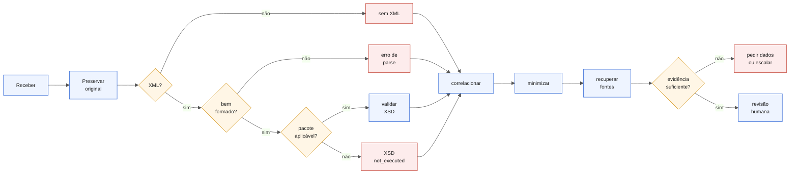
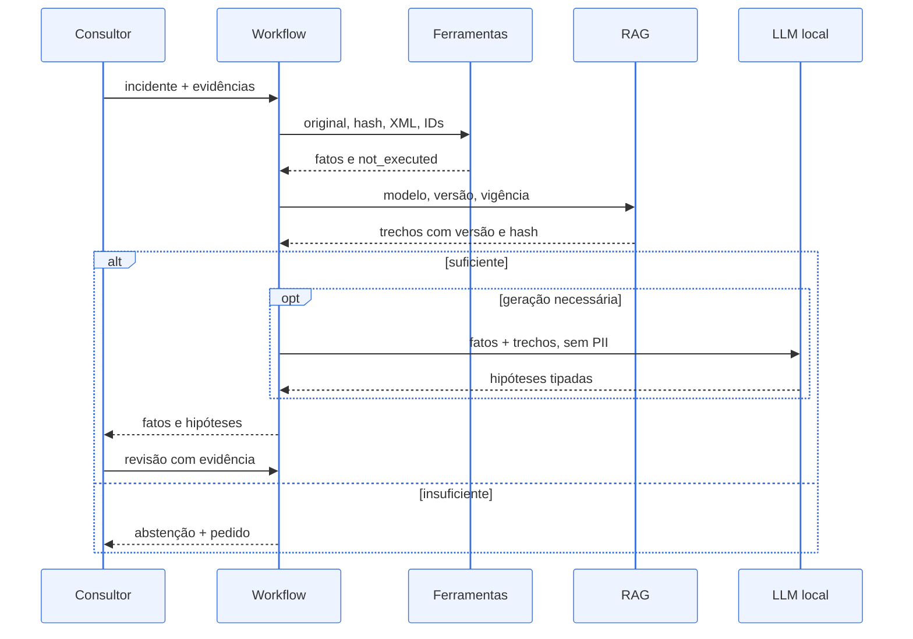
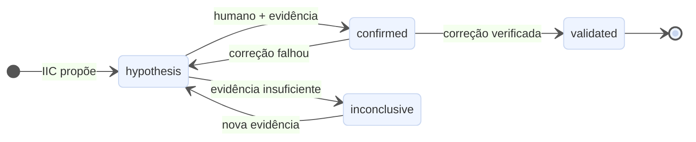
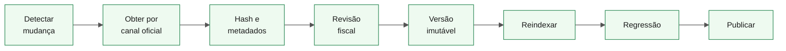
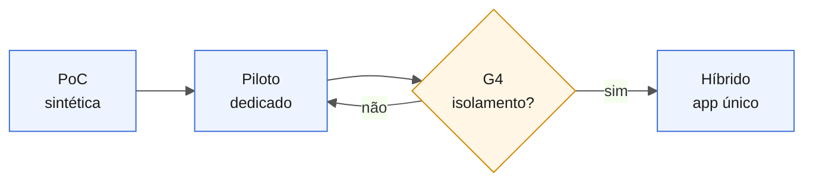

# IIC para SAP AMS N2/N3 e DF-e — Estudo consolidado v3

> **Data:** 2026-11-11 · **Autor da solução:** Marcos Silva Lima
> **Base auditada:** `integration-incident-copilot`, HEAD `6662162c5c072f5080d1f5e026b261c42aa2a480`, versão declarada 1.4.0, **mais as alterações não commitadas da working tree em 2026-11-11 21:47** (revisão 3.1)
> **Fontes deste documento:** estudo v2.0 (principal) + consolidado v1 (complemento), com achados reconferidos no código e microensaio corrigido e reexecutado.
> **Natureza:** assessment, especificação de evolução e microensaio offline. Correções parciais de A1, A4 e A5 já existem na working tree (§3.1); nada de DF-e está integrado ou homologado.

**Legenda de estado (vale para todo o documento)**

| Sigla | Significado |
|---|---|
| **I** | Implementado e inspecionado no código |
| **P** | Parcial: existe, mas incompleto, só mock ou com defeito |
| **N** | Proposto por este estudo |
| **V** | Depende de validação externa (SAP, SEFAZ, fornecedor, cliente) |
| **NV** | Não verificado por este estudo: citado pela v2.0, sem conferência independente |

---

## Sumário

1. [Resumo executivo](#1-resumo-executivo)
2. [Baseline e evidências](#2-baseline-e-evidências)
3. [Achados](#3-achados)
4. [Gap analysis e reutilização](#4-gap-analysis-e-reutilização)
5. [Arquitetura-alvo](#5-arquitetura-alvo)
6. [Modelo de diagnóstico e evidência](#6-modelo-de-diagnóstico-e-evidência)
7. [Integrações SAP e de terceiros](#7-integrações-sap-e-de-terceiros)
8. [Conhecimento fiscal, RAG e ontologia](#8-conhecimento-fiscal-rag-e-ontologia)
9. [Segurança, privacidade e governança](#9-segurança-privacidade-e-governança)
10. [Operação AMS e ITSM](#10-operação-ams-e-itsm)
11. [Casos de uso](#11-casos-de-uso)
12. [Estratégia de código](#12-estratégia-de-código)
13. [Backlog, estimativas e gates](#13-backlog-estimativas-e-gates)
14. [PoC local](#14-poc-local)
15. [Avaliação e métricas](#15-avaliação-e-métricas)
16. [Valor profissional](#16-valor-profissional)
17. [Riscos e decisões pendentes](#17-riscos-e-decisões-pendentes)
18. [Verificações realizadas e fontes](#18-verificações-realizadas-e-fontes)
19. [Apêndice A — Microensaio cStat 204](#apêndice-a--microensaio-cstat-204)

---

## 1. Resumo executivo

**Pergunta:** como transformar o IIC num acelerador de diagnóstico SAP AMS N2/N3 especializado em DF-e, com o menor esforço viável e máxima reutilização?

**Resposta:** manter o núcleo e acrescentar um **pacote de domínio fiscal** (contratos de evidência, ferramentas determinísticas e um especialista de diagnóstico), corrigir os defeitos que tocam esse caminho e provar o resultado em cinco cenários sintéticos de NF-e antes de conectar qualquer ambiente real. Não criar oito agentes LLM.

**Princípio de desenho:**

> O LLM explica e prioriza hipóteses. Regras e ferramentas determinísticas decidem apenas o que está dentro do seu escopo e é verificável: código de retorno, validade de schema, dígito verificador, metadados de certificado, correlação por identificador explícito.

**Decisões**

| Tema | Decisão | Motivo |
|---|---|---|
| Escopo inicial | NF-e modelo 55 de saída + mensageria sintética, cinco cenários | Menor variação de jurisdição, alta demonstrabilidade |
| Orquestração | Workflow LangGraph atual + um especialista de domínio | Reaproveita a estrutura, evita coordenação entre LLMs |
| Validação XML | Ferramenta determinística sobre o original, antes de mascarar | LLM não é validador XSD nem autoridade fiscal |
| Recuperação | RAG híbrido com filtros obrigatórios antes da busca | Códigos e versões exigem correspondência exata e vigente |
| GraphRAG e ontologia | Fora do caminho mínimo | Benefício não medido; A4 precisa ser corrigido antes |
| Coleta inicial | Upload ou exportação autorizada | Desacopla o valor da disponibilidade de ambiente SAP |
| Primeiro conector real | Cloud Integration MPL | Contrato público verificável; HTTP/OAuth já existentes |
| Modelo de tenancy | Instância dedicada no piloto → híbrido (app único, dados separados por cliente) após G4; pool compartilhado não recomendado | Isolamento não demonstrado (A5); detalhe em §9.1 |
| Código | Domínio na `main` atrás de flag, sem branch de longa duração | Evita divergência com os quality gates |
| Primeira entrega | PR 0: commitar a correção parcial de A4/A5 já existente e completar A4 | Bug do produto atual, independente do DF-e |

**Três entregas distintas** (detalhadas em §13):

| Entrega | Conteúdo | Engenharia | Curadoria fiscal/AMS |
|---|---|---|---|
| Demonstração mínima | Caso 204 + controle XML, offline | 8–12 dias-pessoa | 2–4 |
| MVP offline (F0–F2) | Cinco cenários, segurança, avaliação | 26–40 dias-pessoa | 6–10 |
| Piloto assistido (F0–F4) | Um ambiente SAP autorizado, ITSM, revisão | 40–63 dias-pessoa | + revisão de domínio |

Esperas por ambiente, licença ou rede não estão incluídas. Redução de MTTR, retorno financeiro e precisão em produção são **hipóteses a medir**, não resultados.

---

## 2. Baseline e evidências

### 2.1 Versões

Python medido na `.venv` com `importlib.metadata`; frontend declarado em `package.json`.

| Componente | Versão |
|---|---|
| FastAPI / Pydantic | 0.142.2 / 2.13.5 |
| LangGraph / checkpoint-postgres | 1.2.12 / 3.2.0 |
| qdrant-client | 1.19.1 |
| Driver Neo4j | 6.3.1 |
| Langfuse SDK | 4.16.0 |
| RDFLib | 7.6.0 |
| sentence-transformers | 6.1.0 |
| lxml (disponível, transitiva) | 6.1.3 |
| React / TypeScript / Vite | ^19.2.8 / ~6.0.2 / ^8.3.0 |
| LLM canônico | `qwen3.6:35b-a3b` (DA-92) |
| Reranker | `cross-encoder/mmarco-mMiniLMv2-L12-H384-v1` (DA-29, invariante 1) |

Versões dos servidores Qdrant, Neo4j, PostgreSQL e Ollama em execução não foram medidas.

### 2.2 Registro de evidências

| ID | Local | Conclusão permitida | Limite |
|---|---|---|---|
| E01 | `app/agent/graph.py::build_graph` | `supervisor → connector → retrieve → [graph_enrich] → {sap,saas,generic}_diagnose → [graph_write] → report → [ontology_debug]` | Não prova execução conectada |
| E02 | `graph.py::get_graph`, `app/agent/checkpointing.py` | Checkpointer Postgres opcional com redação de PII | `CHECKPOINTING_ENABLED` OFF por padrão; retomada usa estado redigido |
| E03 | `app/agent/nodes.py::retrieve_node` | Caminho ontology-aware condicional | Acesso a `error_code` corrigido (DA-64); restante de A4 aberto |
| E04 | `nodes.py::_build_diagnosis_prompt` | Prompt reúne RAG, conector, logs, payload, histórico | Usa o texto do primeiro hit (DA-1) |
| E05 | `nodes.py::_assemble_evidence` | Evidência montada por código, com proveniência (DA-15) | Regra curada rotulada `system_observed` (A6) |
| E06 | `nodes.py::_run_diagnosis_agent` | Regra antecede o ReAct; caminho HITL | Retrieval ocorre antes da regra (A7) |
| E07 | `app/agent/state.py::DiagnosisModel` | `matched_source`, `probable_root_cause`, `confidence`, `next_steps` | Não separa hipótese, causa e resolução |
| E08 | `app/llm/gateway.py`, `app/config.py` | Política, orçamento, breaker; soberania `strict` | — |
| E09 | `app/rag/retriever.py` | Dense + BM25, RRF, reranker | `HYBRID_TARGETS = {"incidents"}` (A10) |
| E10 | `app/connectors/odata_connector.py` | HTTP/OAuth2, parsing OData v2; filtro por `MessageGuid` | Só `MockTransport`; parsing e cassette ainda no formato antigo (A1) |
| E11 | `app/connectors/rfc_connector.py` | pyrfc com logon e `RFC_SYSTEM_INFO` no ABAP Trial | `BAPI_IDOC_STATUS` nunca executada (A2) |
| E12 | `app/connectors/po_connector.py` | Consulta `/mdt/api/1.0/facade` | Endpoint não público (A3, DA-56) |
| E13 | `app/models/models.py` | `IncidentRequest` com limites e Literals de `interface_type` | Não é contrato fiscal |
| E14 | `graph.py::run_diagnosis`, `state.py`, `services/incident_recorder.py::build_incident_row`, repositórios | `tenant_id` propagado ao estado e persistido; filtros por tenant no SQL dos repositórios | Tenant ainda vem do corpo da requisição (A5) |
| E15 | `app/main.py`, revisão com `Command(resume=...)` | Retomada HITL em código (DA-75) | Teste HTTP não concluiu (A9) |
| E16 | `app/redaction.py`, `app/auth.py`, `app/mcp/policy.py` | Redação, sessão, policy fail-closed | Não é DLP completo nem ABAC |
| E17 | `app/rag/graph_store.py::verify_incident` | `POST /incidents/{id}/verify` (DA-28/50) | `diagnosis_correct` pode ser NULL (invariante 13) |
| E18 | `app/agent/rules.py`, `app/ontology/error_codes.ttl` | 22 regras, fallback em ontologia (DA-33/61) | Nenhuma regra fiscal |
| E19 | `app/` inteiro | Nenhuma ocorrência de NF-e, SEFAZ, GRC ou DRC em código | Menções só em PDFs da `reference_library` |
| E20 | `docs/ARCHITECTURE.md` | Matriz histórica de validação dos conectores | Registro documental, não teste repetido |

---

## 3. Achados

Prioridade: **P0** bloqueia dado real ou alegação empresarial; **P1** bloqueia funcionalidade opcional ou primeiro piloto; **P2** é evolução. Um bloqueio condicional não obriga a construir capacidade fora do MVP.

| ID | Prioridade | Estado da evidência | Condição de impacto | Tratamento e aceite |
|---|---|---|---|---|
| **A1** | P1 | **P** — filtro corrigido; parsing, cassette e paginação não | Coleta MPL direta | Ver abaixo |
| **A2** | P1 | Limitação declarada no conector | Leitura RFC de IDoc | Ver abaixo |
| **A3** | P1 | Endpoint interno descrito pelo próprio repositório | Coleta produtiva PI/PO | Ver abaixo |
| **A4** | **PR 0** | **P** — `AttributeError` corrigido (DA-64); estado e ordem do nó não | Uso com `ontology_enrichment_enabled=true` | Ver abaixo |
| **A5** | P0 condicional | **P** — propagação corrigida; tenant ainda do corpo | Alegar multi-tenancy com dado real | Ver abaixo |
| **A6** | P1 | Semântica do código verificada | Confiança do diagnóstico fiscal | Ver §6.3 |
| **A7** | P1 | Ordem do grafo e watchdog inspecionados | Qdrant lento ou indisponível | Ver abaixo |
| **A8** | P1 (gate G0) | Limitação documental | Regra e pacote fiscal não homologados | Ver §11.1 e §13.3 |
| **A9** | P1 | Execução observada | Retomada HITL via HTTP | Ver abaixo |
| **A10** | P1 | Constante verificada | Recuperação de códigos fiscais | Ver abaixo |
| **A11** | **P0 imediato** | Working tree inspecionada | Commit acidental, quebra de gates | Ver abaixo |

**A1 — Contrato do Cloud Integration (parcial).** A working tree passou o filtro de `MessageId` para `MessageGuid`, alinhado à API oficial de MPL. Continua aberto:
- o parsing ainda lê `StatusText`/`LogText`, que não são campos da entidade MPL; o detalhe de erro vem de recurso associado;
- o cassette `tests/cassettes/cpi_message_status.json` e os testes de contrato da DA-52 continuam com `MessageId`, então o teste mock não exercita o filtro novo;
- sem paginação por next-link nem janela temporal;
- a mudança pode quebrar quem usa uma fachada própria com `MessageId`, e não há DA nem nota em `docs/CONNECTORS.md`.

*Aceite:* cassette e parser no formato MPL, consulta por `MessageGuid`, paginação e erros 401/403/429 testados contra o destino real definido; mudança registrada.

**A2 — RFC validada não é leitura de IDoc validada.** Logon e `RFC_SYSTEM_INFO` não validam função de negócio. Nenhuma função citada em comentário (inclusive leitura genérica de tabela) entra como produtiva sem confirmação de existência, suporte e liberação no release do cliente. *Aceite:* função suportada identificada e executada com usuário mínimo.

**A3 — PI/PO.** `/mdt/api/1.0/facade` é o endpoint que o próprio NWA consome; não sustenta alegação de integração suportada. *Tratamento:* exportação autorizada no primeiro recorte; automatizar só com contrato suportado no SP do cliente.

**A4 — Enriquecimento por ontologia (parcial).**

| Parte | Estado | Evidência |
|---|---|---|
| `AttributeError` em `retrieve_node` (`.get` sobre `ConnectorResult` ou `None`) | **Corrigido** com `getattr` (DA-64) | `nodes.py:164`; `tests/test_gap_a4_ontology_broken.py` (9 testes) |
| `ontology_inference` e `ontology_next_steps` ausentes do `CopilotState` | Aberto | `nodes.py:213-240`; chaves continuam descartadas |
| `ontology_debug` depois de `report` | Aberto | `graph.py:136-137`; nunca influencia o diagnóstico |
| Mapeamento explícito `error_code` → conceito SKOS | Aberto | Código de transporte segue tratado como categoria |

*Aceite restante:* código sem mapeamento segue o retrieval base com motivo registrado; categoria conhecida produz evidência consumida **antes** do diagnóstico; teste com flag ligada no grafo compilado. Neo4j não é necessário. O primeiro critério (dado ausente não gera exceção) está atendido.

**A5 — Multi-tenancy (parcial).** A working tree corrigiu a propagação: `run_diagnosis()` copia `request.tenant_id` para o estado, o `CopilotState` declara a chave e `build_incident_row()` grava a coluna (antes, todo incidente era persistido com `tenant_id=NULL`). `tests/test_gap_a5_multitenancy.py` cobre propagação, fallback, `None` e filtros no SQL dos repositórios. Continua aberto: o tenant **vem do corpo da requisição**, não da identidade; rotas de verificação, listagem e export da API pública não filtram por tenant; checkpoints, traces, coleções Qdrant e cache não são escopados. A DA-79 segue candidata. *Aceite:* tenant derivado da identidade no servidor e aplicado em todas essas superfícies, com testes cruzados sem rota permissiva. Até lá, instância dedicada (§9.1).

**A7 — Resiliência antes do LLM.** A regra é avaliada depois do retrieval; com Qdrant fora, `_retrieve_*` retornam vazio (DA-65), mas o fluxo `/diagnose` completo não tem teste de integração. O watchdog limita a espera de quem chama sem encerrar a thread. *Tratamento:* ferramentas determinísticas antes do retrieval (§5.2), modo degradado explícito com motivo auditável, teste de indisponibilidade.

**A9 — Retomada HITL via HTTP não concluiu.** Em `tests/test_hitl.py`, a execução com endpoints foi interrompida no limite de 55 s em `test_review_endpoint_resumes_interrupt`; cinco casos haviam passado antes. Não está demonstrado defeito: a causa não foi isolada. *Aceite:* reproduzir com timeout e stack trace controlados, isolar app/ambiente/`TestClient` e aprovar o caso HTTP antes do piloto.

**A10 — Base de referência sem BM25.** `HYBRID_TARGETS = {"incidents"}`: a `reference_library` usa só busca densa. Códigos de rejeição, números de NT e nomes de campo exigem correspondência lexical. *Tratamento:* coleção fiscal própria e híbrida; incluir uma coleção existente em `HYBRID_TARGETS` muda o retrieval e exige rebaseline do promptfoo (invariante 20).

**A11 — Higiene da working tree.** As correções de A1, A4 e A5 existem só como alterações não commitadas; nenhuma suíte foi rodada por este estudo contra elas (§18.1). Itens:

| Item | Risco | Ação |
|---|---|---|
| `docs/secrets-local/URLS_E_CREDENCIAIS.md` não está no `.gitignore` | Credencial commitada por `git add docs/` (gitleaks pode não pegar tudo) | Mover para fora do repositório ou adicionar `docs/secrets-local/` ao `.gitignore` **antes de qualquer commit** |
| Cópias do estudo em `docs/` (`ESTUDO_EVOLUCAO_DF_E_AMS.md`, `ESTUDO_RESUMO_EXECUTIVO.md`, `RESUMO_FINAL_ESTUDO.md`, `PRIORIZACAO_ATIVIDADES.md`) | Divergem desta revisão; gate `docs_code_references` passa a validar referências do estudo; os dois resumos declaram "estudo completo e validado", o que contradiz §18 | Manter uma única cópia versionada ou deixar o estudo fora de `docs/`; corrigir o status |
| DA-64 reaproveita um número antes marcado como "pulo intencional" | Válido, mas a seção ficou como §84 e o índice aponta corretamente | Nenhuma, além de rodar `scripts/quality_gate.py` |
| A1 sem DA nem nota em `CONNECTORS.md` | Mudança de contrato invisível | Registrar junto com o PR do A1 |

---

## 4. Gap analysis e reutilização

Esforço em dias-pessoa adicionais, apenas indicativo; módulos se sobrepõem. O esforço planejado e somável está no backlog (§13). Não foi atribuída porcentagem de reutilização: número de arquivos não mede esforço.

| Componente | Estado | Reuso | Adaptação | Esforço | Risco |
|---|---|---|---|---|---|
| LangGraph | I | Extensão | Nós de domínio, estados, retomada | 3–6 | Médio |
| Supervisor / skills | I | Extensão | Domínio fiscal em `data/skills/diagnose_incident.yaml` | 0,5–1 | Baixo |
| Rule engine | I | Extensão | Regras de família de retorno, TLS, certificado, timeout | 2–4 | Baixo |
| LLM Gateway | I | Direta | Política "dado fiscal ⇒ só local", métricas por domínio | 1–3 | Baixo |
| RAG / Qdrant | I | Extensão | Coleção híbrida, metadados, filtro antes da busca, múltiplos trechos (A10) | 5–9 | Alto |
| Versionamento de documentos | P | Extensão | `supersedes` e `valid_to` sobre `knowledge_document_versions` (DA-86) | 2–3 | Médio |
| Ontologia | P | Refatoração | Restante de A4 + taxonomia fiscal + testes | 2–5 | Alto |
| Neo4j / GraphRAG | I (opt-in) | Adiar | Dataset de recorrência e ablação | 4–8 após MVP | Médio/alto |
| Evidence Layer | I | Extensão | `rule_reference`, envelope com hash e vigência (A6) | 2–3 | Médio |
| `DiagnosisModel` | I | Extensão compatível | `findings`, `cause_status` (§6.1) | 1–2 + rebaseline | Médio |
| HITL / verify | I / P (A9) | Extensão | Transições auditadas de causa e resolução | 2–4 | Médio |
| Validador XML/XSD | N | Novo | Parser seguro, pacotes locais, controles positivo e negativo | 3–6 | Médio |
| Correlacionador | N | Novo | Linha do tempo por identificador explícito | 2–4 | Médio |
| Redação / DLP | P | Extensão | CNPJ, CPF, IE, chave de acesso; HMAC por cliente | 2–3 | Médio |
| Conectores SAP | P | Refatoração | Completar A1 (parser, cassette, paginação), PO por exportação (A3) | 5–10 no 1º contrato | Alto |
| GRC NFE / DRC / mensageria | N | Novo ou importação | Inventário de produto, release, API, autorização | 5–15 por cenário após acesso | Alto |
| ServiceNow | P (leitura) | Extensão | Relatório para colagem; escrita depois | 4–8 | Médio |
| Frontend | I | Extensão | Fatos × hipóteses, vigência, validações não executadas, revisão | 3–6 | Médio |
| Observabilidade | I | Extensão | Tag de domínio, telemetria sem payload bruto | 2–5 | Médio |
| Segurança e isolamento | P (A5 parcial) | Hardening | Tenant da identidade, filtros nas rotas públicas, testes negativos, retenção | 5–10 para piloto dedicado | Alto |
| MCP / A2A | I | Direta | Expor validação e lookup como tools (policy fail-closed) | 1–2 | Baixo |
| Avaliação | I | Extensão | Dataset fiscal, baseline sem IA | 4–6 | Médio |

---

## 5. Arquitetura-alvo

### 5.1 Visão lógica



Desenho-alvo: blocos existentes também precisam validar as conexões novas. Sistemas SAP só alimentam a coleta. Neo4j e ontologia ficam fora do caminho mínimo.

### 5.2 Grafo atual × alvo

Com a flag desligada o grafo é idêntico ao atual. Com a flag ligada, entram dois nós; o especialista reaproveita `_run_diagnosis_agent` com persona própria.



O nó de ferramentas fiscais roda sem LLM e antes do retrieval (resolve A7). Sequência: preservar original e hash → parse seguro → XSD se houver pacote aplicável → extração de campos de retorno → dígito verificador da chave → metadados de certificado → correlação temporal. Saída: `findings` do tipo `fact`.

### 5.3 Capacidades pedidas × mecanismo

| Capacidade | Mecanismo | Papel do LLM |
|---|---|---|
| Triage | Supervisor existente + regras de prioridade | Só descrição ambígua |
| Diagnóstico de integração SAP | Conectores read-only + especialista `sap` | Síntese de evidências |
| Diagnóstico ABAP | Importação de dump/log autorizado + busca documental | Explicação; nunca executa ABAP |
| Conhecimento DF-e | Retriever com filtros e catálogo versionado | Explicação citada |
| XML & Schema | Validador determinístico | Nenhum na decisão de validade |
| Root cause | Linha do tempo + hipóteses tipadas no especialista fiscal | Único ponto probabilístico |
| Recomendação | Runbooks + policy gate | Redação fundamentada |
| Relatório | `report_node` + template | Opcional, sem inventar conclusão |

Resultado: um nó de ferramentas e um especialista novos. Subgrafo ABAP só se o piloto mostrar ferramentas, contexto e permissões diferentes. Paralelismo útil é entre leituras e validadores, não debate entre modelos.

### 5.4 Workflow com XML condicional



- A ausência de XML não bloqueia diagnóstico de conectividade ou logs.
- Sem pacote aplicável, `xsd_validation=not_executed`; só seguem conclusões que dispensam o schema.
- XSD inválido é evidência útil, não falha do workflow.
- O original nunca é reescrito antes da validação.

**Estados persistidos do incidente:** `received`, `awaiting_evidence`, `diagnosing`, `hypothesis_proposed`, `human_review_pending`, `cause_confirmed`, `remediation_pending`, `resolution_validated`, `escalated`, `failed`. Cada transição registra ator, horário, versão de regra e evidência. Se o humano confirmar que nenhuma alteração é necessária (por exemplo, só reconciliação de status), registra-se essa decisão sem inventar correção. O fechamento no ITSM é um evento separado.

### 5.5 Sequência



### 5.6 Controles de execução

| Risco | Controle | Estado |
|---|---|---|
| Loop | Grafo é DAG; único retorno é "pedir evidência", que depende de ação humana | I + N |
| Custo | Orçamento por diagnóstico (DA-67); PoC com uma geração e no máximo uma reformulação; até três leituras remotas por fonte | I + N |
| Retentativa indevida | Só leituras idempotentes e falhas transitórias, jitter, `Retry-After`; erro de credencial não é indisponibilidade (DA-68) | I |
| Fonte instável | Circuit breaker por conector (DA-41) | I |
| Decisão sem evidência | Limiar de admissão (DA-25), guardrails (DA-3), escalonamento (DA-44) | I |
| Retomada | Checkpointer, `thread_id`, revisor autorizado; nós podem reexecutar, então efeitos precisam de idempotência | P (A9) |
| Timeout | Watchdog não prova término; resultado tardio não é reaproveitado sem verificação | N |

---

## 6. Modelo de diagnóstico e evidência

### 6.1 Extensão compatível do `DiagnosisModel`

Campos atuais mantidos; novos campos opcionais. Mudar `Field(description=)` altera o digest do prompt e exige promptfoo e `--write-prompt-baseline` (invariante 20).

```python
class Finding(BaseModel):
    finding_id: str
    kind: Literal["fact", "hypothesis"]  # "fact" só é criado por ferramenta
    statement: str
    source: Literal["tool", "connector", "rule_reference", "rag", "llm"]
    evidence_refs: list[str] = []
    contradicting_refs: list[str] = []
    gaps: list[str] = []
    confirmation_test: list[str] = []


class DiagnosisModel(BaseModel):
    matched_source: str | None  # existente
    probable_root_cause: str  # existente
    confidence: float  # existente; não é probabilidade calibrada
    next_steps: list[str]  # existente
    findings: list[Finding] = []  # novo
    cause_status: Literal["hypothesis", "confirmed", "inconclusive"] = "hypothesis"  # novo
```

Regras em código (DA-3):
- `fact` emitido pelo LLM é rebaixado para `hypothesis`;
- `cause_status` só muda por endpoint de revisão, com ator autorizado e evidência vinculada;
- **resolução é outro objeto**: intervenção, executor, data e verificação posterior.

### 6.2 Ciclo de vida da causa



`validated` pertence ao objeto de resolução e reutiliza `verify_incident()`; `diagnosis_correct` continua podendo ser NULL (invariante 13).

### 6.3 Níveis de confiança (resolve A6)

| trust_level | Quando | Situação |
|---|---|---|
| `system_observed` | Conector real ou ferramenta determinística sobre dado **do incidente** | Redefinido |
| `rule_reference` | Regra publicada ou curada (rule engine, ontologia, tabela de retornos) | **Novo** |
| `simulated` | Conector mock ou fallback | Existente |
| `retrieved_document` | Trecho RAG ou histórico GraphRAG | Existente |
| `web_untrusted` | Busca web; desligada para o domínio fiscal | Existente |
| `user_reported` | Descrição do chamado | Existente |

Regra publicada não prova que o incidente a violou; o score vetorial e a `confidence` do LLM não são probabilidade de causa.

### 6.4 Envelope de evidência

```json
{
  "evidence_id": "EV-SYN-004-01",
  "source_type": "synthetic_log",
  "source_system": "CI_HOMOLOG_FIXTURE",
  "trust_level": "system_observed",
  "collected_at": "2026-11-11T12:00:00Z",
  "event_time": "2026-11-11T11:59:30Z",
  "tenant_scope": "DEMO",
  "environment": "homologation",
  "content_ref": "fixture:SYN-004/mpl",
  "content_sha256": "HASH_DOS_BYTES_ORIGINAIS",
  "correlation": {"fiscal_key_hmac": "HMAC_POR_CLIENTE", "mpl_guid": "GUID-T04", "correlation_id": "CORR-T04"},
  "observed_fields": {"transport_error": "TLS_HANDSHAKE_FAILED"},
  "rule_ref": null,
  "synthetic": true
}
```

Uma regra referenciada carrega fonte, versão, vigência e jurisdição. O relatório precisa ser reconstruível a partir dos envelopes, sem depender do texto do LLM.

### 6.5 Contrato da API

`interface_type` continua significando mecanismo de transporte. O domínio fiscal entra como contexto opcional e versionado (por exemplo `domain_context = {family, model, environment, jurisdiction, event_time}`), com compatibilidade da API atual. Conector novo exige as nove superfícies da invariante 23.

---

## 7. Integrações SAP e de terceiros

**Pré-requisito comum:** inventário de produto, release e SP; ambiente; responsável; autorização de coleta; classificação de dados; conectividade; contrato exportado. Exportação manual autorizada é fallback legítimo e nunca é descrita como conector automático.

| Fonte | Mecanismo candidato | Estado | Autorização e rede | Dados | Risco | Prova exigida |
|---|---|---|---|---|---|---|
| Cloud Integration | OData `/api/v1/MessageProcessingLogs` e recursos de erro | P (A1) | OAuth com leitura de monitoramento; payload exige permissão adicional | GUID, correlation e application ID, status, horários, erro | Retenção, paginação, volume; anexos não garantidos | GET real, EDMX, 200/401/403/429 |
| PI/PO 7.x | Exportação NWA/PIMON; interface suportada a confirmar | P (A3) | Monitoramento só leitura; rede privada | Message ID, interface, canal, adapter, status | Endpoint atual não aprovado para produção | Contrato no SP + amostras reais |
| ECC / S/4HANA on-premise | Exportação de logs; API liberada; RFC só para função validada | P (A2) | Usuário técnico mínimo; SDK e licença; VPN | IDs, execução, mensagens | Sem API universal de dump/SLG1 comprovada | Release, interface suportada, execução read-only |
| S/4HANA Public Cloud | APIs liberadas e communication arrangements | N | Cenário e escopos | Conforme cenário | Sem equivalência com on-premise | API e cenário da versão do cliente |
| Application Log / dumps | Exportação pelo operador; serviço liberado se existir | N | Acesso de suporte ao objeto | Classe/número de mensagem, timestamp, stack minimizado | Dados e código proprietário | Exemplo autorizado mapeado por ABAP/Basis |
| SAP GRC NFE (NFE 10.0) | Exportação do monitor da instalação | N | Operação fiscal e Basis | Documento, retorno, status, vínculo com backend | Legado; fim de manutenção e limitações na reforma tributária registrados pela SAP | Versão/SP, fluxo real, posição de suporte do cliente |
| SAP DRC | API, monitor ou exportação da edição e opção contratadas | N | Tenant e papéis | eDocument, retorno, correlação | Edição cloud, opção Brasil e backend não são sinônimos | Produto, release, API liberada, payload |
| Mensageria de terceiros | API oficial ou exportação | N | Contrato, token read-only | Estado fiscal × técnico, IDs externos | Semântica e limites próprios | OpenAPI/WSDL, sandbox, autorização |
| ServiceNow | Table API (leitura existente) | P | Conta com ACL | Chamado, prioridade, categoria | Leitura não prova atualização | Contrato de campos em ambiente autorizado |
| SAP Cloud ALM | APIs públicas adequadas | N | A identificar | Eventos e alertas | Não substitui ITSM | Caso de uso, API e teste de acesso |

**Normalização:** todo conector segue devolvendo `ConnectorResult`, com campos opcionais de correlação (`fiscal_key_hmac`, `protocol`, `cstat`, `mpl_guid`, `message_id`, `event_time_utc`).

**Rede:** Cloud Connector pode fazer parte de um desenho BTP/on-premise, mas não é túnel genérico para aplicação no desktop. A PoC usa arquivos exportados.

**Produtos distintos:** regra ou conector de GRC NFE não se transporta para DRC (nem entre opções DRC) sem validação própria. Produto, edição e release são filtros obrigatórios em toda correlação.

---

## 8. Conhecimento fiscal, RAG e ontologia

### 8.1 Fontes e licenças

| Classe | Fonte preferida | Controle | Demo pública |
|---|---|---|---|
| NF-e | Portal Nacional NF-e e SVRS: MOC, NTs, pacotes XSD | Ambiente, pacote, datas de homologação e produção, substituições | Sim |
| CT-e | Portal CT-e | Modelo, versão, NT | Depois do MVP |
| MDF-e | Portal SVRS | Pacote e vigência | Depois do MVP |
| NFS-e | Portal Nacional e município ou provedor | Município, adesão, padrão, endpoint | Depois do MVP |
| SAP | SAP Help, Business Accelerator Hub | Produto, edição, SP | Resumo + link |
| SAP Notes | SAP for Me | Licença do cliente | Só no tenant: número, metadados, resumo permitido |
| Fornecedor | Portal contratado | Versão e limites de redistribuição | Só no tenant |
| Runbook e incidente | Cliente | Autor, revisão, ambiente, expiração | Só no tenant, anonimizado |

A licença MIT do IIC não transfere direitos sobre SDK SAP, documentação, modelos, dados de clientes ou bibliotecas de terceiros. "Documento mais recente" não decide aplicabilidade: o portal NFS-e, por exemplo, separa produção, homologação e APIs.

### 8.2 Metadados por documento e trecho

| Grupo | Campos |
|---|---|
| Identidade | `source_id`, `publisher`, `canonical_url`, `document_type`, `document_number`, `version`, `content_sha256` |
| Autoridade | `authority_class`: `oficial_gov` > `oficial_sap` > `fornecedor` > `runbook` > `incidente` |
| Aplicabilidade | `product`, `edition`, `release`, `model`, `layout_version`, `schema_package_id`, `jurisdiction`, `municipality_code`, `environment` |
| Tempo | `published_at`, `retrieved_at`, `valid_from`, `valid_to`, `effective_from_homologation`, `effective_from_production`, `supersedes`, `status` |
| Acesso | `license_scope`, `tenant_scope`, `acl_scope` |
| Curadoria | `reviewed_by`, `reviewed_at` |

### 8.3 Ciclo editorial



- Revogado ou substituído sai do diagnóstico atual e continua consultável como histórico.
- Falta de vigência, conflito entre fontes ou versão ausente gera lacuna explícita, nunca fallback silencioso.
- Indexar em coleção própria; nunca `--reset` sobre coleção existente sem escopo autorizado (ver armadilha do `.ingest_state_*.json` no `CLAUDE.md`).

### 8.4 Algoritmo de recuperação

1. Resolver cliente e ACL no servidor (A5).
2. Extrair produto, modelo, jurisdição, ambiente e data do evento; pedir o que faltar.
3. Filtrar o universo aplicável **antes** da busca, com o mesmo filtro nas pernas densa e esparsa, no histórico, no cache e no reranking. Código de retorno só tem significado dentro de modelo e versão.
4. BM25 para códigos, NTs e campos; denso para descrições; RRF; reranker atual (A10, invariante 1).
5. Preservar trecho, seção, versão e hash por evidência; enviar ao modelo os trechos necessários dentro do orçamento. Isso revê a DA-1 (top-1) para o domínio fiscal e exige decisão própria e rebaseline.
6. Verificar que cada citação existe no documento autorizado; aplicabilidade e causalidade são verificadas fora do LLM.
7. Abster sem fonte aplicável; o modelo não completa regra fiscal com conhecimento próprio.

### 8.5 Ontologia, SHACL e GraphRAG

**Modelo semântico mínimo.** Entidades: `DocumentoFiscal`, `TentativaTransmissao`, `RetornoFiscal`, `MensagemIntegracao`, `Sistema`, `Componente`, `CertificadoReferencia`, `Incidente`, `Hipotese`, `Evidencia`, `RegraValidacao`, `PacoteSchema`, `Runbook`. Relações: `gerou`, `transmitiu`, `recebeu`, `correlaciona_com`, `valida_por`, `sustenta`, `contradiz`, `confirmada_por`, `substitui`, `resolvido_por`.

| Tecnologia | Decisão | Critério para mudar |
|---|---|---|
| SKOS (DA-61) | Estender com conceito de retorno fiscal, depois de A4 | — |
| OWL | Fora do MVP | Surgir inferência formal necessária |
| SHACL | Fora do MVP; teste pytest de consistência basta | Mais de um autor editando a ontologia |
| GraphRAG | Desligado no MVP | Gate abaixo |

**Gate do GraphRAG:** no mesmo conjunto, comparar RAG híbrido com híbrido + grafo. Adotar só com ganho de **pelo menos 5 pontos percentuais** em Recall@5 ou acerto de correlação, sem regressão de segurança e com p95 até **20%** maior. Se filtro relacional em SQL alcançar o mesmo ganho, preferi-lo. O grafo só recupera histórico autorizado e separa causa confirmada de hipótese antiga.

---

## 9. Segurança, privacidade e governança

A PoC usa só dados sintéticos. Piloto real exige decisão do controlador sobre finalidade, base legal (consentimento não é base universal), papéis, retenção e autorização. O guia da ANPD é referência de controles, não certificação. **Princípio:** acesso read-only; ação corretiva sempre por profissional autorizado.

| Superfície | Controle-alvo | Estado | Teste de aceite |
|---|---|---|---|
| Identidade | Sessão de usuário/serviço; SSO quando necessário | I (DA-54/55) | Sessão expirada ou revogada bloqueada |
| Autorização | RBAC + ABAC por cliente, sistema, ambiente, sensibilidade | P | N2 não acessa outro cliente nem revisão restrita |
| Tenant | Derivado da identidade; negar por padrão | P (A5: propagado, mas vindo do corpo) | Tenant forjado não altera escopo |
| Dados brutos | Armazenamento cifrado separado, referência por hash | P (DA-60) | Payload fora de traces e erros HTTP |
| XML | Sem DTD, entidades externas, rede ou resolução fora do pacote; limites de tamanho e tempo | N (provado no microensaio) | XXE, entity expansion, zip bomb, schema remoto bloqueados |
| Credenciais | Cofre, rotação, read-only, auditoria | I (DA-47) | Token nunca em prompt ou log |
| Certificados | Só metadados; chave privada fica no sistema ou cofre | N | Nenhum PFX, senha ou chave privada aceito |
| IA | Gateway obrigatório (invariante 3), soberania `strict`, saída de rede controlada | I (DA-39/43) | Falha do Ollama não envia dado fiscal à nuvem |
| Injection | XML (`infCpl`, `xObs`), logs e documentos como dado; tools com schema e allowlist | I (DA-71) + extensão | Instrução no XML não aciona tool |
| Evidências | IDs imutáveis, hash, ator, vigência | P | Relatório reconstruível sem o texto do LLM |
| Checkpoint | Redação + acesso por tenant e thread | P (DA-69/75, A9) | Outro usuário não retoma thread alheia |
| Retenção | Descarte em DB, vetores, caches, traces, backups, exports | N | Exclusão verificada em todas as cópias |
| Busca web | Sem linha em `web_search_sources` para o domínio fiscal (fail-closed, DA-57) | I | Nenhuma chamada externa |

### 9.1 Modelo de tenancy

| Modelo | Como funciona | Prós | Contras | Uso |
|---|---|---|---|---|
| **Instância dedicada** (silo) | Deploy completo por cliente: app, Postgres, Qdrant, chaves | Isolamento físico; LGPD simples | Custo e operação multiplicados | **Piloto e primeiros clientes** |
| **Híbrido** (bridge) | Uma aplicação; por cliente: banco ou schema, coleção Qdrant, chave Fernet, chave HMAC | Uma operação e versão; isolamento de dados na infraestrutura | Exige tenant da identidade em todo o caminho | **Produto AMS (F5), após G4** |
| **Pool** | Tudo compartilhado; isolamento só por `tenant_id` nas consultas | Menor custo | Um filtro esquecido vaza dado fiscal de outro cliente | Não recomendado para DF-e |



O híbrido atende ao contexto AMS: o consultor entra uma vez e alterna de cliente, enquanto os dados ficam separados na infraestrutura, o que responde à exigência contratual típica de não misturar dados de clientes.

**Para passar do dedicado ao híbrido (G4):**

| Requisito | Estado |
|---|---|
| `tenant_id` no `CopilotState` e persistido no incidente | **I** (working tree, A5) |
| Filtros por tenant no SQL dos repositórios | **I** |
| Tenant derivado da sessão ou token, nunca do corpo | N |
| Filtro por tenant em verificação, listagem e export da API pública | N |
| Checkpoints e traces escopados por tenant | N |
| Banco ou schema, coleção Qdrant, chave Fernet e chave HMAC por cliente | N |
| Testes cruzados: tenant forjado, ID alheio, thread alheia | N |

**Mascaramento sem destruir evidência.** Validar o original em zona controlada e só então gerar a versão minimizada. Mascarar invalida assinatura e pode invalidar schema; nunca afirmar assinatura válida sobre a versão mascarada. XSD válido não prova assinatura, conteúdo fiscal correto nem autorização.

**Correlação sem exposição.** HMAC com chave por cliente sobre identificadores normalizados; hash simples de identificador previsível não anonimiza. Não exibir chave de acesso completa em relatório compartilhado. Preservar campos técnicos não sensíveis: redação excessiva prejudica o diagnóstico.

**Local não significa tudo local.** Embeddings, reranker, tracing, download de modelos e busca web também precisam de política; pré-carregar artefatos e testar com rede bloqueada. Redação por regex é defesa parcial.

**Automação (fora do MVP).** Reprocessamento, emissão, cancelamento, inutilização ou contingência exigem autorização explícita, aprovação segregada, idempotência, auditoria e análise de reversibilidade. Evento fiscal muitas vezes não tem reversão.

---

## 10. Operação AMS e ITSM

| Prática ITIL 4 | Papel do IIC | Responsabilidade humana |
|---|---|---|
| Incident Management | Sintomas, evidências, linha do tempo, próximos passos | Priorizar e restaurar |
| Problem Management | Agrupar recorrências confirmadas; rascunho de known error | Confirmar causa, manter runbook |
| Change Enablement | Evidências e riscos para a mudança; nunca executa | Aprovar, agendar, executar |
| Knowledge Management | Propor artigo a partir de resolução validada | Curar, publicar, retirar |
| Monitoring / Event | Normalizar eventos (CloudEvents/AMQP, DA-23/40) e correlacionar | Limiares, supressão, plantão |
| Major Incident | Consolidar evidências e atualizações revisadas | Comando, comunicação, decisão |
| Post-Incident Review | Linha do tempo e hipótese × causa | Validar lições e ações |

**Prioridade:** vem do contrato AMS. Exemplo: impacto alto + urgência alta → P1; alto+média ou média+alta → P2. Rejeição isolada difere de faturamento parado; registrar volume, filiais, prazo, workaround e janela crítica. O relógio de SLA é do ITSM, não do LLM.

**Escalonamento:** N1 coleta ID, horário, ambiente e sintoma; N2 valida conectividade, retorno, schema e runbook; N3 envolve ABAP, integração, Basis ou fiscal. Repetição, evidência baixa, mudança legal e ausência de API elevam o nível; o `compute_escalation_signal` (DA-44) é mapeado para esses tiers. Deduplicação por ID de origem e janela, nunca por similaridade textual.

**Integração:** ServiceNow começa por leitura e relatório para colagem; escrita exige mapeamento de assignment group, categoria, prioridade, work notes, estados, ACL, deduplicação e confirmação de entrega. SAP Cloud ALM entra como origem de eventos se houver API adequada.

---

## 11. Casos de uso

Identificadores sintéticos; contratos de entrada e saída são propostas, não payloads aceitos pela API atual.

### 11.1 UC01 — NF-e rejeitada por duplicidade (cStat 204)

| Item | Conteúdo |
|---|---|
| Recorte | Modelo 55, UF de contexto MG, homologação (`tpAmb=2`), leiaute 4.00 |
| Regra | cStat 204, regra **2B08-20**, NT 2018.005 v1.51, seção 4.5 (a v2.0 cita as páginas 22–23: **NV**); código também listado no MOC 7.0 Anexo I |
| Pacote de schema candidato | PL 010g v1.03 (NT 2026.006 v1.00 e NT 2026.008 v1.00), publicado em 26/10/2026: **verificado** em 11/11/2026 no Portal Nacional NF-e; ZIP SHA-256 `b329ecbe…485eaf`; versionado em `data/fiscal/schemas/nfe/` com manifesto. Não traz schema de `protNFe` |
| Evidências | `protNFe` sintético; duas tentativas ligadas ao mesmo documento; timeout entre elas; retorno 204 |
| Entrada | `{case_id: SYN-001, model: 55, environment: homologation, jurisdiction: MG, document_cStat: 204, evidence_refs: [EV-A, EV-T, EV-B, EV-XML]}` |
| Workflow | Conferir namespace e caminho do `cStat` (documento, não lote) → ambiente → dígito verificador da chave → regra oficial → correlação por vínculo explícito → hipótese de reenvio → pedir conciliação e revisão |
| Saída (microensaio, Apêndice A) | `F1` fato (204 em homologação); `H1` hipótese só se houver timeout entre os envios; `cause_status=hypothesis`; `remote_authorization_confirmed=false`; XSD e assinatura `not_executed`; nenhuma ação automática |
| Hipóteses alternativas | Retransmissão automática, envio manual concorrente, divergência de estado entre mensageria e backend |
| Confirmação | Consulta autorizada de situação/protocolo no ambiente correto, vínculo de IDs verificado e prova do mecanismo de reenvio |
| Intervenção humana | N2 concilia status; N3 investiga logs e lógica de retry; fiscal aprova qualquer ação sobre o documento. O 204 não autoriza marcar resolução nem recriar numeração |
| Aceite | Código no caminho correto; lote ≠ documento; sem declarar autorização, causa ou correção sem evidência; rejeitar DTD e XML malformado; abster sem ambiente ou código |
| Métricas | Identificação da regra, precisão da correlação, falsa confirmação, tempo de investigação |

**Conclusão admissível:** *fato* — duas tentativas e retorno 204. *Interpretação documental* — rejeição por duplicidade. *Hipótese* — reenvio após timeout. *Falta* — conciliação de protocolo e prova do mecanismo de retry. *Ação* — consulta autorizada, sem retransmitir às cegas. *Resolução* — não validada.

**Linha do tempo do fixture**

| Evidência | Horário UTC | Evento |
|---|---|---|
| EV-A | 12:59:00 | Tentativa A para DOC-DEMO-001 |
| EV-T | 13:00:00 | Timeout observado na tentativa A |
| EV-B | 13:00:01 | Tentativa B para o mesmo documento |
| EV-XML | 13:00:03 | Retorno 204 (XML com `-03:00`; o normalizador de produção converte para UTC e preserva o offset) |

### 11.2 UC02 — Timeout na comunicação com o autorizador

| Item | Conteúdo |
|---|---|
| Contexto | SAP → middleware → mensageria → autorizador; resposta não chega no prazo |
| Entrada | `{case_id: SYN-002, correlation: CORR-T02, http_status: 504, elapsed_ms: 60000, result: unknown}` |
| Evidências | Linha do tempo UTC, logs do canal, TLS, destino efetivo, recibo ou protocolo, metadados do certificado |
| Workflow | Localizar o salto que expirou → validade de certificado e cadeia → correlação temporal (várias filiais da mesma UF na mesma janela sugere causa externa) → status por mecanismo permitido |
| Saída | `processing_outcome=unknown`, hipóteses ordenadas, próxima verificação |
| Hipóteses | Timeout local, rede ou proxy, handshake, lentidão remota, resposta perdida, fila assíncrona parada. Um 504 não prova indisponibilidade da SEFAZ |
| Confirmação | Evidência do salto que falhou ou consulta autorizada confirmando processamento ou ausência dele |
| Intervenção humana | Basis, rede, integração e fiscal; ativar contingência é decisão humana; nunca retransmitir às cegas |
| Fixture mínimo | Duas linhas do tempo: resposta perdida com autorização confirmada por consulta sintética; falha de rede sem resultado conhecido |
| Controle negativo | Mesmo 504 com causa diferente não recebe diagnóstico idêntico por regra genérica |
| Métricas | Localização correta, externo × interno, conclusão indevida, chamadas por caso |

### 11.3 UC03 — XML inválido contra o XSD

| Item | Conteúdo |
|---|---|
| Contexto | Payload falha antes da autorização |
| Entrada | Mensagem do tipo identificado com mutação controlada (elemento obrigatório removido) + pacote XSD fixado + **controle positivo** |
| Controle positivo | Obtido de gerador ou amostra autorizada e validado antes da mutação. Fragmento sem assinatura pode falhar por motivo alheio ao elemento testado |
| Fontes | XSD oficial local e manifesto; nunca baixar o XSD indicado por URL dentro do XML |
| Workflow | Parse seguro → resolver pacote por tipo, versão, data e ambiente → validar → erro com XPath e linha → explicação opcional pelo LLM |
| Saída | `{xml_validation: invalid, error: required_element_missing, path: CAMINHO_FIXTURE, schema_sha256: ..., evidence: EV03}` |
| Hipóteses | Mapping ou serialização omitiu estrutura; pacote errado (testar também) |
| Confirmação | Erro reproduzido por validador independente com o pacote correto |
| Intervenção humana | Desenvolvedor corrige o mapping e testa em homologação; transporte pelo processo de mudança |
| Controle negativo | Pacote errado ou ausente gera `not_executed`/incompatibilidade, não "XML inválido" |
| Estado | Bloqueado no gate G0: XSD oficial não obtido |
| Métricas | Concordância com validador independente, falso positivo por pacote errado, tempo, memória |

### 11.4 UC04 — Falha em PI/PO ou Cloud Integration

| Item | Conteúdo |
|---|---|
| Contexto | Documento sai do backend e não chega à mensageria |
| Entrada | `{case_id: SYN-004, source_id: SRC-T04, mpl_guid: GUID-T04, receiver_id: null, error: TLS_HANDSHAKE_FAILED}` |
| Evidências | ID de saída, mensagem no middleware, erro TLS, janela temporal; payload dispensável se metadados bastarem |
| Workflow | Unir IDs por mapeamento explícito → último salto com sucesso → erro detalhado (regras HTTP/TLS existentes) → trust store, cadeia e validade contra runbook |
| Saída | Falha localizada no salto middleware → mensageria, hipóteses ordenadas, prova que falta |
| Hipóteses | Trust store, certificado expirado, cadeia incompleta, hostname, versão TLS |
| Confirmação | Detalhe técnico da negociação e teste aprovado após ajuste |
| Intervenção humana | Integração, Basis ou fornecedor, via mudança |
| Fixture mínimo | Eventos backend → middleware → mensageria com vínculo explícito; variantes TLS e autenticação |
| Controle negativo | Ausência de ID do receptor não prova que não houve envio |
| Métricas | Ponto de falha, precisão de correlação, tempo de triagem |

### 11.5 UC05 — Recorrência em mensageria sintética

| Item | Conteúdo |
|---|---|
| Escopo do MVP | Falhas repetidas na mensageria sintética `DEMO_MESSAGING` |
| Fora do MVP | Variantes GRC NFE e DRC, cada uma com release, logs, contrato e casos confirmados próprios. Adaptadores fictícios com nomes de produto não provam cobertura |
| Entrada | `{case_id: SYN-005, product: DEMO_MESSAGING, release: fixture-v1, signature: SIG-T05, window: JANELA_T05}` |
| Workflow | Agrupar por produto, versão, assinatura e componente → recuperar casos resolvidos → comparar diferenças → hipótese de recorrência → Problem Management. SQL e filtros RAG primeiro; GraphRAG só experimental |
| Saída | "Padrão compatível com incidente anterior, confirmação pendente", com evidências semelhantes e contraditórias |
| Hipóteses | Regressão de configuração, job duplicado, falha do provedor, causa nova com sintoma parecido |
| Confirmação | Mecanismo causal encontrado; teste dirigido reproduz ou elimina a falha |
| Fixture mínimo | Histórico com casos confirmados, uma hipótese não revisada e um falso semelhante |
| Controle negativo | Saída anterior do LLM nunca vira causa histórica confirmada |
| Métricas | Precisão do agrupamento, falsas recorrências, Recall@5 de similares, reabertura |

### 11.6 Ordem de construção

| Ordem | Cenário | Demonstra | Dependência |
|---|---|---|---|
| 1 | UC01 cStat 204 | Regra oficial + correlação + abstenção de confirmação | Microensaio pronto; G0 para XSD |
| 2 | UC03 XML inválido | Decisão 100% verificável | XSD oficial (G0) |
| 3 | UC02 Timeout | Correlação e abstenção | Linha do tempo sintética |
| 4 | UC04 Middleware | Integração SAP | Exportação ou MPL autorizado |
| 5 | UC05 Recorrência | Recuperação governada | Histórico sintético confirmado |

NFS-e, CT-e e MDF-e entram depois do MVP, com corpus, schemas, retornos e ambientes próprios.

---

## 12. Estratégia de código

### 12.1 Decisão

| Opção | Avaliação |
|---|---|
| Branch fiscal de longa duração | Rejeitada: os gates `prompt_digest_measured`, `connector_reachable`, `da_registered` e `das_index_current` quebrariam em um dos lados a cada mudança; correções exigiriam cherry-pick |
| **Feature branches curtos + domínio na `main` atrás de flag** | **Recomendada:** o ponto de extensão existe (DA-63); flag desligada mantém o grafo idêntico |
| Repositório separado | Só para conteúdo privado (SAP Notes, runbooks, documentação de fornecedor) ou se o domínio virar produto com licença própria |

### 12.2 Mecânica

- Flag de domínio fiscal em `app/config.py`, desligada por padrão.
- Prompt do especialista fiscal com `PromptSpec` próprio (version + digest) e baseline própria, sem alterar o digest atual.
- Fixtures e gabaritos versionados em `data/eval/`, em subpasta do domínio.
- DAs registradas pelo processo do `CLAUDE.md` (tabela, seção `### N. Título (DA-N)`, índice); **número atribuído só no registro**.

**DAs propostas (sem número)**

| Proposta | Decisão |
|---|---|
| Pacote de domínio DF-e | Manter backend, frontend, gateway e orquestrador; acrescentar contratos e ferramentas no projeto |
| Regra × inferência | Regras e XSD decidem só seu escopo; LLM sintetiza hipóteses; evidências e confirmações tipadas e auditáveis |
| Conhecimento versionado | Produto, ambiente, data e jurisdição filtram antes da recuperação; fonte inaplicável não vira fallback |
| Acesso e implantação | Demo sintética offline; piloto dedicado read-only; multicliente e automação com gates próprios |
| Ontologia e GraphRAG | Opcionais e fora do caminho mínimo; A4 resolvido antes de ligar a flag; OWL/SHACL só por necessidade |

### 12.3 Sequência de PRs

| PR | Conteúdo | Tarefas (§13) | Gate |
|---|---|---|---|
| **0** | Resolver A11 (segredo fora do repo, cópias do estudo); commitar DA-64 e A5 já prontos; completar A4 (estado, ordem do nó, teste no grafo compilado) | T02 | Suíte completa + `scripts/quality_gate.py` |
| 0b | Completar A1 (parser, cassette, paginação) + registro em `CONNECTORS.md` | T02 | `test_connectors`, contratos DA-52 |
| 1 | Flag de domínio + DAs registradas + domínio na skill | T01, T04 | `candidate_das_fresh`, `das_index_current` |
| 2 | Validador XML/XSD seguro + controles hostis | T06 | Suíte nova |
| 3 | Regras fiscais e verificação de dígito da chave | T03, T08 | `test_rules_*` |
| 4 | `findings`, `cause_status`, `rule_reference` | T04 | `prompt_digest_measured` após rebaseline |
| 5 | Coleção fiscal híbrida com filtro de vigência | T05 | `test_rag_quality` + dataset fiscal |
| 6 | Correlacionador e nós de ferramentas e especialista | T07, T08 | Promptfoo do domínio |
| 7 | UI de fatos × hipóteses e revisão | T09 | `ui_i18n`, `content_i18n` |

```bash
git switch main && git pull
git switch -c fix/ontology-retrieve-node
```

---

## 13. Backlog, estimativas e gates

### 13.1 Backlog

Estimativas por julgamento de engenharia, sem histórico de velocidade; não são SLA nem calendário. Premissas: um engenheiro sênior que conhece o IIC, corpus autorizado pequeno, especialista fiscal/AMS disponível, nenhuma plataforma nova. Curadoria fiscal contada à parte. Esperas externas não incluídas. Reestimar após T02 e T03.

| ID | Fase | Entrega | Dependência | Dias-pessoa | Aceite verificável |
|---|---|---|---|---|---|
| T01 | F0 | Escopo, produtos, fontes, riscos, baseline | Responsáveis definidos | 1–2 | Requisitos e dados permitidos aprovados |
| T02 | F0 | Concluir gaps do recorte (PR 0 e 0b); parte já feita na working tree | T01 | 1–2 | Suíte e quality gate verdes; A4 com flag ligada no grafo compilado |
| T03 | F1 | Corpus NF-e, regra 204, catálogo de versões e XSD | T01 + curadoria | 3–4 | Origem, direitos, versão, aplicabilidade e hash dos bytes |
| T04 | F1 | Contratos de contexto, evidência, hipótese, resolução | T01–T02 | 2–3 | Schemas versionados; API atual compatível |
| T05 | F1 | Retrieval com escopo e múltiplas evidências | T03–T04 | 2–4 | Regressão de versão, jurisdição, ACL, ausência de fonte |
| T06 | F2 | Validador XML/XSD seguro | T03–T04 | 3–5 | Schema compilado, controle válido, mutações, entradas hostis |
| T07 | F2 | Linha do tempo e correlação explícita | T04 | 2–3 | Lote × documento; IDs ausentes, duplicados, divergentes |
| T08 | F2 | Workflow, regras, abstenção, revisão | T04–T07 | 2–3 | Caminhos com e sem XML, schema e LLM; sem confirmação indevida |
| T09 | F2 | Interface e relatório | T08 | 2–3 | Revisor vê origem, versão, validações não executadas, decisões |
| T10 | F2 | Dataset, avaliação, adversariais | T03–T09 | 5–7 | 100 casos, conjunto cego, adjudicação, sem contaminação |
| T11 | F2 | Regressão integrada e empacotamento offline | T05–T10 | 3–4 | Cinco roteiros, sem saída de dados nem ação fiscal |
| T12 | F3 | MPL contra contrato real autorizado | Ambiente SAP + T11 | 6–10 | EDMX, campos, paginação, auth, falhas de rede |
| T13 | F4 | ITSM e revisão humana operacional (inclui A9) | T12 + ITSM | 5–8 | ACL, retomada HTTP, deduplicação, estados autorizados |
| T14 | F4 | Piloto, comparação com baseline, incidentes | T13 | 3–5 | Relatório pareado e decisão de continuidade |
| F5 | F5 | Produto, escala, automações opcionais | Piloto aprovado | Assessment próprio | Isolamento ponta a ponta, recuperação, carga, operação |

### 13.2 Totais

| Recorte | Engenharia | Curadoria fiscal/AMS | Calendário (1 pessoa, tempo integral) |
|---|---|---|---|
| F0 | 2–4 | — | — |
| F1 | 7–11 | — | — |
| F2 | 17–25 | — | — |
| **Demonstração mínima** (subconjunto de T01, T03, T04, T06, T08, T09, T11) | **8–12** | **2–4** | ~2–3 semanas |
| **MVP F0–F2** | **26–40** | **6–10** | ~6–8 semanas |
| **Piloto F0–F4** | **40–63** | + revisão de domínio | depende da janela de observação |

A demonstração mínima está contida no MVP, não é adicional. Sem especialista fiscal e XSD oficial, a apresentação fica restrita ao microensaio, com limites visíveis.

### 13.3 Gates

| Gate | Condição de passagem | Se não atendido |
|---|---|---|
| **G0 — Fonte** | Regra e pacote aplicáveis, direitos e bytes verificados (resolve A8) | Diagnóstico documental restrito; nenhuma alegação de conformidade XSD |
| **G1 — MVP offline** | Cinco roteiros e avaliação integrada concluídos | Permanecer em demonstração |
| **G2 — Dados reais** | Contrato de acesso, minimização e saída de dados testados | Só dados sintéticos |
| **G3 — Piloto SAP** | Contrato de um ambiente validado read-only | Exportações autorizadas, sem alegar coleta automática |
| **G4 — Multicliente** | Requisitos de §9.1 atendidos e testes cruzados aprovados (A5) | Instância dedicada |
| **G5 — Automação** | Aprovação, autorização, idempotência, análise da ação fiscal | Só recomendação humana |

**Procedimento do G0:** obter o arquivo oficial → registrar URL, data e hash → inspecionar arquivos, includes e imports → confirmar contexto de homologação → compilar sem rede → validar controle positivo → aplicar mutação controlada → comparar erros. Ausência de acesso não é validação nem invalidação do schema; não substituir por cópia de terceiros.

---

## 14. PoC local

**Infraestrutura:** GMKtec EVO-X2 (Ryzen AI Max+ 395, Radeon 8060S, 128 GB compartilhados), Ubuntu, Ollama nativo, serviços do `docker-compose.yml`. Manter o modelo canônico até medição justificar troca; não presumir NPU ou offload sem confirmar no log do runtime.

| Incluído | Excluído |
|---|---|
| NF-e 55 de saída e mensageria sintética | NFS-e, CT-e, MDF-e |
| Cinco cenários, uma jurisdição, um pacote fixados | Emissão ou recepção real |
| Importação de evidências sintéticas | Conectores SAP reais, GRC/DRC |
| FastAPI, React, gateway, RAG, relatório | Neo4j no primeiro experimento |
| PostgreSQL (HITL), Qdrant, Langfuse local opcional | Redis, salvo necessidade de fila |

**Dados (a construir em T10):** 100 incidentes (20 por cenário), divididos em 40 desenvolvimento, 20 validação e 40 teste cego, separados por assinatura e causa. Incluir versões conflitantes, falta de fonte, XML inválido, timeout sem causa, erro de autenticação, duplicidade e falso semelhante. Conjunto adversarial com pelo menos 20 casos. Chaves de acesso com dígito verificador válido e CNPJs fictícios.

**Roteiro**
1. Fixar checkout e manifesto: modelo, digest, quantização, contexto, flags; pré-baixar dependências.
2. Curar corpus mínimo e pacotes XSD com hash e data (G0).
3. Corrigir só os gaps do recorte: A4 no PR 0; A1 só se houver coleta MPL direta; A5 impede alegar isolamento, não obriga multi-tenancy numa demo dedicada.
4. Implementar normalização, validação determinística e envelope de evidência.
5. Indexar em coleção isolada.
6. Rodar baseline (runbook manual e ferramenta determinística) e depois a variante com RAG e LLM nos mesmos casos.
7. Demonstrar os cinco cenários, um documento desatualizado ignorado e uma injection bloqueada.
8. Exportar relatório com evidências, limitações e métricas; repetir com saída de rede bloqueada.

**Medição no EVO-X2:** uma geração por vez; memória do host e GPU compartilhada, TTFT, tokens/s, latência por etapa, offload efetivo, swap, falhas, temperatura. Começar com contextos pequenos; embeddings, reranker e bancos disputam a mesma RAM.

**Critério de término:** cinco roteiros executáveis, relatório reproduzível, zero chamada fiscal modificadora, dados identificados como sintéticos, julgamento independente e riscos restantes documentados.

---

## 15. Avaliação e métricas

Metas são propostas de aceite. Especialistas definem rótulos antes de rodar; LLM nunca é árbitro único.

| Métrica | Definição | Meta proposta |
|---|---|---|
| Classificação | Macro-F1 por cenário e matriz de confusão | ≥ 0,85 por classe |
| Retrieval | Recall@5 e nDCG@5 com relevância julgada | Recall@5 ≥ 0,90 onde a fonte existe |
| Regra aplicável | Fonte, versão, ambiente, jurisdição corretos | 100% no conjunto curado |
| XML | Concordância com validador independente | 100% nos casos determinísticos |
| Hipóteses | Top-1/top-3 contra causa rotulada | Top-3 ≥ 0,85 nos casos diagnosticáveis |
| Fundamentação | Alegações sustentadas por evidência válida / total | ≥ 0,95; zero conclusão crítica sem evidência |
| Fato indevido | `fact` gerado pelo LLM | Zero |
| Abstenção | Precisão e recall em casos insuficientes | Zero falsa "causa confirmada" |
| Confirmação | Hipóteses confirmadas / avaliadas | Reportar taxa e denominador |
| Correlação | Precisão dos vínculos | Zero vínculo entre clientes |
| Tempo de investigação | Tempo ativo até hipótese sustentada | Pareado; meta exploratória ≥ 20% de redução |
| MTTR | Restauração validada pelo relógio do ITSM | Só em piloto real |
| Reabertura | Reabertos / encerrados na janela | Não piorar a baseline |
| Escalonamento | Adequação de grupo e necessidade | Avaliado pelo AMS |
| Latência e custo | p50/p95 por etapa, tokens, recursos | Baseline no hardware antes de SLO |
| Segurança | Violação, fuga de dados, ação indevida | Zero; qualquer ocorrência bloqueia o piloto |

**Variantes:** A = runbook manual; B = ferramentas determinísticas; C = B + RAG + LLM; D (opcional) = C + grafo. Mesmos casos, evidências e orçamento; ordem alternada entre consultores; tempo ativo separado de espera externa.

**Rigor:** dois avaliadores cegos (integração e fiscal) com consenso; mediana, dispersão e diferença pareada com bootstrap, sem declarar significância com amostra pequena; 40 casos cegos servem para viabilidade, não generalização; calibração e Brier quando houver score probabilístico; `evidence_strength` e cosseno não viram probabilidade sem calibração; seed e temperatura fixas (DA-2); guardar logs minimizados, manifesto, hash do corpus, configuração e adjudicação.

**Testes de segurança:** XXE, zip bomb, injection em log e RAG, vazamento em trace, tenant forjado, acesso por ID alheio, retomada de thread alheia, schema revogado, fonte sem licença, credencial vencida, Qdrant indisponível, timeout com thread ativa, failover proibido para nuvem.

---

## 16. Valor profissional

**Posicionamento:** *SAP Integration & AI Solution Architect — Intelligent SAP AMS and DF-e Operations.* A força está em ligar experiência de integração a diagnóstico governado: contrato técnico, validação determinística, evidência fiscal aplicável, workflow e confirmação humana.

**Para a Bravo ou outra consultoria:** acelerador de apoio N2/N3 que consolida evidências, potencialmente reduz busca manual e padroniza relatórios. Não substitui o especialista tributário nem tem homologação fiscal; deixar claro quais ambientes foram realmente operados e quais são PoC.

**Apresentação de 10 minutos**

| Tempo | Conteúdo |
|---|---|
| 1 min | Problema e escopo |
| 2 min | Arquitetura e limites |
| 4 min | Caso 204 ao vivo (microensaio ou PoC) + um caso inconclusivo |
| 2 min | Métricas contra baseline |
| 1 min | Proposta de piloto com escopo e aceite |

Mostrar a evidência antes da explicação gerada, o estado da hipótese e a decisão humana; rotular "sintético", "read-only" e "sem validação em SAP real" quando for o caso.

**Frase sugerida:** "Desenvolvi o IIC para investigar incidentes de integração. Estou propondo uma especialização DF-e que combina validação técnica, recuperação da documentação aplicável e diagnóstico assistido com evidências. O primeiro piloto seria limitado a casos definidos e acesso de leitura, com o benefício medido contra o atendimento atual."

**Oferta:** assessment pago ou PoC delimitada → piloto dedicado → produto, condicionado a suporte, atualização documental, segurança, operação e direitos de distribuição. Revisar contratos de trabalho e prestação quanto a titularidade e uso do acelerador; não incorporar código, logs ou runbooks de cliente ou empregador sem autorização. Custo local inclui energia, hardware, manutenção e curadoria.

**Encaixe na trajetória:** o mesmo raciocínio (DRC, e-invoicing, regras versionadas por jurisdição) vale para as obrigações europeias de faturamento eletrônico, o que torna o case útil também fora do Brasil.

---

## 17. Riscos e decisões pendentes

| Risco | Probabilidade / impacto | Mitigação e gate |
|---|---|---|
| Regra fiscal fora de vigência | Alta / alto | Filtros e curadoria; abster sem metadados (G0) |
| Conector com contrato errado | Alta / alto | Contrato real e teste em tenant (G3) |
| Dado de cliente atravessa escopo | Incerta / crítico | Instância dedicada e testes negativos (G4) |
| Hipótese apresentada como certeza | Média / alto | `cause_status`, evidência, revisão humana |
| Timeout leva a reenvio duplicado | Média / alto | `processing_outcome=unknown`, consulta antes de agir |
| XML hostil ou schema remoto | Média / alto | Parse seguro, pacotes locais, limites |
| Conteúdo licenciado redistribuído | Média / alto | `license_scope`, corpus separado |
| Recorrência falsa entre GRC e DRC | Média / alto | Produto, edição e release obrigatórios |
| Ontologia ligada sem efeito no diagnóstico (restante de A4) | Alta se a flag for ligada / médio | PR 0 |
| Credencial commitada ou estudo divergente em `docs/` (A11) | Média / crítico | PR 0, antes de qualquer `git add` |
| Mudança de filtro MPL quebra fachada existente (A1) | Média / médio | PR 0b com registro em `CONNECTORS.md` |
| Retomada HITL HTTP instável (A9) | Incerta / alto no piloto | T13 com reprodução controlada |
| Mudança de retrieval quebra baseline | Média / médio | Coleção e prompt próprios; rebaseline formal |
| Hardware ou modelo sem benchmark | Média / médio | Medir antes de SLO |
| GraphRAG sem benefício | Alta / médio | Ablação e gate |
| Fim de manutenção do GRC NFE no cliente | Variável / alto | Registrar posição de suporte por cliente |

**Decisões a registrar antes de implementar:** recorte NF-e (modelo, ambiente, UF, pacote); responsável pela curadoria fiscal; contrato de evidência (§6.4); retenção por classe; instância dedicada no piloto; revisão da DA-1 para o domínio fiscal com rebaseline; correção da ontologia e destino de `ontology_debug`; MPL versus exportação; limite de autonomia e orçamento. Nenhuma delas autoriza, por si só, acesso a cliente ou alteração fiscal.

---

## 18. Verificações realizadas e fontes

### 18.1 Verificações

| Verificação | Resultado | Conclusão permitida | Origem |
|---|---|---|---|
| HEAD do checkout | `6662162c5c072f5080d1f5e026b261c42aa2a480` | Mesma base em todas as análises | v2.0 + v3 |
| Testes selecionados sem endpoints | 44 aprovados, 2 desmarcados, 1 warning, 7,00 s, exit 0 | Cobertura dos contratos exercitados | v2.0 |
| `test_hitl.py` com endpoints | Interrompido em 55 s (exit 124) em `test_review_endpoint_resumes_interrupt`; 5 casos antes passaram | Causa não isolada (A9) | v2.0 |
| A4 | `AttributeError` com `ConnectorResult` e `None`; flag desligada funciona | Defeito local comprovado | v2.0 + leitura v3 |
| A5 (HEAD) | Zero ocorrências de `tenant` em `app/agent/graph.py` | Tenant não chegava ao grafo | v3 |
| Working tree (21:47) | 7 arquivos de `app/` alterados, 2 testes novos (`test_gap_a4_ontology_broken.py`, 9 testes; `test_gap_a5_multitenancy.py`, 10 testes), DA-64 registrada, nenhum commit | Correções parciais de A1, A4, A5 (§3) | v3.1 |
| Execução dos testes novos | **Não executada**: a `.venv` não é utilizável no ambiente de análise | Aprovação não atribuída por este estudo | v3.1 |
| A10 | `HYBRID_TARGETS = {"incidents"}` | Referência sem BM25 | v3 |
| Microensaio UC01 corrigido | Todos os checks aprovados com lxml 6.1.3 (Apêndice A) | Contrato de diagnóstico sintético, fora do IIC | v3 |
| Sintaxe Mermaid | 4 diagramas aceitos pelo parser na v2.0; diagramas da v3 **não renderizados** | Renderizar no ambiente de publicação | v2.0 / v3 |
| XSD oficial | Não executado | Nenhuma conformidade XSD atribuída | — |
| SAP, SEFAZ, ITSM conectados | Não executado | Nenhuma capacidade conectada declarada | — |

Comando da v2.0 para os 44 testes:

```bash
LANGFUSE_TRACING_ENABLED=false HF_HUB_OFFLINE=1 TRANSFORMERS_OFFLINE=1 timeout 50s \
  .venv/bin/python -m pytest tests/test_checkpointing.py tests/test_ontology_aware_retriever.py \
  tests/test_evidence.py tests/test_hitl.py -k 'not endpoint' -q --disable-warnings --tb=short -o addopts=''
```

Não executados: suíte completa, quality gate completo, build do frontend, carga, benchmark do modelo, OWL/SHACL, isolamento adversarial e avaliação fiscal real. Nenhuma alteração foi feita nos fontes do IIC.

### 18.2 Fontes primárias (consultadas pela v2.0 em 2026-11-11)

Páginas "latest" mudam: fixar versão e cópia permitida no manifesto da implementação. As fontes S14–S16 foram lidas pela v2.0; os bytes não foram baixados nem tiveram hash calculado.

| ID | Fonte | Uso |
|---|---|---|
| S1 | [SAP Help — Message Processing Logs](https://help.sap.com/docs/cloud-integration/sap-cloud-integration/message-processing-logs) | API MPL e permissões |
| S2 | [SAP Help — Query Options](https://help.sap.com/docs/cloud-integration/sap-cloud-integration/query-options) | GUID e IDs, janela UTC, paginação |
| S3 | [SAP Help — End-to-End Processing with DRC](https://help.sap.com/docs/SAP_S4HANA_CLOUD/71af4585db6d4904b1724730f3776c9b/55a418a0093b4ae6a68b4c492b472bde.html) | Edições e opção Brasil |
| S4 | [SAP Help — Interfaces for Communicating with Messaging System](https://help.sap.com/docs/PRODUCT_ID/c5e66d2df826499d9b8c76b8355601c3/48c54a3918a6035be10000000a42189b.html) | Backend, SAP NFE, mensageria |
| S5 | [SAP Help — What's New in NFE 10.0 SP35](https://help.sap.com/docs/SAP_ELECTRONIC_INVOICING_FOR_BRAZIL/e04cbb64541548f1bee0e4cb30fada56/0c68ff7a5dac4acca6591d76c6332afa.html) | Manutenção e reforma tributária |
| S6 | [Portal Nacional NFS-e — Documentação técnica](https://www.gov.br/nfse/pt-br/biblioteca/documentacao-tecnica) | Produção, homologação, APIs |
| S7 | [Qdrant — Hybrid Queries](https://qdrant.tech/documentation/search/hybrid-queries/) | Busca híbrida |
| S8 | [ANPD — Guia de segurança](https://www.gov.br/anpd/pt-br/centrais-de-conteudo/materiais-educativos-e-publicacoes/guia-orientativo-sobre-seguranca-da-informacao-para-agentes-de-tratamento-de-pequeno-porte) | Controles LGPD |
| S9 | [LangGraph — Interrupts](https://docs.langchain.com/oss/python/langgraph/interrupts) | Persistência e retomada |
| S10 | [SAP Help — Monitoring Messages (PI)](https://help.sap.com/saphelp_scm700_ehp02/helpdata/en/48/b2d2347895307be10000000a42189b/content.htm) | Monitor PI (histórico) |
| S11 | [Portal Nacional NF-e](https://www.nfe.fazenda.gov.br/portal/principal.aspx) | MOC, NTs, pacotes |
| S12 | [Portal CT-e](https://www.cte.fazenda.gov.br/portal/) | CT-e |
| S13 | [Portal MDF-e (SVRS)](https://mdfe-portal.svrs.rs.gov.br/) | MDF-e (não legível por automação) |
| S14 | [NT 2018.005 v1.51](https://www.nfe.fazenda.gov.br/portal/exibirArquivo.aspx?conteudo=URRwWd0zp2U%3D) | Seção 4.5, regra 2B08-20 (páginas: **NV**) |
| S15 | [MOC 7.0 Anexo I](https://www.nfe.fazenda.gov.br/PORTAl/exibirArquivo.aspx?AspxAutoDetectCookieSupport=1&conteudo=J+I+v4eN00E%3D) | Tabela de códigos de rejeição |
| S16 | [Pacotes XML NF-e](https://www.nfe.fazenda.gov.br/portal/listaConteudo.aspx?AspxAutoDetectCookieSupport=1&tipoConteudo=BMPFMBoln3w%3D) | PL 010g v1.03 (**NV**) |
| S17 | [SVRS — Documentação NF-e](https://dfe-portal.svrs.rs.gov.br/Nfe/Documentos) | Manuais e NTs posteriores |
| S18 | [lxml — Validation](https://lxml.de/validation.html) e [Resolvers](https://lxml.de/resolvers.html) | Suporte técnico ao validador |

---

## Apêndice A — Microensaio cStat 204

### A.1 Escopo

Script offline, independente do IIC, que demonstra o contrato de diagnóstico do UC01. Não acessa rede, SAP, LLM ou bancos; não é validador fiscal. Depende de Python 3 e lxml (6.1.3 já presente na `.venv` do IIC como dependência transitiva; adotá-la como dependência direta é parte do PR 2).

**Correções em relação à v2.0**

| Item | v2.0 | v3 |
|---|---|---|
| Condição de H1 | ≥ 2 envios do mesmo documento | ≥ 2 envios do mesmo documento **e** timeout entre o primeiro e o último envio |
| Chave de acesso | 44 dígitos sem DV válido | `31261111222333000181550010000000011000000015`: cUF 31, AAMM 2611, CNPJ fictício 11.222.333/0001-81, modelo 55, série 001, nº 1, tpEmis 1, cNF 00000001, **DV 5** (módulo 11) |
| Verificação do DV | Ausente | `chave_dv_ok()`; DV inválido torna o caso inconclusivo |
| Saída | `hypotheses` solta | `findings` com `kind` fato/hipótese (§6.1) |
| Controles negativos | Sem cStat, namespace alheio, documentos distintos, XML hostil | + sem timeout, timeout após o segundo envio, DV inválido |

### A.2 Código

Salvar como `caso_nfe_204.py` e executar `python3 caso_nfe_204.py`.

```python
"""Microensaio offline do estudo v3. NAO e modulo integrado ao IIC nem validador fiscal."""

import copy
import hashlib
import json

from lxml import etree

NS = "http://www.portalfiscal.inf.br/nfe"
CHAVE = "31261111222333000181550010000000011000000015"  # sintetica, DV mod 11 valido

XML = f"""<?xml version="1.0" encoding="UTF-8"?>
<!-- DADOS SINTETICOS. NAO TRANSMITIR. CNPJ ficticio 11.222.333/0001-81. -->
<protNFe xmlns="{NS}" versao="4.00">
  <infProt>
    <tpAmb>2</tpAmb>
    <verAplic>DEMO_IIC_V3</verAplic>
    <chNFe>{CHAVE}</chNFe>
    <dhRecbto>2026-11-11T10:00:03-03:00</dhRecbto>
    <cStat>204</cStat>
    <xMotivo>Rejeicao: Duplicidade de NF-e</xMotivo>
  </infProt>
</protNFe>"""

EVENTS = [
    {
        "evidence_id": "EV-A",
        "request_id": "REQ-A",
        "document_ref": "DOC-DEMO-001",
        "at": "2026-11-11T12:59:00Z",
        "event": "sent",
    },
    {
        "evidence_id": "EV-T",
        "request_id": "REQ-A",
        "document_ref": "DOC-DEMO-001",
        "at": "2026-11-11T13:00:00Z",
        "event": "timeout",
    },
    {
        "evidence_id": "EV-B",
        "request_id": "REQ-B",
        "document_ref": "DOC-DEMO-001",
        "at": "2026-11-11T13:00:01Z",
        "event": "sent",
    },
]


def chave_dv_ok(chave: str) -> bool:
    if len(chave) != 44 or not chave.isdigit():
        return False
    total, peso = 0, 2
    for c in reversed(chave[:43]):
        total += int(c) * peso
        peso = peso + 1 if peso < 9 else 2
    resto = total % 11
    return int(chave[43]) == (0 if resto < 2 else 11 - resto)


def diagnose(xml_bytes: bytes, events: list[dict]) -> dict:
    if len(xml_bytes) > 1_000_000:
        raise ValueError("input_too_large")
    parser = etree.XMLParser(
        resolve_entities=False, load_dtd=False, no_network=True, huge_tree=False, recover=False
    )
    root = etree.fromstring(xml_bytes, parser)
    if root.getroottree().docinfo.doctype:
        raise ValueError("dtd_forbidden")

    def field(name):
        found = root.findall(f"{{{NS}}}infProt/{{{NS}}}{name}")
        return found[0].text if len(found) == 1 else None

    is_prot = root.tag == f"{{{NS}}}protNFe"
    status = field("cStat") if is_prot else None
    chave = field("chNFe") if is_prot else None
    out = {
        "synthetic": True,
        "integrated_with_iic": False,
        "raw_sha256": hashlib.sha256(xml_bytes).hexdigest(),
        "well_formed": True,
        "xsd_validation": "not_executed",
        "signature_validation": "not_executed",
        "access_key_dv_valid": chave_dv_ok(chave) if chave else None,
        "document_cStat": status,
        "official_rule_ref": None,
        "rule_applicability": "fixed_demo_reference_not_production_certified",
        "cause_status": "inconclusive",
        "resolution_status": "not_validated",
        "remote_authorization_confirmed": False,
        "findings": [],
        "automatic_actions": [],
    }
    if status != "204" or field("tpAmb") != "2" or not out["access_key_dv_valid"]:
        out["next_step"] = "Obter retorno, chave e contexto aplicaveis."
        return out

    out["official_rule_ref"] = "NT2018.005_v1.51_sec4.5_2B08-20"
    out["findings"].append(
        {
            "id": "F1",
            "kind": "fact",
            "source": "tool",
            "statement": "Retorno do documento com cStat 204 em homologacao.",
        }
    )
    doc = [e for e in events if e["document_ref"] == "DOC-DEMO-001"]
    sent = [e for e in doc if e["event"] == "sent"]
    timeouts = [e for e in doc if e["event"] == "timeout"]
    # H1 exige: >=2 envios do mesmo documento E timeout entre o 1o e o ultimo envio.
    if (
        len(sent) >= 2
        and len({e["document_ref"] for e in sent}) == 1
        and any(sent[0]["at"] < t["at"] < sent[-1]["at"] for t in timeouts)
    ):
        out["cause_status"] = "hypothesis"
        out["findings"].append(
            {
                "id": "H1",
                "kind": "hypothesis",
                "source": "tool",
                "statement": "Reenvio apos timeout pode explicar a duplicidade.",
                "evidence_refs": [e["evidence_id"] for e in doc],
                "confirmation_test": [
                    "Consulta autorizada de situacao/protocolo",
                    "Vinculo de IDs verificado",
                    "Confirmacao humana do mecanismo de reenvio",
                ],
            }
        )
    out["next_step"] = (
        "Conciliar situacao/protocolo por leitura autorizada; nao reenviar cegamente."
    )
    return out


def self_check() -> dict:
    b = XML.encode("utf-8")
    assert chave_dv_ok(CHAVE)
    out = diagnose(b, EVENTS)
    assert out["document_cStat"] == "204" and out["cause_status"] == "hypothesis"
    assert [f["id"] for f in out["findings"]] == ["F1", "H1"]
    assert out["resolution_status"] == "not_validated" and out["automatic_actions"] == []
    assert out["remote_authorization_confirmed"] is False
    # Sem timeout: fato 204 mantido, sem H1.
    no_timeout = [e for e in EVENTS if e["event"] != "timeout"]
    r = diagnose(b, no_timeout)
    assert r["cause_status"] == "inconclusive" and [f["id"] for f in r["findings"]] == ["F1"]
    # Timeout depois do segundo envio nao sustenta H1.
    late = copy.deepcopy(EVENTS)
    late[1]["at"] = "2026-11-11T13:05:00Z"
    assert all(f["id"] != "H1" for f in diagnose(b, late)["findings"])
    # Documentos distintos nao sustentam H1.
    distinct = copy.deepcopy(EVENTS)
    distinct[-1]["document_ref"] = "DOC-DEMO-002"
    assert all(f["id"] != "H1" for f in diagnose(b, distinct)["findings"])
    # Sem cStat, chave com DV invalido ou namespace alheio: inconclusivo.
    assert diagnose(b.replace(b"<cStat>204</cStat>", b""), EVENTS)["official_rule_ref"] is None
    bad_dv = b.replace(CHAVE.encode(), (CHAVE[:43] + "0").encode())
    assert diagnose(bad_dv, EVENTS)["access_key_dv_valid"] is False
    assert diagnose(b.replace(NS.encode(), b"urn:non-fiscal"), EVENTS)["official_rule_ref"] is None
    # XML hostil ou malformado rejeitado.
    for hostile in [b'<!DOCTYPE x [<!ENTITY e SYSTEM "file:///NAO_LER">]><x>&e;</x>', b"<xml>"]:
        try:
            diagnose(hostile, [])
        except (ValueError, etree.XMLSyntaxError):
            continue
        raise AssertionError("XML hostil ou malformado aceito")
    return out


if __name__ == "__main__":
    print(
        json.dumps({"self_checks": "passed", "result": self_check()}, indent=2, ensure_ascii=False)
    )
```

### A.3 Resultado obtido (Python 3, lxml 6.1.3)

```json
{
  "self_checks": "passed",
  "result": {
    "synthetic": true,
    "integrated_with_iic": false,
    "raw_sha256": "3bf81cb60b815c71c8d90410f5d9a6490ac4854a09b5a121accd7cc698f31c9e",
    "well_formed": true,
    "xsd_validation": "not_executed",
    "signature_validation": "not_executed",
    "access_key_dv_valid": true,
    "document_cStat": "204",
    "official_rule_ref": "NT2018.005_v1.51_sec4.5_2B08-20",
    "rule_applicability": "fixed_demo_reference_not_production_certified",
    "cause_status": "hypothesis",
    "resolution_status": "not_validated",
    "remote_authorization_confirmed": false,
    "findings": [
      {"id": "F1", "kind": "fact", "source": "tool",
       "statement": "Retorno do documento com cStat 204 em homologacao."},
      {"id": "H1", "kind": "hypothesis", "source": "tool",
       "statement": "Reenvio apos timeout pode explicar a duplicidade.",
       "evidence_refs": ["EV-A", "EV-T", "EV-B"],
       "confirmation_test": ["Consulta autorizada de situacao/protocolo",
                             "Vinculo de IDs verificado",
                             "Confirmacao humana do mecanismo de reenvio"]}
    ],
    "automatic_actions": [],
    "next_step": "Conciliar situacao/protocolo por leitura autorizada; nao reenviar cegamente."
  }
}
```

`well_formed=true` significa apenas que o parser aceitou a sintaxe. Não significa conformidade XSD, assinatura íntegra, regra fiscal satisfeita nem autorização. A chave e o CNPJ são fictícios, sem validade negocial.
